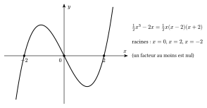

Une expression comme $2+3\cdot 4^2$ doit avoir une seule valeur. On convient donc d'un ordre pour effectuer les opérations.

::: {.encadre #alge-priorites nature="Propriété" titre="priorité des opérations"}
On effectue dans l'ordre :

1. les calculs entre parenthèses (en commençant par les plus intérieures) ;
2. les puissances et les racines ;
3. les multiplications et les divisions, de gauche à droite ;
4. les additions et les soustractions, de gauche à droite.

Une barre de fraction joue le rôle de parenthèses autour du numérateur et autour du dénominateur.
:::

::: {.encadre nature="Exemple"}
$2+3\cdot 4^2=2+3\cdot 16=50$ ; $(2+3)\cdot 4^2=80$ ; $12:4\cdot 3=3\cdot 3=9$ (et non $12:12=1$) ; $\dfrac{6+4}{2}=5$ (et non $6+2=8$).
:::

::: {.encadre nature="Remarque" titre="le signe moins devant une parenthèse"}
$-(a-b+c)=-a+b-c$ : le signe moins change le signe de **chaque** terme de la parenthèse. De même, $5-2(x-3)=5-2x+6=11-2x$.
:::

Les expressions comme $3x^2-x+5$ sont des polynômes. Leur degré est la plus grande puissance de $x$ qui apparaît vraiment.

::: {.encadre #alge-poly nature="Définition" titre="polynôme et degré"}
Un **polynôme** en $x$ est une expression de la forme $a_nx^n+a_{n-1}x^{n-1}+\cdots+a_1x+a_0$, où $n$ est un naturel et les **coefficients** $a_0,\dots,a_n$ sont des réels.

Si $a_n\neq 0$, le polynôme est de **degré** $n$ et $a_n$ est son coefficient dominant. Un polynôme du premier degré s'écrit $ax+b$ ($a\neq 0$), un polynôme du second degré $ax^2+bx+c$ ($a\neq 0$).
:::

Pour additionner deux polynômes, on additionne les coefficients des termes de même degré. Pour les multiplier, on distribue chaque terme du premier sur chaque terme du second, puis on regroupe. Le terme de plus haut degré du produit vient du produit des termes dominants : $a_nx^n\cdot b_mx^m=a_nb_m\,x^{n+m}$.

::: {.encadre #alge-poly-op nature="Propriété" titre="somme et produit de polynômes"}
Si $P$ est de degré $n$ et $Q$ de degré $m$ :

- le degré de $P+Q$ est au plus le plus grand des deux nombres $n$ et $m$ (il peut être plus petit si les termes dominants s'annulent) ;
- le degré de $P\cdot Q$ est exactement $n+m$.
:::

::: {.encadre nature="Exemple"}
Avec $P(x)=2x^2-x+1$ et $Q(x)=-2x^2+3x$ : $P(x)+Q(x)=2x+1$ est de degré $1$ seulement. Et
$$(x+2)(x^2-3x+1)=x^3-3x^2+x+2x^2-6x+2=x^3-x^2-5x+2,$$
de degré $1+2=3$.
:::

Factoriser, c'est écrire une somme sous forme de produit. C'est l'opération inverse du développement. Une forme factorisée permet de trouver les valeurs qui annulent l'expression ou d'étudier son signe, car un produit est nul si et seulement si un de ses facteurs est nul.

::: {.encadre #alge-fact nature="Propriété" titre="méthodes de factorisation"}
Pour factoriser une expression, on essaie dans l'ordre :

1. la **mise en évidence** d'un facteur commun : $ab+ac=a(b+c)$ ;
2. les **produits remarquables** lus de droite à gauche : $a^2-b^2=(a-b)(a+b)$, $a^2\pm2ab+b^2=(a\pm b)^2$ ;
3. pour un trinôme $ax^2+bx+c$, ses **racines** : $ax^2+bx+c=a(x-x_1)(x-x_2)$ ;
4. le **groupement** de termes, qui fait apparaître un facteur commun.
:::

::: {.encadre nature="Exemple"}
- $6x^3-9x^2=3x^2(2x-3)$.
- $x^3-4x=x(x^2-4)=x(x-2)(x+2)$.
- $x^3+2x^2-x-2=x^2(x+2)-(x+2)=(x+2)(x^2-1)=(x+2)(x-1)(x+1)$.
:::

::: {.encadre #alge-prod-nul nature="Propriété" titre="produit nul"}
Un produit de facteurs est nul si et seulement si au moins un des facteurs est nul : $ab=0\iff a=0$ ou $b=0$.
:::

Graphiquement, les solutions de $P(x)=0$ sont les abscisses des points où le graphique coupe l'axe des abscisses : la forme factorisée les donne directement.

{.th}

::: {.encadre nature="Remarque" titre="ne pas diviser par l'inconnue"}
Pour résoudre $x^2=3x$, diviser par $x$ fait perdre la solution $x=0$. On écrit plutôt $x^2-3x=x(x-3)=0$, d'où $x=0$ ou $x=3$.
:::
