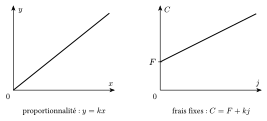

Un pourcentage décrit toujours une fraction **d'une grandeur de référence**. Augmenter un prix de $20\,\%$, c'est lui ajouter $\frac{20}{100}$ de lui-même. Plutôt que de calculer l'augmentation puis de l'ajouter, on multiplie directement par un seul nombre, le **coefficient multiplicateur**.

::: {.encadre #alge-pct nature="Propriété" titre="augmentation et diminution en pourcentage"}
Augmenter une grandeur de $p\,\%$ revient à la multiplier par $1+\dfrac{p}{100}$.

Diminuer une grandeur de $p\,\%$ revient à la multiplier par $1-\dfrac{p}{100}$.
:::

En effet, si la grandeur vaut $x$, l'augmenter de $p\,\%$ donne $x+\dfrac{p}{100}\,x=\left(1+\dfrac{p}{100}\right)x$.

::: {.encadre nature="Exemple"}
Un article coûte $80$ €. Après une réduction de $25\,\%$, il coûte $80\cdot 0{,}75=60$ €. La réduction vaut $80\cdot 0{,}25=20$ €.
:::

::: {.encadre nature="Remarque" titre="retrouver la valeur de départ"}
Pour retrouver le prix avant réduction, on **divise** par le coefficient multiplicateur. Le prix soldé $60$ € correspond à un prix de départ de $\dfrac{60}{0{,}75}=80$ €.

Augmenter $60$ € de $25\,\%$ donne $75$ €, et non $80$ € : les $25\,\%$ ne portent plus sur la même grandeur de référence.
:::

Lorsque plusieurs variations se suivent, chacune porte sur le résultat de la précédente. Il suffit donc d'enchaîner les multiplications.

::: {.encadre #alge-pct-succ nature="Propriété" titre="variations successives"}
Des variations successives en pourcentage reviennent à multiplier la grandeur par le **produit** des coefficients multiplicateurs.
:::

::: {.encadre nature="Exemple"}
Une hausse de $10\,\%$ suivie d'une baisse de $10\,\%$ revient à multiplier par $1{,}1\cdot 0{,}9=0{,}99$. Le prix final a donc **diminué** de $1\,\%$ par rapport au prix initial : les deux variations ne se compensent pas.
:::

::: {.encadre #alge-pct-diff nature="Propriété" titre="variation d'une différence"}
Si deux grandeurs $a$ et $b$ sont multipliées par un même coefficient $c$, leur différence est elle aussi multipliée par $c$ :
$$ca-cb=c\,(a-b).$$
:::

::: {.encadre nature="Exemple"}
Un commerçant achète un article $40$ € et le revend $50$ € : sa marge est de $10$ €. Si le prix d'achat et le prix de vente augmentent tous deux de $5\,\%$, la marge devient $1{,}05\cdot 50-1{,}05\cdot 40=1{,}05\cdot 10=10{,}50$ € : elle augmente aussi de $5\,\%$.
:::

Beaucoup de problèmes concrets reposent sur une relation de proportionnalité entre grandeurs. Il faut savoir la traduire par une formule.

::: {.encadre #alge-prop nature="Définition" titre="proportionnalité directe"}
Une grandeur $y$ est **directement proportionnelle** à une grandeur $x$ s'il existe une constante $k$ telle que $y=kx$.

Une grandeur $y$ est directement proportionnelle **à la fois** à $x$ et à $z$ s'il existe une constante $k$ telle que $y=kxz$.
:::

{.th}

::: {.encadre nature="Exemple"}
- Si $y$ est proportionnelle à $x$ et à $z$, et si l'on double $x$ et triple $z$, alors $y$ est multipliée par $2\cdot 3=6$.
- Le coût d'une location composé de frais fixes $F$ et d'un montant proportionnel au nombre $j$ de jours s'écrit $C=F+kj$. Ce coût n'est **pas** proportionnel à $j$ : louer deux fois plus longtemps ne coûte pas deux fois plus cher.
:::

La proportionnalité directe justifie la **règle de trois** : puisque $y=kx$, le rapport $\dfrac{y}{x}$ est le même pour tous les couples de valeurs.

::: {.encadre #alge-regle-trois nature="Propriété" titre="règle de trois"}
Si $y$ est directement proportionnelle à $x$ et si la valeur $x_1$ correspond à $y_1$ (avec $x_1\neq 0$), alors la valeur $x_2$ correspond à
$$y_2=\frac{y_1}{x_1}\cdot x_2.$$
On passe par l'unité : on divise par $x_1$, puis on multiplie par $x_2$.
:::

::: {.encadre nature="Exemple"}
Une perfusion apporte $150\,\mathrm{mg}$ de médicament en $40$ minutes, à débit constant. En une minute, elle apporte $\dfrac{150}{40}\,\mathrm{mg}$ ; en $60$ minutes, $\dfrac{150}{40}\cdot 60=225\,\mathrm{mg}$.
:::

::: {.encadre nature="Remarque" titre="vérifier la proportionnalité"}
La règle de trois ne s'applique que si les grandeurs sont proportionnelles. Si $3$ ouvriers construisent un mur en $6$ jours, $6$ ouvriers ne mettent pas $12$ jours : la durée est inversement proportionnelle au nombre d'ouvriers (voir ci-dessous), et ils mettent $3$ jours.
:::

::: {.encadre nature="Remarque" titre="proportionnalité inverse"}
On dit que $y$ est **inversement proportionnelle** à $x$ s'il existe une constante $k$ telle que $y=\dfrac{k}{x}$. Doubler $x$ divise alors $y$ par deux.
:::
