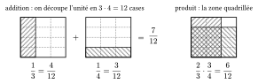
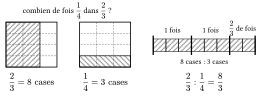
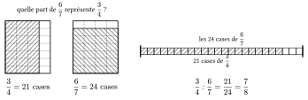

Pour additionner deux fractions, il faut d'abord les écrire avec un même dénominateur. En prenant le produit des dénominateurs, on obtient la formule générale ci-dessous. Diviser par une fraction revient à multiplier par son inverse.

Pour additionner $\frac13$ et $\frac14$, on découpe l'unité en $3\cdot4=12$ cases : chaque fraction s'écrit alors en douzièmes. Le produit $\frac23\cdot\frac34$ est la partie hachurée dans les deux sens : $2\cdot3$ cases sur $3\cdot4$.

{.th}

Diviser $\frac23$ par $\frac14$, c'est chercher combien de fois $\frac14$ est contenu dans $\frac23$. Sur la même grille, $\frac23$ occupe $2\cdot4=8$ cases et $\frac14$ en occupe $1\cdot3=3$ : le quotient vaut $\frac83$. En général, $\frac ab$ occupe $ad$ cases et $\frac cd$ en occupe $bc$, d'où $\frac{a/b}{c/d}=\frac{ad}{bc}$.

{.th}

Le comptage fonctionne aussi quand le diviseur est le plus grand : $\frac34$ occupe $3\cdot7=21$ cases d'une grille de $4\cdot7$, et $\frac67$ en occupe $6\cdot4=24$. $\frac34$ ne contient pas une fois $\frac67$, mais $21$ cases sur $24$ : $\frac34:\frac67=\frac{21}{24}=\frac78$.

{.th}

::: {.encadre #alge-frac-op nature="Propriété" titre="opérations sur les fractions"}
Pour des réels $a$, $c$ et des réels non nuls $b$, $d$ :
$$\frac{a}{b}+\frac{c}{d}=\frac{ad+bc}{bd}\qquad\text{et}\qquad \frac{a}{b}\cdot\frac{c}{d}=\frac{ac}{bd}.$$
Si de plus $c\neq 0$ :
$$\frac{a/b}{c/d}=\frac{a}{b}\cdot\frac{d}{c}=\frac{ad}{bc}.$$
:::

::: {.encadre nature="Exemple"}
$\dfrac{1}{3}+\dfrac{7}{4}=\dfrac{4+21}{12}=\dfrac{25}{12}$ et $\dfrac{1/3}{7/4}=\dfrac{1}{3}\cdot\dfrac{4}{7}=\dfrac{4}{21}$.
:::

Une fraction étagée contient des fractions à son numérateur ou à son dénominateur. On la simplifie en partant de l'étage le plus bas, en appliquant chaque fois la règle de la division.

::: {.encadre #alge-frac-etagee nature="Propriété" titre="fraction étagée"}
Pour $a$ réel et $b$, $c$ réels non nuls :
$$\frac{a}{b/c}=\frac{ac}{b}.$$
:::

::: {.encadre nature="Exemple"}
Pour $x\notin\{-1;0\}$ :
$$\frac{1}{1+\frac{1}{x}}=\frac{1}{\frac{x+1}{x}}=\frac{x}{x+1}.$$
:::

::: {.encadre nature="Remarque" titre="on ne simplifie que des facteurs"}
Dans $\dfrac{x+2}{x+5}$, on ne peut rien simplifier : $x$ n'est pas un facteur commun au numérateur et au dénominateur, c'est un terme. Par contre, $\dfrac{x(x+2)}{x(x+5)}=\dfrac{x+2}{x+5}$ pour $x\neq 0$.
:::
