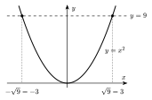
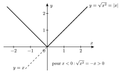

Le nombre $9$ est le carré de $3$, mais aussi le carré de $-3$. Pour que $\sqrt{9}$ désigne un seul nombre, on convient de choisir le nombre **positif**.

::: {.encadre #alge-rac-def nature="Définition" titre="racine carrée et racine n-ième"}
Pour $a\ge 0$, la **racine carrée** $\sqrt{a}$ est le réel positif dont le carré vaut $a$.

Pour $n$ pair et $a\ge 0$, $\sqrt[n]{a}$ est le réel positif dont la puissance $n$-ième vaut $a$. Pour $n$ impair et $a$ réel quelconque, $\sqrt[n]{a}$ est l'unique réel dont la puissance $n$-ième vaut $a$.
:::

::: {.encadre nature="Exemple"}
$\sqrt{9}=3$ et non $\pm 3$ ; $\sqrt[3]{-8}=-2$ car $(-2)^3=-8$ ; $\sqrt[4]{-16}$ n'existe pas dans $\mathbb{R}$.
:::

::: {.encadre nature="Remarque" titre="équation et racine carrée"}
L'équation $x^2=9$ a **deux** solutions : $\sqrt{9}=3$ et $-\sqrt{9}=-3$. Le symbole $\sqrt{9}$, lui, ne désigne qu'un seul nombre.
:::

Graphiquement, la droite $y=9$ coupe la parabole $y=x^2$ en deux points, d'abscisses $-\sqrt9$ et $\sqrt9$.

{.th}

Que vaut $\sqrt{a^2}$ ? C'est le nombre positif dont le carré vaut $a^2$. Si $a\ge 0$, c'est $a$ ; si $a<0$, c'est $-a$. On reconnaît la valeur absolue de $a$.

::: {.encadre #alge-rac-abs nature="Propriété" titre="racine d'un carré"}
Pour tout réel $a$ : $\sqrt{a^2}=|a|$.

Pour tout réel $a\ge 0$ : $\left(\sqrt{a}\right)^2=a$.
:::

{.th}

::: {.encadre nature="Exemple"}
$\sqrt{(-5)^2}=\sqrt{25}=5=|-5|$. Pour tout réel $x$ : $\sqrt{x^2+2x+1}=\sqrt{(x+1)^2}=|x+1|$, qui ne vaut $x+1$ que si $x\ge -1$.
:::

Une racine peut s'écrire comme une puissance. Si l'on veut que la règle $(a^m)^n=a^{mn}$ reste vraie, le nombre $a^{1/n}$ doit vérifier $\left(a^{1/n}\right)^n=a^1=a$ : c'est donc $\sqrt[n]{a}$.

::: {.encadre #alge-rac-puiss nature="Propriété" titre="racine et exposant rationnel"}
Pour $a>0$, $m$ entier et $n$ naturel supérieur ou égal à $2$ :
$$\sqrt[n]{a^m}=a^{m/n}.$$
:::

::: {.encadre nature="Exemple"}
$27^{2/3}=\left(\sqrt[3]{27}\right)^2=3^2=9$ ; pour $x>0$, $\sqrt{x^3}=x^{3/2}=x\sqrt{x}$.
:::

Comme pour les puissances, la racine se comporte bien avec les produits et les quotients, mais pas avec les sommes.

::: {.encadre #alge-rac-prod nature="Propriété" titre="racine d'un produit, d'un quotient"}
Pour $a\ge 0$ et $b\ge 0$ : $\sqrt{ab}=\sqrt{a}\,\sqrt{b}$.

Pour $a\ge 0$ et $b>0$ : $\sqrt{\dfrac{a}{b}}=\dfrac{\sqrt{a}}{\sqrt{b}}$.

En général, $\sqrt{a+b}\neq\sqrt{a}+\sqrt{b}$.
:::

::: {.encadre nature="Exemple"}
- $\sqrt{12}=\sqrt{4}\,\sqrt{3}=2\sqrt{3}$.
- $\sqrt{9+16}=\sqrt{25}=5$ alors que $\sqrt{9}+\sqrt{16}=3+4=7$.
- Pour supprimer une racine au dénominateur, on multiplie par le **binôme conjugué** : $\dfrac{1}{\sqrt{3}-1}=\dfrac{\sqrt{3}+1}{(\sqrt{3}-1)(\sqrt{3}+1)}=\dfrac{\sqrt{3}+1}{3-1}=\dfrac{\sqrt{3}+1}{2}$.
:::
