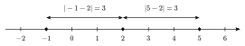
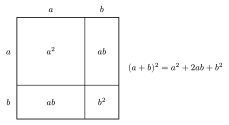
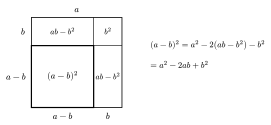
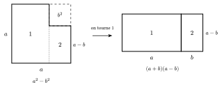

La valeur absolue d'un nombre est sa distance à $0$ sur la droite des réels. Elle ne garde que la « taille » du nombre et oublie son signe.

::: {.encadre #alge-abs nature="Définition" titre="valeur absolue"}
Pour tout réel $a$ : $|a|=a$ si $a\ge 0$ et $|a|=-a$ si $a<0$.

Pour tous réels $a$ et $b$ : $|ab|=|a|\,|b|$ et $|a+b|\le |a|+|b|$, avec égalité si et seulement si $a$ et $b$ ont le même signe ($ab\ge 0$).
:::

{.th}

::: {.encadre nature="Exemple"}
$|-3|=3$ ; $|2+(-5)|=3$ alors que $|2|+|-5|=7$ ; $|x-2|$ est la distance entre $x$ et $2$.
:::

::: {.encadre nature="Remarque" titre="« −a » peut être positif"}
Si $a<0$, alors $-a>0$ : écrire $|a|=-a$ n'est pas une erreur de signe. Par exemple, $|-7|=-(-7)=7$.
:::

Les produits remarquables s'obtiennent en distribuant. Par exemple, $(a+b)^2=(a+b)(a+b)=a^2+ab+ba+b^2=a^2+2ab+b^2$. Ils servent dans les deux sens : pour développer, mais aussi pour reconnaître un carré ou une différence de carrés et factoriser.

::: {.encadre #alge-prod-rem nature="Propriété" titre="produits remarquables"}
Pour tous réels $a$ et $b$ :
$$(a+b)^2=a^2+2ab+b^2\qquad (a-b)^2=a^2-2ab+b^2\qquad (a+b)(a-b)=a^2-b^2.$$
:::

{.th}

Les deux autres produits remarquables se voient aussi avec des aires. Pour $(a-b)^2$, on retire du carré de côté $a$ deux bandes de largeur $b$ ; comme les deux bandes se recouvrent sur le petit carré $b^2$, chacune vaut $ab-b^2$. Pour $a^2-b^2$, on découpe la figure restante en deux rectangles et on les met bout à bout.

{.th}

{.th}

::: {.encadre nature="Exemple"}
$(x-3)^2=x^2-6x+9$ ; $x^2-4x+4=(x-2)^2$ ; $51\cdot 49=(50+1)(50-1)=50^2-1^2=2\,499$.
:::

::: {.encadre nature="Remarque" titre="le double produit"}
L'erreur la plus fréquente est d'oublier le double produit : $(1+1)^2=4$ alors que $1^2+1^2=2$.
:::
