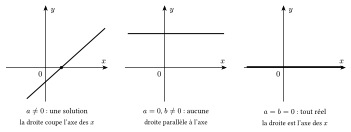
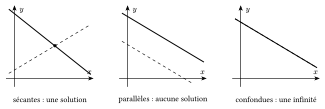

Pour résoudre une équation, on la transforme en équations équivalentes (qui ont les mêmes solutions) jusqu'à isoler l'inconnue. On peut ajouter un même nombre aux deux membres, ou les multiplier par un même nombre **non nul**.

::: {.encadre #alge-1deg nature="Propriété" titre="équation du premier degré"}
L'équation $ax+b=0$ :

- a une seule solution, $x=-\dfrac{b}{a}$, si $a\neq 0$ ;
- n'a aucune solution si $a=0$ et $b\neq 0$ ;
- est vérifiée par tout réel si $a=0$ et $b=0$.
:::

Graphiquement, $ax+b$ est représenté par une droite : résoudre $ax+b=0$, c'est chercher où elle coupe l'axe des abscisses.

{.th}

::: {.encadre nature="Exemple"}
$3(x-2)=x+4\iff 3x-6=x+4\iff 2x=10\iff x=5$. L'équation $2(x+1)=2x+3$ se ramène à $0x=1$ : elle n'a pas de solution.
:::

::: {.encadre nature="Remarque" titre="équation à paramètre"}
Dans $(m-2)x=m+1$, on ne peut diviser par $m-2$ que si $m\neq 2$ ; on obtient alors $x=\dfrac{m+1}{m-2}$. Pour $m=2$, l'équation devient $0x=3$ et n'a pas de solution.
:::

## Systèmes de deux équations à deux inconnues

Chaque équation $ax+by=c$ (avec $a$ et $b$ non tous deux nuls) a pour graphique une droite. Résoudre le système, c'est chercher les points communs aux deux droites. Deux droites peuvent se couper en un point, être parallèles et distinctes, ou être confondues : il y a donc trois cas possibles.

::: {.encadre #alge-sys-vocab nature="Définition" titre="système déterminé, impossible, indéterminé"}
Un système est **déterminé** s'il admet une unique solution, **impossible** s'il n'admet aucune solution, **indéterminé** s'il admet une infinité de solutions.

Pour deux équations à deux inconnues, ces trois cas correspondent à deux droites sécantes, parallèles distinctes ou confondues.
:::

{.th}

::: {.encadre nature="Exemple"}
$\begin{cases}x+y=2\\x-y=0\end{cases}$ est déterminé (solution $(1;1)$) ; $\begin{cases}x+y=2\\x+y=3\end{cases}$ est impossible ; $\begin{cases}x+y=2\\2x+2y=4\end{cases}$ est indéterminé.
:::

Pour résoudre, on combine les équations de façon à faire disparaître une inconnue. Cette méthode est justifiée par la propriété suivante.

::: {.encadre #alge-sys-comb nature="Propriété" titre="combinaison d'équations"}
Tout couple $(x;y)$ solution des équations $(E_1)$ et $(E_2)$ est aussi solution de toute combinaison $\lambda(E_1)+\mu(E_2)$, où $\lambda$ et $\mu$ sont des réels.
:::

En effet, si les deux égalités sont vraies, on obtient encore une égalité vraie en les multipliant par des nombres puis en les additionnant membre à membre.

::: {.encadre nature="Exemple"}
$\begin{cases}x+3y=7&(E_1)\\3x+y=5&(E_2)\end{cases}$

$(E_1)+(E_2)$ donne $4x+4y=12$, donc $x+y=3$. $(E_1)-(E_2)$ donne $-2x+2y=2$, donc $y-x=1$. On en déduit $x=1$ et $y=2$.

Si la question ne demande que $x+y$, la première combinaison suffit : il est inutile de résoudre complètement le système.
:::

Les deux droites sont parallèles (ou confondues) lorsque les coefficients de $x$ et de $y$ sont proportionnels, c'est-à-dire lorsque $\dfrac{a_1}{a_2}=\dfrac{b_1}{b_2}$, ou encore $a_1b_2-a_2b_1=0$. Ce nombre suffit donc à reconnaître le cas déterminé.

::: {.encadre #alge-sys-det nature="Propriété" titre="discussion d'un système"}
On considère le système $\begin{cases}a_1x+b_1y=c_1\\a_2x+b_2y=c_2\end{cases}$ et on pose $D=a_1b_2-a_2b_1$.

- Si $D\neq 0$, le système est déterminé.
- Si $D=0$, le système est impossible ou indéterminé. Il est indéterminé si et seulement si une des équations est un multiple de l'autre, termes indépendants compris.
:::

::: {.encadre nature="Exemple"}
$\begin{cases}x+2y=3\\2x+4y=5\end{cases}$ : $D=1\cdot 4-2\cdot 2=0$. La seconde équation n'est pas le double de la première, car $2\cdot 3\neq 5$ : le système est impossible. Avec $2x+4y=6$ comme seconde équation, il serait indéterminé.
:::

::: {.encadre nature="Remarque" titre="système à paramètre"}
Lorsque les coefficients dépendent d'un paramètre $m$, on calcule $D$ en fonction de $m$. Pour les valeurs de $m$ qui annulent $D$, on remplace $m$ par sa valeur dans le système et on regarde s'il est impossible ou indéterminé.
:::

## Systèmes de trois équations à trois inconnues

La même méthode s'applique avec trois inconnues : on combine les équations deux à deux pour éliminer une inconnue, ce qui ramène à un système de deux équations à deux inconnues.

::: {.encadre #alge-sys3 nature="Propriété" titre="résolution par élimination"}
Pour résoudre un système de trois équations à trois inconnues $x$, $y$, $z$ :

1. on choisit une inconnue, par exemple $z$, et on l'élimine dans deux combinaisons différentes des équations ;
2. on résout le système de deux équations en $x$ et $y$ obtenu ;
3. on remplace $x$ et $y$ dans une équation de départ pour trouver $z$.

Comme pour deux inconnues, le système peut être déterminé, impossible ou indéterminé.
:::

::: {.encadre nature="Exemple"}
$\begin{cases}x+y+z=6&(E_1)\\2x-y+z=3&(E_2)\\x+2y-z=2&(E_3)\end{cases}$

$(E_1)+(E_3)$ : $2x+3y=8$. $(E_2)+(E_3)$ : $3x+y=5$. De la seconde, $y=5-3x$ ; dans la première, $2x+15-9x=8$, donc $x=1$ et $y=2$. Enfin $(E_1)$ donne $z=6-1-2=3$.

Vérification dans $(E_2)$ : $2-2+3=3$.
:::

::: {.encadre nature="Remarque" titre="ne pas tout résoudre"}
Si la question porte seulement sur $x+y+z$, il suffit parfois d'additionner les trois équations. Par exemple, avec $x+y=5$, $y+z=7$ et $x+z=6$, la somme donne $2(x+y+z)=18$, donc $x+y+z=9$.
:::
