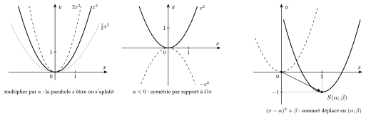
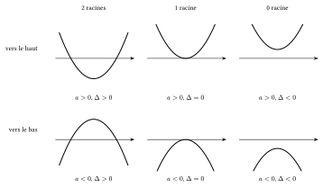
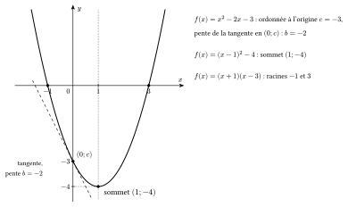
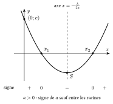
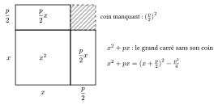

Toutes les fonctions du second degré se déduisent de la fonction carré $x\mapsto x^2$, dont le graphique est la parabole de sommet $(0;0)$, symétrique par rapport à l'axe des ordonnées. On transforme ce graphique en trois étapes.

- Multiplier par $a$ : le graphique de $a\,x^2$ s'obtient en multipliant toutes les ordonnées par $a$. Si $|a|>1$, la parabole se resserre ; si $|a|<1$, elle s'élargit ; si $a<0$, elle est en plus retournée (symétrie par rapport à l'axe des abscisses).
- Remplacer $x$ par $x-\alpha$ : le graphique de $a\,(x-\alpha)^2$ est le précédent déplacé horizontalement de $\alpha$. En effet, la valeur que $a\,x^2$ prenait en $0$, $a\,(x-\alpha)^2$ la prend en $x=\alpha$.
- Ajouter $\beta$ : le graphique de $a\,(x-\alpha)^2+\beta$ est déplacé verticalement de $\beta$.

{.th}

::: {.encadre #alge-2deg-canon nature="Définition" titre="forme canonique"}
Une fonction du second degré est écrite sous **forme canonique** lorsqu'elle s'écrit
$$f(x)=a\,(x-\alpha)^2+\beta\qquad(a\neq 0).$$
Son graphique est la parabole de la fonction carré, multipliée par $a$ puis déplacée de façon que son sommet soit le point $S(\alpha;\beta)$.
:::

::: {.encadre #alge-2deg-parab nature="Propriété" titre="parabole"}
Le graphique de $f(x)=a\,(x-\alpha)^2+\beta$ est une parabole :

- tournée vers le haut si $a>0$ (le sommet est un minimum) et vers le bas si $a<0$ (le sommet est un maximum) ;
- de sommet $S(\alpha;\beta)$ ;
- d'axe de symétrie la droite d'équation $x=\alpha$.
:::

::: {.encadre nature="Exemple"}
$f(x)=2(x-1)^2-3$ : la parabole de $x^2$ est resserrée ($a=2$), puis déplacée de $1$ vers la droite et de $3$ vers le bas. Son sommet est $(1;-3)$, c'est un minimum, et son axe de symétrie est la droite $x=1$.
:::

Une fonction du second degré est souvent donnée sous forme développée $ax^2+bx+c$. Pour faire le lien avec la forme canonique, on développe celle-ci :
$$a\,(x-\alpha)^2+\beta=ax^2-2a\alpha\,x+a\alpha^2+\beta.$$
Deux polynômes sont égaux pour tout $x$ lorsqu'ils ont les mêmes coefficients. En identifiant avec $ax^2+bx+c$, on obtient $b=-2a\alpha$ et $c=a\alpha^2+\beta$.

::: {.encadre #alge-2deg-alpha nature="Propriété" titre="lien entre forme développée et forme canonique"}
Si $ax^2+bx+c=a\,(x-\alpha)^2+\beta$ pour tout $x$ (avec $a\neq0$), alors
$$\alpha=-\frac{b}{2a}\qquad\text{et}\qquad\beta=f(\alpha)=c-a\alpha^2=-\frac{\Delta}{4a},\quad\text{où }\Delta=b^2-4ac.$$
Le coefficient $a$ est le même dans les deux écritures.
:::

::: {.encadre nature="Exemple"}
$f(x)=x^2-2x-3$ : $a=1$, donc $\alpha=-\frac{-2}{2}=1$ et $\beta=f(1)=1-2-3=-4$. Ainsi $x^2-2x-3=(x-1)^2-4$.

Vérification : $(x-1)^2-4=x^2-2x+1-4=x^2-2x-3$.
:::

La forme canonique permet de résoudre l'équation $f(x)=0$ en isolant le carré :
$$a\,(x-\alpha)^2+\beta=0\iff (x-\alpha)^2=-\frac{\beta}{a}=\frac{\Delta}{4a^2}.$$
Un carré n'est jamais négatif. Il y a donc deux solutions si $\Delta>0$ (alors $x-\alpha=\pm\frac{\sqrt\Delta}{2|a|}$), une seule si $\Delta=0$ et aucune si $\Delta<0$. Graphiquement, les solutions sont les abscisses des points où la parabole coupe l'axe des abscisses : tout dépend de l'orientation de la parabole et de la position du sommet par rapport à cet axe.

::: {.encadre #alge-2deg-delta nature="Propriété" titre="résolution d'une équation du second degré"}
On considère l'équation $ax^2+bx+c=0$ avec $a\neq 0$ et on pose $\Delta=b^2-4ac$.

- Si $\Delta<0$, l'équation n'a pas de solution réelle.
- Si $\Delta=0$, elle a une seule solution : $x=-\dfrac{b}{2a}$.
- Si $\Delta>0$, elle a deux solutions distinctes : $x=\dfrac{-b-\sqrt{\Delta}}{2a}$ et $x=\dfrac{-b+\sqrt{\Delta}}{2a}$.
:::

{.th}

::: {.encadre nature="Exemple"}
$x^2-5x+6=0$ : $\Delta=25-24=1$, d'où $x=\dfrac{5-1}{2}=2$ ou $x=\dfrac{5+1}{2}=3$. Le sommet est sous l'axe des abscisses ($\beta=-\frac14$) et la parabole est tournée vers le haut : elle coupe l'axe en deux points.
:::

La formule ne s'applique que si $a\neq 0$. Quand le coefficient de $x^2$ dépend d'un paramètre, il faut donc traiter à part les valeurs qui l'annulent : c'est un cas souvent oublié.

::: {.encadre #alge-2deg-param nature="Propriété" titre="coefficient de x² dépendant d'un paramètre"}
Une équation $a(m)\,x^2+bx+c=0$ n'est du second degré que pour les valeurs du paramètre $m$ telles que $a(m)\neq 0$. Pour les valeurs qui annulent $a(m)$, l'équation est du premier degré (ou ne contient plus l'inconnue) et s'étudie séparément.
:::

::: {.encadre nature="Exemple"}
$(m-1)x^2+2x+1=0$. Pour $m=1$, l'équation devient $2x+1=0$ et a une seule solution, $x=-\dfrac{1}{2}$, alors que le calcul de $\Delta=4-4(m-1)=8-4m$ donnerait $\Delta=4>0$, donc « deux solutions ».
:::

Le signe de $\Delta$ se lit parfois sans calcul : si $a$ et $c$ sont de signes contraires, $-4ac$ est positif, et $\Delta=b^2-4ac$ est une somme d'un carré et d'un nombre strictement positif.

::: {.encadre #alge-2deg-ac nature="Propriété" titre="coefficients a et c de signes contraires"}
Si $ac<0$, alors $\Delta>0$ : l'équation $ax^2+bx+c=0$ a deux solutions réelles distinctes.
:::

::: {.encadre nature="Exemple"}
$3x^2+7x-2=0$ : $a=3$ et $c=-2$ sont de signes contraires, l'équation a deux solutions distinctes. On le sait sans calculer $\Delta$.
:::

En additionnant les deux solutions de la formule, les racines carrées s'éliminent : $\dfrac{-b-\sqrt{\Delta}}{2a}+\dfrac{-b+\sqrt{\Delta}}{2a}=-\dfrac{b}{a}$. En les multipliant, on reconnaît une différence de carrés : $\dfrac{b^2-\Delta}{4a^2}=\dfrac{4ac}{4a^2}=\dfrac{c}{a}$.

::: {.encadre #alge-2deg-sp nature="Propriété" titre="somme et produit des solutions"}
Si $\Delta\ge 0$ et si $x_1$, $x_2$ sont les solutions de $ax^2+bx+c=0$ (avec $x_1=x_2$ si $\Delta=0$) :
$$x_1+x_2=-\frac{b}{a}\qquad\text{et}\qquad x_1\,x_2=\frac{c}{a}.$$
:::

::: {.encadre nature="Exemple"}
Les solutions de $x^2-5x+6=0$ ont pour somme $5$ et pour produit $6$ : ce sont $2$ et $3$. Si $x_1x_2<0$, les deux solutions sont de signes contraires.
:::

::: {.encadre #alge-2deg-fact nature="Propriété" titre="factorisation"}
Si $\Delta\ge 0$ et si $x_1$, $x_2$ sont les racines de $ax^2+bx+c$, alors
$$ax^2+bx+c=a\,(x-x_1)(x-x_2).$$
Un polynôme du second degré dont on connaît les racines $x_1$ et $x_2$ s'écrit donc $a\,(x-x_1)(x-x_2)$ ; il reste à déterminer $a\neq 0$, par exemple à l'aide d'un point du graphique.
:::

::: {.encadre nature="Exemple"}
$2x^2-2x-4$ a pour racines $-1$ et $2$, donc $2x^2-2x-4=2\,(x+1)(x-2)$.
:::

Une même fonction du second degré peut donc s'écrire de trois façons. Chacune se lit directement sur le graphique.

::: {.encadre #alge-2deg-ecritures nature="Propriété" titre="trois écritures et leur lecture graphique"}
- **Forme développée** $f(x)=ax^2+bx+c$ : $c=f(0)$ est l'**ordonnée à l'origine** ; $b$ est la **pente de la tangente** à la parabole au point $(0;c)$ ; le signe de $a$ donne l'orientation.
- **Forme canonique** $f(x)=a\,(x-\alpha)^2+\beta$ : le **sommet** est $(\alpha;\beta)$ et l'axe de symétrie est $x=\alpha$.
- **Forme factorisée** $f(x)=a\,(x-x_1)(x-x_2)$, qui n'existe que si $\Delta\ge0$ : $x_1$ et $x_2$ sont les **racines**, abscisses des points d'intersection avec l'axe des abscisses. L'axe de symétrie passe au milieu : $\alpha=\frac{x_1+x_2}{2}$.
:::

Pourquoi $b$ est-il la pente de la tangente en $(0;c)$ ? Près de $x=0$, le terme $ax^2$ est beaucoup plus petit que $bx$ (pour $x=0{,}01$, $x^2=0{,}0001$) : la parabole se confond avec la droite $y=bx+c$, qui est sa tangente.

{.th}

::: {.encadre nature="Exemple"}
$f(x)=x^2-2x-3=(x-1)^2-4=(x+1)(x-3)$. Sur le graphique, on lit l'ordonnée à l'origine $-3$ et une tangente de pente $-2$ en $(0;-3)$ (forme développée), le sommet $(1;-4)$ (forme canonique) et les racines $-1$ et $3$ (forme factorisée).
:::

::: {.encadre #alge-2deg-signe nature="Propriété" titre="signe d'un trinôme"}
Le trinôme $ax^2+bx+c$ a le signe de $a$, sauf entre ses racines (lorsque $\Delta>0$), où il a le signe contraire de $a$. Il s'annule en ses racines.
:::

{.th}

C'est ce qu'on voit sur la parabole : si $a>0$, elle est tournée vers le haut et ne passe sous l'axe des abscisses qu'entre ses racines.

::: {.encadre nature="Exemple"}
$x^2-5x+6=(x-2)(x-3)$ et $a=1>0$, donc $x^2-5x+6<0 \iff x\in\,]2;3[$.
:::

## Technique : compléter le carré {#alge-s-completer}

Pour faire apparaître un carré dans une expression $x^2+px$, on part du produit remarquable $(x+k)^2=x^2+2kx+k^2$ : le terme $2kx$ doit être $px$, donc $k=\frac p2$. Il reste à retirer le terme $k^2$ ajouté.

{.th}

::: {.encadre #alge-completer nature="Méthode" titre="compléter le carré"}
$$x^2+px=\left(x+\frac p2\right)^2-\frac{p^2}{4}.$$
Pour $ax^2+bx+c$ avec $a\neq0$, on met d'abord $a$ en évidence dans les termes en $x$ : $ax^2+bx+c=a\left(x^2+\frac bax\right)+c$, puis on complète le carré dans la parenthèse.
:::

::: {.encadre nature="Exemple"}
$x^2+6x+5$ : $x^2+6x=(x+3)^2-9$, donc $x^2+6x+5=(x+3)^2-4$.

$2x^2-8x+3=2\left(x^2-4x\right)+3=2\left[(x-2)^2-4\right]+3=2(x-2)^2-5$.
:::

::: {.encadre nature="Remarque" titre="à quoi sert la technique"}
Compléter le carré donne la forme canonique sans retenir de formule, et permet de résoudre une équation du second degré en isolant le carré : $x^2+6x+5=0\iff(x+3)^2=4\iff x+3=\pm2\iff x=-1$ ou $x=-5$. C'est d'ailleurs ainsi que s'obtient la formule de résolution avec $\Delta$.
:::
