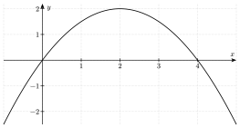
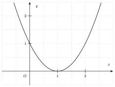

::::: {.qcm .exo #alge-e01 source="Examen 2021" reponse="D" theorie="alge-sys-comb"}
Les pays $A$ et $B$ ont, ensemble, vacciné $20$ millions de personnes. S'il avait vacciné $4$ millions de personnes de plus, le pays $B$ aurait vacciné trois fois plus de personnes que le pays $A$. Combien de personnes le pays $B$ a-t-il vaccinées ?

::: options
- $4$ millions
- $6$ millions
- $8$ millions
- $14$ millions
:::

::: indice
Quelles sont les deux inconnues ? Quelles phrases de l'énoncé donnent une équation ?

:::

::: indice
Avec $a$ et $b$ les nombres de personnes vaccinées (en millions) : $a+b=20$ et $b+4=3a$.

:::

::: details
De $a+b=20$, $b=20-a$. Dans $b+4=3a$ : $24-a=3a$, donc $a=6$ et $b=14$.

Vérification : $6+14=20$ et $14+4=18=3\cdot 6$.

:::

:::::

::::: {.qcm .exo #alge-e02 source="Examen 2019" reponse="B" theorie="alge-rac-abs alge-prod-rem"}
Parmi les expressions suivantes, une seule est égale à $\sqrt{x^2+9-6x}$ pour tout réel $x$ où cette expression est définie. Laquelle ?

::: options
- $|x|-3$
- $|3-x|$
- $x-3$
- $3-x$
:::

::: indice
L'expression sous la racine est-elle le carré d'une expression simple ?

:::

::: indice
$x^2-6x+9=(x-3)^2$. Que vaut $\sqrt{a^2}$ ?

:::

::: details
$x^2+9-6x=(x-3)^2$, donc $\sqrt{x^2+9-6x}=\sqrt{(x-3)^2}=|x-3|=|3-x|$.

$x-3$ et $3-x$ ne conviennent pas : l'une des deux est négative selon le signe de $x-3$, alors qu'une racine carrée est positive.

:::

:::::

::::: {.qcm .exo #alge-e03 source="Examen 2020" reponse="B" theorie="alge-prod-rem"}
Soient $a$ et $b$ deux réels tels que $a\neq b$. Sachant que $a^2-b^2=(a-b)^2$, laquelle des propositions ci-dessous est toujours vraie ?

::: options
- $a=0$
- $b=0$
- $a>b$
- $b>a$
:::

::: indice
Comment factoriser $a^2-b^2$ ? Par quoi peut-on diviser les deux membres, sachant que $a\neq b$ ?

:::

::: indice
$(a-b)(a+b)=(a-b)^2$. Divise par $a-b$, qui n'est pas nul.

:::

::: details
$a^2-b^2=(a-b)(a+b)$, donc l'égalité s'écrit $(a-b)(a+b)=(a-b)^2$.

Comme $a-b\neq0$, on divise par $a-b$ : $a+b=a-b$, donc $2b=0$ et $b=0$.

:::

:::::

::::: {.qcm .exo #alge-e04 source="Examen 2020" reponse="B" theorie="alge-pct-diff"}
Au premier octobre prochain, une université augmentera les loyers de tous les logements étudiants de $1{,}95\,\%$. Dans le même temps, l'État augmentera de $1{,}95\,\%$ la subvention qu'il alloue à tous les étudiants pour leur logement.

Quelle est la conséquence de ces augmentations sur la partie du loyer que devra débourser chaque étudiant ?

::: options
- Elle diminuera de $1{,}95\,\%$.
- Elle augmentera de $1{,}95\,\%$.
- Elle augmentera de $1{,}95$ euro.
- Elle ne changera pas.
:::

::: indice
Comment s'écrit la part payée par l'étudiant à partir du loyer et de la subvention ?

:::

::: indice
La part de l'étudiant est la différence loyer $-$ subvention, et les deux termes sont multipliés par $1{,}0195$.

:::

::: details
Avec $L$ le loyer et $S$ la subvention, l'étudiant paie $L-S$.

Après les augmentations, il paie $1{,}0195\,L-1{,}0195\,S=1{,}0195\,(L-S)$ : sa part augmente de $1{,}95\,\%$.

Elle n'augmente pas de $1{,}95$ euro : l'augmentation dépend du montant de $L-S$.

:::

:::::

::::: {.qcm .exo #alge-e05 source="Examen 2020" reponse="A" theorie="alge-2deg-sp"}
L'équation $ax^2+bx+1=0$ a pour solutions $x=1$ et $x=2$. Que valent $a$ et $b$ ?

::: options
- $a=\frac{1}{2}$ et $b=-\frac{3}{2}$
- $a=-\frac{1}{2}$ et $b=\frac{3}{2}$
- $a=\frac{1}{2}$ et $b=\frac{3}{2}$
- $a=-\frac{1}{2}$ et $b=-\frac{3}{2}$
:::

::: indice
Que valent la somme et le produit des solutions d'une équation $ax^2+bx+c=0$ ?

:::

::: indice
Le produit des solutions vaut $\frac ca=\frac1a$ et leur somme vaut $-\frac ba$.

:::

::: details
Produit des solutions : $\frac1a=1\cdot2=2$, donc $a=\frac12$.

Somme des solutions : $-\frac ba=1+2=3$, donc $b=-3a=-\frac32$.

Vérification : $\frac12x^2-\frac32x+1=\frac12(x^2-3x+2)=\frac12(x-1)(x-2)$.

:::

:::::

::::: {.qcm .exo #alge-e06 source="Examen 2020" reponse="C" theorie="alge-puiss-def"}
Parmi les propositions suivantes, une seule présente des nombres classés par ordre croissant. Laquelle ?

::: options
- $-\frac{1}{5}\,;\ \frac{1}{5^{-1}}\,;\ -5^1\,;\ 5^{-1}$
- $-\frac{1}{5}\,;\ 5^{-1}\,;\ -5^1\,;\ \frac{1}{5^{-1}}$
- $-5^1\,;\ -\frac{1}{5}\,;\ 5^{-1}\,;\ \frac{1}{5^{-1}}$
- $-5^1\,;\ 5^{-1}\,;\ -\frac{1}{5}\,;\ \frac{1}{5^{-1}}$
:::

::: indice
Que vaut chacun des quatre nombres ? Sur quoi porte l'exposant dans $-5^1$ ?

:::

::: indice
$5^{-1}=\frac15$ et $\frac1{5^{-1}}=5$.

:::

::: details
$-5^1=-5$, $-\frac15=-0{,}2$, $5^{-1}=\frac15=0{,}2$ et $\frac1{5^{-1}}=5$.

Dans l'ordre croissant : $-5^1<-\frac15<5^{-1}<\frac1{5^{-1}}$.

:::

:::::

::::: {.qcm .exo #alge-e07 source="Examen 2021" reponse="C" theorie="alge-pct-succ"}
Dans une chaîne de magasins d'habillement, une opération de déstockage propose $-50\,\%$ sur les « prix rouges », ces « prix rouges » étant déjà $30\,\%$ moins chers que le prix initial. À quelle réduction sur le prix initial correspondent les prix de ce déstockage ?

::: options
- $35\,\%$
- $45\,\%$
- $65\,\%$
- $85\,\%$
:::

::: indice
Par quel nombre multiplie-t-on le prix initial pour obtenir le prix rouge ? Puis le prix du déstockage ?

:::

::: indice
Le prix final est le prix initial multiplié par $0{,}7\cdot0{,}5$.

:::

::: details
Le prix rouge est le prix initial multiplié par $0{,}7$, le prix du déstockage est le prix rouge multiplié par $0{,}5$.

$0{,}7\cdot0{,}5=0{,}35$ : le prix final vaut $35\,\%$ du prix initial, soit une réduction de $65\,\%$.

Les réductions ne s'additionnent pas : $30\,\%+50\,\%=80\,\%$ est faux.

:::

:::::

::::: {.qcm .exo #alge-e08 source="Examen 2021" reponse="C" theorie="alge-sys-comb"}
Ma voiture consomme $6$ litres de carburant par $100$ km en ville et $4$ litres par $100$ km hors ville. Le tableau suivant donne les distances, en kilomètres, parcourues en ville et hors ville lors de trois trajets.

| | En ville | Hors ville |
|---|---|---|
| Trajet 1 | $x$ | $300$ |
| Trajet 2 | $5$ | $y$ |
| Trajet 3 | $15$ | $200$ |

Ma voiture a consommé $42{,}4$ litres pour les trois trajets et $32$ litres pour les parties hors ville des trajets 1 et 2. Que valent $x$ et $y$ ?

::: options
- $x=12{,}5$ et $y=450$
- $x=15$ et $y=250$
- $x=20$ et $y=500$
- $x=22$ et $y=500$
:::

::: indice
Laquelle des deux informations ne fait intervenir qu'une seule inconnue ?

:::

::: indice
Hors ville, les trajets 1 et 2 font $300+y$ km, à $4$ litres par $100$ km : $0{,}04\,(300+y)=32$.

:::

::: details
Hors ville, trajets 1 et 2 : $0{,}04\,(300+y)=32$, donc $300+y=800$ et $y=500$.

Les trois trajets : en ville $x+5+15=x+20$ km, hors ville $300+500+200=1000$ km. Donc $0{,}06\,(x+20)+0{,}04\cdot1000=42{,}4$, soit $0{,}06\,(x+20)=2{,}4$, $x+20=40$ et $x=20$.

:::

:::::

::::: {.qcm .exo #alge-e09 source="Examen 2021" reponse="A" theorie="alge-2deg-parab alge-2deg-fact"}
Une portion de parabole est représentée ci-dessous. Quelles sont les coordonnées du point $P$ d'abscisse $10$ de cette parabole ?

::: options
- $(10;-30)$
- $(10;-32)$
- $(10;-34)$
- $(10;-36)$
:::

::: indice
Quels points de la parabole peux-tu lire sur le graphique ? Quelle écriture de $f$ utilise les zéros ?

:::

::: indice
La parabole coupe l'axe des abscisses en $0$ et en $4$ : $f(x)=a\,x(x-4)$. Le sommet $(2;2)$ donne $a$.

:::

::: details
Les zéros sont $0$ et $4$, donc $f(x)=a\,x(x-4)$.

Le sommet est $(2;2)$ : $f(2)=a\cdot2\cdot(-2)=-4a=2$, donc $a=-\frac12$.

$f(10)=-\frac12\cdot10\cdot6=-30$ : $P=(10;-30)$.

:::

:::::

::::: {.qcm .exo #alge-e10 source="Examen 2018" reponse="C" theorie="alge-2deg-ac"}
Soit $a$ un nombre réel non nul. Combien de solutions réelles distinctes l'équation $x^2+x-a^2=2$ possède-t-elle ?

::: options
- $0$
- $1$
- $2$
- Il n'y a pas suffisamment d'informations pour répondre.
:::

::: indice
Quels sont les coefficients $a$, $b$ et $c$ de l'équation écrite sous la forme $\ldots=0$ ? Quel est le signe de $c$ ?

:::

::: indice
L'équation s'écrit $x^2+x-(a^2+2)=0$ : le terme constant est strictement négatif.

:::

::: details
L'équation s'écrit $x^2+x-(a^2+2)=0$.

Le coefficient de $x^2$ vaut $1>0$ et le terme constant $-(a^2+2)<0$ : ils sont de signes contraires, donc $\Delta=1+4(a^2+2)>0$.

L'équation a deux solutions réelles distinctes, quel que soit $a$.

:::

:::::

::::: {.qcm .exo #alge-e11 source="Examen 2020" reponse="D" theorie="alge-sys-comb"}
Ma consommation d'électricité par année, en kWh, est donnée par le tableau suivant.

| | 2017 | 2018 | 2019 |
|---|---|---|---|
| Heures creuses | $1\,800$ | $x$ | $2\,000$ |
| Heures pleines | $y$ | $2\,300$ | $1\,700$ |

Sur ces trois années, la consommation moyenne totale est de $4\,000$ kWh par an et la consommation moyenne en heures creuses de $2\,000$ kWh par an. Que valent $x$ et $y$ ?

::: options
- $x=1\,750$ et $y=1\,850$
- $x=1\,810$ et $y=2\,200$
- $x=2\,000$ et $y=2\,200$
- $x=2\,200$ et $y=2\,000$
:::

::: indice
Que donne une moyenne de $2\,000$ kWh sur trois ans, en total ? Quelle information ne contient que $x$ ?

:::

::: indice
Heures creuses : $1\,800+x+2\,000=3\cdot2\,000$.

:::

::: details
Heures creuses : $1\,800+x+2\,000=6\,000$, donc $x=2\,200$.

Total sur trois ans : $3\cdot4\,000=12\,000$ kWh. Les heures creuses font $6\,000$ kWh, donc les heures pleines aussi : $y+2\,300+1\,700=6\,000$, d'où $y=2\,000$.

:::

:::::

::::: {.qcm .exo #alge-e12 source="Examen 2019" reponse="D" theorie="alge-2deg-ac alge-2deg-delta"}
Soit $a$ une constante réelle. On considère l'équation $(a^2+1)x^2+a^2x-1=0$. Parmi les propositions suivantes, une seule est vraie quelle que soit la valeur de $a$. Laquelle ? L'équation…

::: options
- n'admet aucune solution réelle.
- admet au plus une solution réelle.
- admet une seule solution réelle.
- admet deux solutions réelles distinctes.
:::

::: indice
Quel est le signe du coefficient de $x^2$ ? Et celui du terme constant ?

:::

::: indice
$a^2+1>0$ et le terme constant vaut $-1$ : ils sont de signes contraires.

:::

::: details
Le coefficient de $x^2$ vaut $a^2+1>0$ et le terme constant vaut $-1<0$.

Ils sont de signes contraires, donc $\Delta=a^4+4(a^2+1)>0$ : l'équation a toujours deux solutions réelles distinctes.

:::

:::::

::::: {.qcm .exo #alge-e13 source="Examen 2021" reponse="B" theorie="alge-rac-puiss alge-puiss-prop"}
Parmi les expressions suivantes, laquelle est égale à $\sqrt{x^5}$ pour $x$ strictement positif ?

::: options
- $\sqrt[5]{x^2}$
- $\dfrac{x^3}{\sqrt{x}}$
- $x^3\sqrt{x}$
- $x^3-\sqrt{x}$
:::

::: indice
Comment écrire $\sqrt{x^5}$ comme une puissance de $x$ ? Et chaque proposition ?

:::

::: indice
$\sqrt{x^5}=x^{\frac52}$ et $\dfrac{x^3}{\sqrt x}=x^{3-\frac12}$.

:::

::: details
$\sqrt{x^5}=x^{\frac52}$.

$\dfrac{x^3}{\sqrt x}=x^{3-\frac12}=x^{\frac52}$ : c'est la bonne expression.

Les autres : $\sqrt[5]{x^2}=x^{\frac25}$, $x^3\sqrt x=x^{\frac72}$, et $x^3-\sqrt x$ est une différence, pas une puissance.

:::

:::::

::::: {.qcm .exo #alge-e14 source="Examen 2017" reponse="A" theorie="alge-2deg-parab"}
Le graphique ci-dessous représente une partie du graphe d'une fonction $f$ du deuxième degré, définie sur $\mathbb{R}$. Que vaut $f(10)$ ?

::: options
- $81$
- $99$
- $101$
- $121$
:::

::: indice
Quel point remarquable de la parabole lis-tu sur le graphique ? Quelle écriture de $f$ l'utilise ?

:::

::: indice
Le sommet est $(1;0)$ : $f(x)=a(x-1)^2$. Un autre point lu sur le graphique donne $a$.

:::

::: details
Le sommet est $(1;0)$, donc $f(x)=a(x-1)^2$.

La parabole passe par $(0;1)$ : $a\cdot1=1$, donc $a=1$ et $f(x)=(x-1)^2$.

$f(10)=9^2=81$.

:::

:::::

::::: {.qcm .exo #alge-e15 source="Examen 2019" reponse="C" theorie="alge-sys-comb"}
Soit $(x;y)$ une solution du système $\begin{cases}4x+y=2\\2x-3y=8\end{cases}$. Parmi les propositions suivantes, laquelle est correcte ?

::: options
- $xy=2$
- $x-y=-3$
- $x^2+y^2=5$
- Ce système n'admet pas de solution.
:::

::: indice
Comment éliminer $y$ en combinant les deux équations ?

:::

::: indice
$3(E_1)+(E_2)$ : $14x=14$.

:::

::: details
$3(E_1)+(E_2)$ : $12x+3y+2x-3y=6+8$, donc $14x=14$ et $x=1$. Puis $(E_1)$ : $y=2-4=-2$.

$xy=-2$, $x-y=3$ et $x^2+y^2=1+4=5$.

:::

:::::

::::: {.qcm .exo #alge-e16 source="Examen 2022" reponse="B" theorie="alge-sys-vocab alge-sys-det"}
On considère le système $\begin{cases}a_1x+b_1y=c_1\\a_2x+b_2y=c_2\end{cases}$ où $a_1$, $a_2$, $b_1$, $b_2$, $c_1$ et $c_2$ sont des réels tous non nuls. Parmi les propositions suivantes, laquelle est correcte pour toutes les valeurs possibles de ces coefficients ?

::: options
- Ce système admet toujours une solution.
- Ce système n'admet jamais $(0;0)$ comme solution.
- Ce système admet toujours une infinité de solutions.
- Ce système peut admettre exactement deux solutions distinctes.
:::

::: indice
Que donne le système si l'on remplace $x$ et $y$ par $0$ ?

:::

::: indice
Avec $x=y=0$, la première équation devient $0=c_1$.

:::

::: details
Pour $(0;0)$, la première équation donne $0=c_1$, ce qui est faux car $c_1\neq0$ : $(0;0)$ n'est jamais solution.

Les autres propositions sont fausses : selon les coefficients, le système peut être déterminé, impossible ou indéterminé, mais il n'a jamais exactement deux solutions.

:::

:::::

::::: {.qcm .exo #alge-e17 source="Examen 2020" reponse="B" theorie="alge-rac-puiss alge-puiss-prop"}
Parmi les nombres suivants, lequel est égal à $0{,}25^{1{,}5}$ ?

::: options
- $0{,}05$
- $0{,}125$
- $0{,}1666\ldots$
- $0{,}375$
:::

::: indice
Comment écrire $0{,}25$ et $1{,}5$ sous forme de fractions ?

:::

::: indice
$0{,}25^{1{,}5}=\left(\frac14\right)^{\frac32}=\left(\sqrt{\frac14}\right)^3$.

:::

::: details
$0{,}25^{1{,}5}=\left(\frac14\right)^{\frac32}=\left(\sqrt{\frac14}\right)^3=\left(\frac12\right)^3=\frac18=0{,}125$.

:::

:::::

::::: {.qcm .exo #alge-e18 source="Examen 2018" reponse="C" theorie="alge-puiss-prop"}
Parmi les propositions suivantes, laquelle est égale à $\left(\dfrac{8\left(\frac{a^4}{b^3}\right)^2}{\frac{125}{ab^3}}\right)^{-\frac{1}{3}}$ ?

::: options
- $\frac{2}{5}a^3b$
- $\frac{2}{5}a^{-3}b$
- $\frac{5}{2}a^{-3}b$
- $\frac{5}{2}a^{-3}b^{-1}$
:::

::: indice
Par quoi commencer : l'exposant $-\frac13$, ou la simplification de la fraction ?

:::

::: indice
Simplifie d'abord la fraction : $8\left(\frac{a^4}{b^3}\right)^2\cdot\frac{ab^3}{125}=\frac{8a^9}{125\,b^3}$.

:::

::: details
$8\left(\frac{a^4}{b^3}\right)^2=\frac{8a^8}{b^6}$, et diviser par $\frac{125}{ab^3}$ revient à multiplier par $\frac{ab^3}{125}$ : on obtient $\frac{8a^9}{125\,b^3}$.

L'exposant $-\frac13$ inverse la fraction et en prend la racine cubique : $\left(\frac{125\,b^3}{8a^9}\right)^{\frac13}=\frac{5b}{2a^3}=\frac52a^{-3}b$.

:::

:::::

::::: {.qcm .exo #alge-e19 source="Examen 2023" reponse="B" theorie="alge-sys3 alge-pct"}
<!-- Examen 2023 (matin) : maths Q4 -->
Le patron d'une jardinerie a trois types de fertilisant pour le gazon : $F_1$, $F_2$ et $F_3$, contenant respectivement $30\,\%$, $20\,\%$ et $10\,\%$ d'azote.

Il projette de les mélanger pour obtenir $500\,\mathrm{kg}$ de fertilisant contenant $15\,\%$ d'azote et souhaite que ce mélange contienne trois fois moins de fertilisant de type $F_1$ que de type $F_2$.

Si on note $p_1$, $p_2$, $p_3$ les masses respectives en kilogrammes de $F_1$, $F_2$ et $F_3$ intervenant dans ce mélange, que vaut $(p_1;p_2;p_3)$?

::: options
- $(45;135;320)$
- $(50;150;300)$
- $(52;156;292)$
- $(60;180;260)$
:::

::: indice
Quelles sont les trois équations ? L'une d'elles traduit « trois fois moins de $F_1$ que de $F_2$ ».

:::

::: indice
$p_1+p_2+p_3=500$, $0{,}3p_1+0{,}2p_2+0{,}1p_3=0{,}15\cdot500$ et $p_2=3p_1$.

:::

::: details
Avec $p_2=3p_1$, les deux autres équations deviennent $4p_1+p_3=500$ et $0{,}9p_1+0{,}1p_3=75$, soit $9p_1+p_3=750$.

Par soustraction : $5p_1=250$, donc $p_1=50$, $p_2=150$ et $p_3=500-200=300$.

Vérification : $15+30+30=75$ kg d'azote, soit $15\,\%$ de $500$ kg.

:::

:::::

::::: {.qcm .exo #alge-e20 source="Examen 2023" reponse="B" theorie="alge-pct"}
<!-- Examen 2023 (matin) : maths Q6 -->
Auparavant, les honoraires pour un traitement chez un dentiste étaient de $50$ euros. Le patient ne payait que $22\,\%$ de ces honoraires, le reste étant payé par l'assurance-maladie.

Les honoraires ont désormais augmenté de $10\,\%$. Les assurances-maladie font en sorte que les patients paient toujours la même somme pour leur traitement qu'avant l'augmentation.

Quel est le pourcentage des nouveaux honoraires pris en charge par l'assurance-maladie?

::: options
- $78\,\%$
- $80\,\%$
- $85\,\%$
- $88\,\%$
:::

::: indice
Combien le patient payait-il avant l'augmentation ? Combien valent les nouveaux honoraires ?

:::

::: indice
Le patient paie toujours $0{,}22\cdot50=11$ euros, sur des honoraires de $55$ euros.

:::

::: details
Le patient payait $0{,}22\cdot50=11$ euros. Les nouveaux honoraires valent $1{,}1\cdot50=55$ euros.

L'assurance paie $55-11=44$ euros, soit $\frac{44}{55}=0{,}8=80\,\%$ des honoraires.

:::

:::::

::::: {.qcm .exo #alge-e21 source="Examen 2023" reponse="B" theorie="alge-sys-vocab alge-sys-comb"}
<!-- Examen 2023 (matin) : maths Q7 -->
On considère le système
$$\begin{cases} ax+by=c\\ -ax+dy=-c \end{cases}$$
où les inconnues $x$ et $y$ sont des nombres réels et où les nombres réels $a$, $b$, $c$ et $d$ sont non nuls.

Parmi les propositions ci-dessous, laquelle est toujours vraie concernant ce système?

::: options
- Il n'admet aucune solution.
- Il admet au moins une solution.
- Il admet exactement deux solutions distinctes.
- Il n'admet qu'une seule solution.
:::

::: indice
Que donne la somme des deux équations ? Peux-tu trouver une solution évidente ?

:::

::: indice
$(E_1)+(E_2)$ : $(b+d)\,y=0$. Essaie $y=0$.

:::

::: details
Le couple $\left(\frac ca;0\right)$ est solution : $a\cdot\frac ca=c$ et $-a\cdot\frac ca=-c$. Le système a donc au moins une solution.

En additionnant les équations, $(b+d)\,y=0$. Si $b+d\neq0$, alors $y=0$ et la solution est unique ; si $b+d=0$, les deux équations sont équivalentes et il y a une infinité de solutions. Les propositions « aucune solution » et « une seule solution » ne sont donc pas toujours vraies.

:::

:::::

::::: {.qcm .exo #alge-e22 source="Examen 2025" reponse="D" theorie="alge-sys3"}
<!-- Examen 2025 (matin) : maths Q1 -->
Le prix d'entrée pour une pièce de théâtre était de $10$ euros pour les étudiants, $15$ euros pour les seniors et $20$ euros pour toutes les autres personnes.

On sait que parmi les $500$ billets qui ont été vendus, pour un total de $6\,500$ euros, il y avait trois fois plus de billets au tarif étudiant que de billets au tarif senior.

Quel est, en euros, le montant obtenu par la vente des billets au tarif étudiant?

::: options
- $1\,800$
- $2\,100$
- $3\,300$
- $3\,000$
:::

::: indice
Quelles sont les trois inconnues et les trois équations ?

:::

::: indice
Avec $e$, $s$ et $a$ les nombres de billets : $e+s+a=500$, $10e+15s+20a=6\,500$ et $e=3s$.

:::

::: details
Avec $e=3s$ : $4s+a=500$ et $45s+20a=6\,500$, soit $9s+4a=1\,300$.

De la première, $a=500-4s$ ; dans la seconde, $9s+2\,000-16s=1\,300$, donc $s=100$, $e=300$ et $a=100$.

Vente des billets étudiants : $300\cdot10=3\,000$ euros.

Vérification : $3\,000+1\,500+2\,000=6\,500$ euros.

:::

:::::

::::: {.qcm .exo #alge-e23 source="Examen 2025" reponse="D" theorie="alge-rac-def alge-2deg-delta"}
<!-- Examen 2025 (matin) : maths Q6 -->
On considère l'équation
$$x=\sqrt{1+\sqrt{1+x}}$$
Parmi les propositions suivantes, quel ensemble représente l'ensemble des solutions?

::: options
- $\left\{-1,\ \dfrac{1-\sqrt{5}}{2},\ \dfrac{1+\sqrt{5}}{2}\right\}$
- $\left\{\dfrac{1-\sqrt{5}}{2},\ \dfrac{1+\sqrt{5}}{2}\right\}$
- $\left\{\dfrac{1-\sqrt{5}}{2}\right\}$
- $\left\{\dfrac{1+\sqrt{5}}{2}\right\}$
:::

::: indice
Quel signe doit avoir $x$, puisqu'il est égal à une racine carrée ? Comment se débarrasser des racines ?

:::

::: indice
Il faut $x\ge1$ (car $\sqrt{1+x}\ge0$). En élevant deux fois au carré : $(x^2-1)^2=1+x$.

:::

::: details
Le membre de droite vaut au moins $1$, donc une solution vérifie $x\ge1$.

En élevant au carré : $x^2=1+\sqrt{1+x}$, donc $x^2-1=\sqrt{1+x}$, puis $(x^2-1)^2=1+x$.

$(x-1)^2(x+1)^2-(x+1)=(x+1)\left[(x-1)^2(x+1)-1\right]=(x+1)(x^3-x^2-x)=(x+1)\,x\,(x^2-x-1)$.

Les candidats sont $-1$, $0$, $\frac{1-\sqrt5}2$ et $\frac{1+\sqrt5}2$. Seul $\frac{1+\sqrt5}2\approx1{,}6$ vérifie $x\ge1$.

Vérification : avec $x=\frac{1+\sqrt5}2$, on a $x^2=x+1$, donc $\sqrt{1+x}=x$ et $\sqrt{1+\sqrt{1+x}}=\sqrt{1+x}=x$.

:::

:::::

::::: {.qcm .exo #alge-e24 source="Examen 2025" reponse="D" theorie="alge-puiss-def"}
<!-- Examen 2025 (matin) : maths Q9 -->
Un jeune enfant s'amuse avec une calculatrice à faire des additions de nombres de plus en plus grands.

Il commence par l'opération $1+1$; une fois le résultat obtenu, il l'additionne à lui-même, puis recommence à chaque étape avec ce nouveau résultat. Il effectue ainsi successivement les opérations $1+1$, $2+2$, $4+4$, et ainsi de suite.

Si $n$ est un nombre entier non nul désignant le nombre d'étapes, quel est le résultat obtenu par l'enfant après $n$ étapes?

::: options
- $2^{2n}$
- $2n$
- $n^2$
- $2^n$
:::

::: indice
Que fait chaque étape au résultat précédent ? Note les résultats des premières étapes.

:::

::: indice
Additionner un nombre à lui-même, c'est le multiplier par $2$ : on obtient $2$, puis $4$, puis $8$.

:::

::: details
Chaque étape multiplie le résultat par $2$, en partant de $1$.

Après $1$ étape on obtient $2=2^1$, après $2$ étapes $4=2^2$, après $3$ étapes $8=2^3$. Après $n$ étapes, on obtient $2^n$.

Pour $n=3$, les autres propositions donnent $2^{6}=64$, $6$ et $9$ au lieu de $8$.

:::

:::::

::::: {.qcm .exo #alge-e25 source="Examen 2026" reponse="B" theorie="alge-sys3"}
<!-- Examen 2026 (matin) : maths Q3 -->
Pour un trajet en train entre deux villes, le voyageur a le choix entre le tarif de 1^ère^ classe, le tarif de 2^ème^ classe et le tarif étudiant. Ces trois tarifs ne dépendent pas de l'heure de départ du train.

Le tableau ci-dessous indique, pour trois trains successifs, notés T1, T2 et T3 respectivement, le nombre de voyageurs ayant opté pour chacun des trois tarifs ainsi que le montant payé par l'ensemble des voyageurs du train.

|    | Voyageurs en 1^ère^ classe | Voyageurs en 2^ème^ classe | Voyageurs étudiants | Montant payé par l'ensemble des voyageurs |
|:--:|:--:|:--:|:--:|:--:|
| T1 | 50 | 300 | 80 | 3630 € |
| T2 | 100 | 400 | 50 | 5000 € |
| T3 | 50 | 350 | 40 | 3790 € |

Quel est le prix d'un trajet en 1^ère^ classe?

::: options
- $10$ €
- $15$ €
- $18$ €
- $25$ €
:::

::: indice
Quelles sont les trois inconnues ? Quelle combinaison de deux lignes élimine le plus facilement une inconnue ?

:::

::: indice
Avec $p$, $s$ et $e$ les trois tarifs : $T_1-T_3$ élimine $p$ et donne $-50s+40e=-160$.

:::

::: details
$50p+300s+80e=3\,630$, $100p+400s+50e=5\,000$ et $50p+350s+40e=3\,790$.

$T_1-T_3$ : $-50s+40e=-160$, soit $5s=4e+16$. $2T_1-T_2$ : $200s+110e=2\,260$, soit $20s+11e=226$.

Avec $20s=16e+64$ : $27e=162$, donc $e=6$ et $s=8$.

Enfin $50p=3\,630-2\,400-480=750$, donc $p=15$ euros.

:::

:::::

::::: {.qcm .exo #alge-e26 source="Examen 2026" reponse="C" theorie="alge-rac-abs alge-prod-rem"}
<!-- Examen 2026 (matin) : maths Q10 -->
On considère l'expression
$$\sqrt{4x^4+b^6+4x^2b^3}$$
Quelle est l'expression parmi celles proposées ci-dessous qui correspond à l'expression de l'énoncé?

::: options
- $2x^2+b^3+2|x|\sqrt{|b|^3}$
- $2x^2+|b|^3$
- $|2x^2+b^3|$
- $2x^2+b^3$
:::

::: indice
L'expression sous la racine est-elle le carré d'une somme ?

:::

::: indice
$4x^4+4x^2b^3+b^6=(2x^2+b^3)^2$.

:::

::: details
$4x^4+4x^2b^3+b^6=(2x^2)^2+2\cdot2x^2\cdot b^3+(b^3)^2=(2x^2+b^3)^2$.

Donc $\sqrt{4x^4+b^6+4x^2b^3}=|2x^2+b^3|$.

La valeur absolue est nécessaire : avec $x=0$ et $b=-1$, l'expression vaut $1$, alors que $2x^2+b^3=-1$.

:::

:::::

::::: {.qcm .exo #alge-e27 source="Prépa UMONS" reponse="D" theorie="alge-sys-comb"}
<!-- Simulation août 2026 (simulation-2026/simulation_medecine.typ) : question 1 -->
On considère $a,b,c\in\mathbb{R}$ tels que $$a+b+c=12\quad\text{et}\quad 2a+b=10.$$ Quelle est la valeur de $b+2c$ ?

::: options
- $6$
- $10$
- $12$
- $14$
:::

::: indice
Faut-il trouver $a$, $b$ et $c$ ? Quelle combinaison des deux égalités fait disparaître $a$ ?

:::

::: indice
$2(a+b+c)-(2a+b)=b+2c$.

:::

::: details
$2(a+b+c)-(2a+b)=2a+2b+2c-2a-b=b+2c$.

Donc $b+2c=2\cdot12-10=14$.

:::

:::::

::::: {.qcm .exo #alge-e28 source="Prépa UMONS" reponse="C" theorie="alge-2deg-delta"}
<!-- Simulation août 2026 (simulation-2026/simulation_medecine.typ) : question 9 -->
On considère la fonction $f(x)=x^2-5x+6$. Combien de racines a la fonction $f\big(f(x)\big)$ ?

::: options
- $0$
- $2$
- $4$
- $6$
:::

::: indice
$f(f(x))=0$ signifie que $f(x)$ est une racine de $f$. Quelles sont les racines de $f$ ?

:::

::: indice
$f(x)=(x-2)(x-3)$ : il faut résoudre $f(x)=2$ et $f(x)=3$.

:::

::: details
Les racines de $f$ sont $2$ et $3$. Donc $f(f(x))=0\iff f(x)=2$ ou $f(x)=3$.

$f(x)=2\iff x^2-5x+4=0\iff x=1$ ou $x=4$.

$f(x)=3\iff x^2-5x+3=0$ : $\Delta=25-12=13>0$, deux solutions $\frac{5\pm\sqrt{13}}2$.

Les quatre nombres sont distincts : $f(f(x))$ a $4$ racines.

:::

:::::
