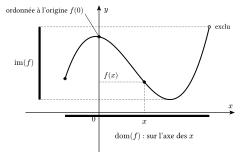
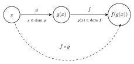
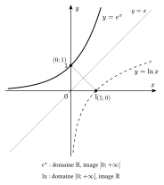

::: {.encadre #ana-domaine nature="Définition" titre="fonction, domaine, image"}
Une **fonction** $f$ associe à chaque réel $x$ **au plus un** réel $f(x)$, l'**image** de $x$.

Le **domaine** de $f$ est l'ensemble des réels qui ont une image. L'**ensemble image** est l'ensemble des valeurs $f(x)$ prises par la fonction.
:::

Graphiquement, on lit le domaine sur l'axe des abscisses et l'ensemble image sur l'axe des ordonnées : on projette le graphique sur chacun des deux axes. Le point du graphique d'abscisse $x$ a pour ordonnée $f(x)$ ; le point d'abscisse $0$ donne l'ordonnée à l'origine $f(0)$, et les points d'ordonnée $0$ donnent les racines.

{.th}

Lorsque la fonction est donnée par une expression, son domaine est l'ensemble des réels pour lesquels chaque opération de l'expression a un sens.

::: {.encadre #ana-conditions nature="Propriété" titre="conditions d'existence"}
Pour déterminer le domaine, on exclut les réels pour lesquels :

- un **dénominateur** s'annule ;
- l'expression sous une **racine d'indice pair** est strictement négative ;
- l'argument d'un **logarithme** est négatif ou nul ;
- l'argument d'un $\arcsin$ ou d'un $\arccos$ sort de $[-1;1]$.
:::

::: {.encadre nature="Exemple"}
$f(x)=\dfrac{x+1}{3x-x^2}$ : le dénominateur $x(3-x)$ s'annule en $0$ et en $3$, donc $\mathrm{dom}\,f=\mathbb{R}\backslash\{0;3\}$.

$g(x)=\ln(-x^2+2x+3)$ : il faut $-x^2+2x+3>0$. Le trinôme a pour racines $-1$ et $3$ et $a=-1<0$ : il est positif entre ses racines. Donc $\mathrm{dom}\,g=\left]-1;3\right[$.
:::

::: {.encadre #ana-composee nature="Définition" titre="opérations sur les fonctions, composée"}
La somme $f+g$ et le produit $f\cdot g$ sont définis là où $f$ et $g$ le sont toutes les deux. Le quotient $\frac fg$ demande en plus $g(x)\neq0$.

La **composée** $f\circ g$ est définie par $(f\circ g)(x)=f\big(g(x)\big)$ : on applique d'abord $g$, puis $f$. Elle est définie pour les $x$ du domaine de $g$ tels que $g(x)$ est dans le domaine de $f$.
:::

{.th}

::: {.encadre nature="Exemple"}
Avec $f(x)=\dfrac{x}{x-3}$ : $(f\circ f)(x)$ demande $x\neq3$ et $f(x)\neq3$. Or $\dfrac{x}{x-3}=3\iff x=3x-9\iff x=\frac92$. Donc $\mathrm{dom}(f\circ f)=\mathbb{R}\backslash\left\{3;\frac92\right\}$.
:::

::: {.encadre nature="Remarque" titre="simplifier ne change pas le domaine"}
Après simplification, $(f\circ f)(x)=\dfrac{x}{9-2x}$, expression qui semble définie en $3$. Mais $3$ n'appartient pas au domaine de $f$, donc pas à celui de $f\circ f$. On détermine le domaine **avant** de simplifier.
:::

::: {.encadre #ana-reciproque nature="Définition" titre="fonction réciproque"}
Si $f$ prend chaque valeur de son ensemble image une seule fois, sa **réciproque** $f^{-1}$ fait le chemin inverse : $f^{-1}(y)=x\iff f(x)=y$.

Les graphiques de $f$ et de $f^{-1}$ sont symétriques par rapport à la droite $y=x$.
:::

{.th}
