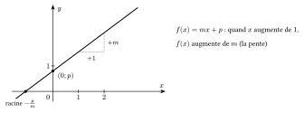
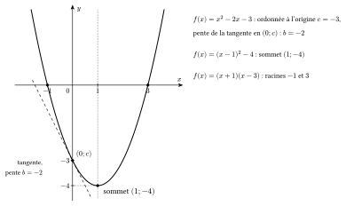

::: {.encadre #ana-affine nature="Propriété" titre="fonction du premier degré"}
Le graphique de $f(x)=mx+p$ est une droite de pente $m$ et d'ordonnée à l'origine $p$. La fonction est croissante si $m>0$ et décroissante si $m<0$.
:::

{.th}

En complétant le carré (voir la théorie d'algèbre), on écrit $ax^2+bx+c=a\left(x+\frac{b}{2a}\right)^2+f\!\left(-\frac{b}{2a}\right)$. Le carré est minimal (nul) en $x=-\frac{b}{2a}$.

::: {.encadre #ana-2deg nature="Propriété" titre="extremum d'une fonction du second degré"}
La fonction $f(x)=ax^2+bx+c$ ($a\neq0$) atteint son extremum en $x_S=-\dfrac{b}{2a}$ :

- un **minimum** si $a>0$ (parabole tournée vers le haut) ;
- un **maximum** si $a<0$ (parabole tournée vers le bas).

La droite $x=x_S$ est l'axe de symétrie de la parabole ; elle passe au milieu des deux racines lorsqu'elles existent.
:::

Les trois écritures d'une fonction du second degré et leur lecture sur le graphique sont détaillées dans la théorie d'algèbre (forme développée, canonique et factorisée).

{.th}

::: {.encadre nature="Exemple"}
$f(x)=2x^2+8x+3$ : $x_S=-\frac{8}{4}=-2$ et $f(-2)=8-16+3=-5$. Comme $a=2>0$, la fonction atteint son minimum $-5$ en $x=-2$.
:::
