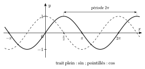
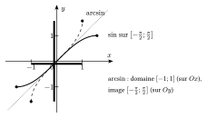

Les fonctions $\sin$ et $\cos$ sont définies sur $\mathbb{R}$, à valeurs dans $[-1;1]$, de période $2\pi$ ; $\tan$ est définie sauf en $\frac\pi2+k\pi$ et est de période $\pi$ (voir la théorie de trigonométrie). Ces fonctions prennent plusieurs fois chaque valeur ; pour définir une réciproque, on se limite à un intervalle où elles ne prennent chaque valeur qu'une fois.

{.th}

::: {.encadre #ana-arc nature="Définition" titre="arcsin, arccos, arctg"}
- Pour $y\in[-1;1]$, $\arcsin y$ est l'unique réel de $\left[-\frac\pi2;\frac\pi2\right]$ dont le sinus vaut $y$.
- Pour $y\in[-1;1]$, $\arccos y$ est l'unique réel de $[0;\pi]$ dont le cosinus vaut $y$.
- Pour $y\in\mathbb{R}$, $\mathrm{arctg}\,y$ est l'unique réel de $\left]-\frac\pi2;\frac\pi2\right[$ dont la tangente vaut $y$.
:::

{.th}

::: {.encadre nature="Exemple"}
$\arcsin\frac12=\frac\pi6$ ; $\arccos\left(-\frac12\right)=\frac{2\pi}{3}$ ; $\mathrm{arctg}\,1=\frac\pi4$ ; $\arcsin\left(\sin\frac{5\pi}{6}\right)=\arcsin\frac12=\frac\pi6$ et non $\frac{5\pi}{6}$.
:::
