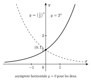

Une grandeur à **croissance exponentielle** est multipliée par le même nombre pendant des durées égales. Si elle triple en $5$ ans, elle est multipliée par $3$ en $5$ ans, par $9=3^2$ en $10$ ans, par $27=3^3$ en $15$ ans.

::: {.encadre #ana-exp nature="Définition" titre="fonction exponentielle"}
Pour une base $a>0$, la fonction $x\mapsto a^x$ est définie sur $\mathbb{R}$ et strictement positive. Elle est croissante si $a>1$ et décroissante si $0<a<1$.

La fonction **exponentielle** $x\mapsto\mathrm{e}^x$ utilise la base $\mathrm{e}$, l'unique base pour laquelle la pente de la tangente au point $(0;1)$ vaut $1$.
:::

{.th}

::: {.encadre #ana-log nature="Définition" titre="logarithme"}
Pour $a>0$, $a\neq1$ et $y>0$, le **logarithme en base $a$** de $y$ est l'exposant auquel il faut élever $a$ pour obtenir $y$ :
$$\log_a y=x\iff a^x=y.$$
On note $\ln=\log_\mathrm{e}$ (logarithme népérien) et $\log=\log_{10}$ (logarithme décimal).
:::

::: {.encadre nature="Exemple"}
$\log1000=3$ car $10^3=1000$ ; $\ln\mathrm{e}^5=5$ ; $\mathrm{e}^{\ln7}=7$ ; $\log_2\frac18=-3$.
:::

Les règles de calcul des logarithmes traduisent celles des puissances : multiplier deux puissances de même base, c'est additionner les exposants.

::: {.encadre #ana-log-prop nature="Propriété" titre="règles de calcul"}
Pour $x>0$, $y>0$, $r$ réel et une base $a$ :
$$\log_a(xy)=\log_ax+\log_ay\qquad\log_a\frac xy=\log_ax-\log_ay\qquad\log_a(x^r)=r\log_ax$$
$$\log_a1=0\qquad\log_aa=1\qquad\log_ax=\frac{\ln x}{\ln a}.$$
Pour les exponentielles : $\mathrm{e}^{x+y}=\mathrm{e}^x\,\mathrm{e}^y$, $\mathrm{e}^{-x}=\dfrac{1}{\mathrm{e}^x}$ et $\left(\mathrm{e}^x\right)^r=\mathrm{e}^{rx}$.
:::

::: {.encadre nature="Remarque" titre="pas de règle pour une somme"}
$\ln(x+y)\neq\ln x+\ln y$ et $\ln^2x=(\ln x)^2\neq\ln(x^2)=2\ln x$. Pour simplifier le logarithme d'une somme, on cherche à la **factoriser** : $\ln\left(\mathrm{e}^{2x}+2\mathrm{e}^x+1\right)=\ln\left(\mathrm{e}^x+1\right)^2=2\ln\left(\mathrm{e}^x+1\right)$.
:::

::: {.encadre #ana-explog-eq nature="Propriété" titre="équations et inéquations"}
Les fonctions $\mathrm{e}^x$ et $\ln x$ sont strictement croissantes. Donc, pour $x,y>0$ : $\ln x=\ln y\iff x=y$ et $\ln x<\ln y\iff x<y$ ; de même pour l'exponentielle sur $\mathbb{R}$.
:::

::: {.encadre nature="Exemple"}
Avec $\alpha(I)=10\log\frac{I}{I_0}$ : $\alpha(I_B)-\alpha(I_A)=10\log\frac{I_B}{I_A}$. Une différence de $20$ décibels donne $\log\frac{I_B}{I_A}=2$, donc $I_B=100\,I_A$.
:::
