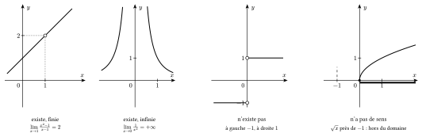
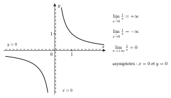
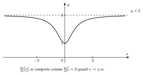
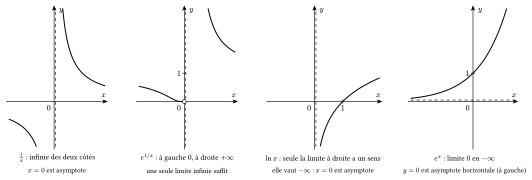
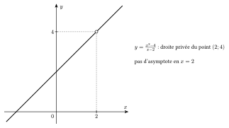
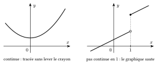

Pour parler de limite, il faut savoir ce que signifie « se rapprocher » d'un nombre, mais aussi de $+\infty$ ou de $-\infty$. Se rapprocher autant qu'on veut de $+\infty$, c'est devenir plus grand que n'importe quel nombre choisi à l'avance, aussi grand soit-il ($10$, $1000$, $10^{6}$…). Se rapprocher autant qu'on veut de $-\infty$, c'est devenir plus petit que n'importe quel nombre choisi à l'avance. Avec ce sens, une seule définition couvre tous les cas.

::: {.encadre #ana-limite nature="Définition" titre="limite"}
Soit $a$ et $b$ des réels, ou $+\infty$, ou $-\infty$. On écrit $\lim\limits_{x\to a}f(x)=b$ si, lorsque $x$ se rapproche autant qu'on veut de $a$ (en restant dans le domaine de $f$), $f(x)$ se rapproche autant qu'on veut de $b$.

La question n'a de sens que si on peut se rapprocher de $a$ autant qu'on veut en restant dans le domaine.
:::

::: {.encadre nature="Exemple"}
- $\lim\limits_{x\to+\infty}\dfrac1x=0$ ($a=+\infty$, $b$ réel) : dès que $x$ dépasse $1000$, $\frac1x$ est compris entre $0$ et $0{,}001$.
- $\lim\limits_{x\to0}\dfrac{1}{x^2}=+\infty$ ($a$ réel, $b=+\infty$) : dès que $0<|x|<0{,}001$, $\frac{1}{x^2}$ dépasse $10^{6}$.
- $\lim\limits_{x\to-\infty}x^3=-\infty$ ($a$ et $b$ infinis) : dès que $x<-10$, $x^3<-1000$.
:::

Une limite peut donc exister (finie ou infinie), ne pas exister, ou ne pas avoir de sens. Lorsque $f(x)$ ne se comporte pas de la même façon à gauche et à droite de $a$, on étudie séparément les deux côtés.

::: {.encadre #ana-limite-cote nature="Définition" titre="limite à gauche, à droite"}
$\lim\limits_{x\overset{<}{\to}a}f(x)$ (limite à gauche) : dans la définition de la limite, on ne considère que les $x<a$. $\lim\limits_{x\overset{>}{\to}a}f(x)$ (limite à droite) : on ne considère que les $x>a$.
:::

::: {.encadre #ana-limite-gd nature="Propriété" titre="limite et limites à gauche et à droite"}
On suppose qu'on peut se rapprocher de $a$ à la fois par la gauche et par la droite en restant dans le domaine de $f$ ($a$ est à l'intérieur du domaine, ou à l'intérieur du domaine privé de $a$). Alors
$$\lim\limits_{x\to a}f(x)=b\iff\lim\limits_{x\overset{<}{\to}a}f(x)=\lim\limits_{x\overset{>}{\to}a}f(x)=b,$$
avec en plus $f(a)=b$ lorsque $a$ appartient au domaine (la définition de la limite permet de prendre $x=a$).
:::

::: {.encadre nature="Remarque" titre="au bord du domaine"}
Si on ne peut se rapprocher de $a$ que d'un côté, seule la limite de ce côté a un sens, et c'est la limite en $a$. Par exemple, $\sqrt x$ n'est défini que pour $x\ge0$ : la limite à gauche en $0$ n'a pas de sens, et $\lim\limits_{x\to0}\sqrt x=\lim\limits_{x\overset{>}{\to}0}\sqrt x=0$.
:::

{.th}

::: {.encadre nature="Exemple"}
Les quatre situations possibles, de gauche à droite sur la figure :

1. **La limite existe et est finie.** $f(x)=\dfrac{x^2-1}{x-1}$ n'est pas définie en $1$, mais on peut s'approcher de $1$ dans son domaine. Pour $x\neq1$, $f(x)=\dfrac{(x-1)(x+1)}{x-1}=x+1$, qui se rapproche de $2$ : $\lim\limits_{x\to1}f(x)=2$. Le graphique est une droite privée du point $(1;2)$.
2. **La limite existe et est infinie.** $f(x)=\dfrac{1}{x^2}$ : lorsque $x$ se rapproche de $0$, $x^2$ est positif et très petit, donc $\dfrac1{x^2}$ devient aussi grand qu'on veut, des deux côtés : $\lim\limits_{x\to0}f(x)=+\infty$. La droite $x=0$ est une asymptote verticale.
3. **La limite n'existe pas.** $f(x)=\dfrac{|x|}{x}$ vaut $-1$ pour $x<0$ et $1$ pour $x>0$. Donc $\lim\limits_{x\overset{<}{\to}0}f(x)=-1$ et $\lim\limits_{x\overset{>}{\to}0}f(x)=1$ : les deux limites sont différentes, $\lim\limits_{x\to0}f(x)$ n'existe pas. Le graphique « saute » en $0$.
4. **La limite n'a pas de sens.** $f(x)=\sqrt x$ a pour domaine $[0;+\infty[$. Aucun réel du domaine n'est proche de $-1$ : on ne peut pas se rapprocher de $-1$ en restant dans le domaine, et la question $\lim\limits_{x\to-1}\sqrt x$ n'a pas de sens.
:::

{.th}

::: {.encadre nature="Exemple"}
$f(x)=\dfrac1x$ : $\lim\limits_{x\overset{<}{\to}0}f(x)=-\infty$ et $\lim\limits_{x\overset{>}{\to}0}f(x)=+\infty$, donc $\lim\limits_{x\to0}f(x)$ n'existe pas. Par contre, $\lim\limits_{x\to+\infty}f(x)=0$.
:::

Pour calculer une limite, on remplace d'abord $x$ par $a$. Si l'expression a une valeur, c'est la limite (pour les fonctions usuelles sur leur domaine). Si on obtient un quotient dont le numérateur et le dénominateur tendent tous deux vers $0$, ce calcul ne permet pas de conclure : il faut transformer l'expression.

::: {.encadre #ana-lim-calcul nature="Méthode" titre="quotient dont les deux termes tendent vers 0"}
Si le numérateur et le dénominateur d'une fraction rationnelle s'annulent en $a$, ils ont tous deux le facteur $x-a$. On factorise, on simplifie par $x-a$ (permis car $x\neq a$ près de $a$), puis on remplace $x$ par $a$.

Avec des racines, on multiplie par le binôme conjugué pour faire apparaître le facteur.
:::

::: {.encadre nature="Exemple"}
$\lim\limits_{x\to1}\dfrac{x^2-1}{x^2+2x-3}=\lim\limits_{x\to1}\dfrac{(x-1)(x+1)}{(x-1)(x+3)}=\lim\limits_{x\to1}\dfrac{x+1}{x+3}=\dfrac12$.

$\lim\limits_{x\to4}\dfrac{x-4}{\sqrt x-2}=\lim\limits_{x\to4}\dfrac{(x-4)(\sqrt x+2)}{x-4}=\lim\limits_{x\to4}\left(\sqrt x+2\right)=4$.
:::

Pourquoi le terme de plus haut degré l'emporte-t-il ? On le met en évidence : par exemple, $2x^3-5x^2+1=2x^3\left(1-\dfrac{5}{2x}+\dfrac{1}{2x^3}\right)$. Quand $x\to\pm\infty$, les fractions de la parenthèse se rapprochent de $0$ et la parenthèse se rapproche de $1$ : le polynôme se comporte comme $2x^3$.

::: {.encadre #ana-lim-infini nature="Propriété" titre="polynôme et fraction rationnelle à l'infini"}
Soit $P(x)=a_nx^n+\cdots+a_1x+a_0$ avec $a_n\neq0$ et $Q(x)=b_mx^m+\cdots+b_1x+b_0$ avec $b_m\neq0$. Alors
$$\lim\limits_{x\to\pm\infty}P(x)=\lim\limits_{x\to\pm\infty}a_nx^n\qquad\text{et}\qquad\lim\limits_{x\to\pm\infty}\frac{P(x)}{Q(x)}=\lim\limits_{x\to\pm\infty}\frac{a_nx^n}{b_mx^m}.$$
Pour la fraction, on obtient donc :

- si $n<m$ : la limite vaut $0$ ;
- si $n=m$ : la limite vaut $\dfrac{a_n}{b_m}$ ;
- si $n>m$ : la limite vaut $+\infty$ ou $-\infty$, selon le signe de $\dfrac{a_n}{b_m}\,x^{n-m}$.
:::

::: {.encadre nature="Exemple"}
- $n=m$ : $\lim\limits_{x\to+\infty}\dfrac{6x^2+1}{2x^2-x}=\lim\limits_{x\to+\infty}\dfrac{6x^2}{2x^2}=3$.
- $n<m$ : $\lim\limits_{x\to+\infty}\dfrac{5x}{x^2+1}=\lim\limits_{x\to+\infty}\dfrac{5x}{x^2}=\lim\limits_{x\to+\infty}\dfrac5x=0$.
- $n>m$ : $\lim\limits_{x\to-\infty}\dfrac{x^3+1}{2x}=\lim\limits_{x\to-\infty}\dfrac{x^2}{2}=+\infty$, et $\lim\limits_{x\to-\infty}\left(-x^3+4x\right)=\lim\limits_{x\to-\infty}\left(-x^3\right)=+\infty$.
:::

{.th}

::: {.encadre #ana-asymptotes nature="Définition" titre="asymptotes"}
- La droite $x=a$ est une **asymptote verticale** du graphique de $f$ si la limite à gauche ou la limite à droite de $f$ en $a$ est infinie ($+\infty$ ou $-\infty$).
- La droite $y=b$ est une **asymptote horizontale** du graphique de $f$ si $\lim\limits_{x\to+\infty}f(x)=b$ ou $\lim\limits_{x\to-\infty}f(x)=b$.

Une seule des deux limites suffit.
:::

{.th}

::: {.encadre nature="Exemple"}
De gauche à droite sur la figure :

1. $f(x)=\dfrac1x$ : $\lim\limits_{x\overset{<}{\to}0}f(x)=-\infty$ et $\lim\limits_{x\overset{>}{\to}0}f(x)=+\infty$. Les deux limites sont infinies : la droite $x=0$ est une asymptote verticale.
2. $f(x)=\mathrm{e}^{1/x}$ : pour $x<0$ proche de $0$, $\frac1x$ tend vers $-\infty$, donc $\lim\limits_{x\overset{<}{\to}0}f(x)=0$ ; pour $x>0$ proche de $0$, $\frac1x$ tend vers $+\infty$, donc $\lim\limits_{x\overset{>}{\to}0}f(x)=+\infty$. Une seule limite est infinie, et cela suffit : $x=0$ est une asymptote verticale.
3. $f(x)=\ln x$ a pour domaine $]0;+\infty[$ : seule la limite à droite en $0$ a un sens, et $\lim\limits_{x\overset{>}{\to}0}\ln x=-\infty$. La droite $x=0$ est une asymptote verticale.
4. $f(x)=\mathrm{e}^x$ : $\lim\limits_{x\to-\infty}\mathrm{e}^x=0$, alors que $\lim\limits_{x\to+\infty}\mathrm{e}^x=+\infty$. La droite $y=0$ est une asymptote horizontale, du côté de $-\infty$ seulement.
:::

::: {.encadre nature="Remarque" titre="valeur interdite sans asymptote"}
Une valeur qui annule le dénominateur ne donne pas toujours une asymptote verticale : $f(x)=\dfrac{x^2-1}{x^2-x-6}=\dfrac{(x-1)(x+1)}{(x-3)(x+2)}$ a deux asymptotes verticales, $x=3$ et $x=-2$ ; mais $\dfrac{x^2-4}{x-2}$ n'en a pas en $2$, car elle vaut $x+2$ pour $x\neq2$.
:::

{.th}

::: {.encadre #ana-continuite nature="Définition" titre="continuité"}
Une fonction $f$ est **continue** en un réel $a$ de son domaine si $\lim\limits_{x\to a}f(x)=f(a)$. Elle est continue sur un intervalle si elle l'est en chaque point de cet intervalle : son graphique s'y trace sans lever le crayon.
:::

{.th}

::: {.encadre nature="Exemple"}
Les fonctions polynômes, rationnelles, racines, exponentielles, logarithmes et trigonométriques sont continues sur leur domaine, ainsi que leurs sommes, produits, quotients et composées. Par exemple, $f(x)=\dfrac{\sqrt{x}+\mathrm{e}^x}{x-2}$ est continue sur son domaine $[0;2[\,\cup\,]2;+\infty[$.

Par contre, la fonction qui vaut $-1$ pour $x<0$ et $1$ pour $x\ge0$ n'est pas continue en $0$ : son graphique « saute » en ce point.
:::
