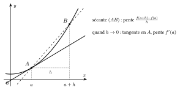
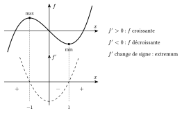
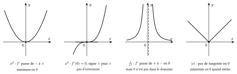
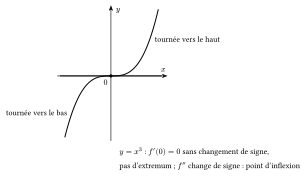

La pente de la sécante qui joint les points d'abscisses $a$ et $a+h$ du graphique vaut $\dfrac{f(a+h)-f(a)}{h}$. Quand $h$ se rapproche de $0$, la sécante se rapproche de la tangente.

::: {.encadre #ana-derivee-def nature="Définition" titre="nombre dérivé et tangente"}
Le **nombre dérivé** de $f$ en $a$ est
$$f'(a)=\lim\limits_{h\to0}\frac{f(a+h)-f(a)}{h},$$
lorsque cette limite existe et est finie. C'est la **pente de la tangente** au graphique au point $(a;f(a))$, qui a pour équation
$$y=f(a)+f'(a)\,(x-a).$$
:::

{.th}

::: {.encadre #ana-derivees-usuelles nature="Propriété" titre="dérivées usuelles"}
| $f(x)$ | $c$ | $x^r$ ($r$ réel) | $\mathrm{e}^x$ | $\ln x$ | $\sin x$ | $\cos x$ | $\tan x$ |
|:--|:-:|:-:|:-:|:-:|:-:|:-:|:-:|
| $f'(x)$ | $0$ | $r\,x^{r-1}$ | $\mathrm{e}^x$ | $\dfrac1x$ | $\cos x$ | $-\sin x$ | $\dfrac{1}{\cos^2x}$ |

En particulier, $\left(\sqrt x\right)'=\dfrac{1}{2\sqrt x}$ et $\left(\dfrac1x\right)'=-\dfrac{1}{x^2}$. Pour une racine, on l'écrit d'abord comme une puissance : $\sqrt[3]{x^4}=x^{4/3}$.
:::

::: {.encadre #ana-derivees-regles nature="Propriété" titre="règles de dérivation"}
$$(f+g)'=f'+g'\qquad(kf)'=kf'\qquad(fg)'=f'g+fg'\qquad\left(\frac fg\right)'=\frac{f'g-fg'}{g^2}$$
Dérivée d'une composée : $\big(f(g(x))\big)'=f'\big(g(x)\big)\cdot g'(x)$.
:::

::: {.encadre nature="Exemple"}
$\left(\mathrm{e}^{u(x)}\right)'=u'(x)\,\mathrm{e}^{u(x)}$ ; $\big(\ln u(x)\big)'=\dfrac{u'(x)}{u(x)}$ ; $\big(\sin(3x)\big)'=3\cos(3x)$ ; $\left(f(x^2)\right)'=2x\,f'(x^2)$.
:::

Si la tangente monte, la fonction monte au voisinage du point. Le signe de la dérivée donne donc les variations.

::: {.encadre #ana-variations nature="Propriété" titre="variations et extrema"}
Sur un intervalle :

- si $f'>0$ (sauf en des points isolés), $f$ est strictement croissante ;
- si $f'<0$ (sauf en des points isolés), $f$ est strictement décroissante.

Si $f'$ s'annule en $a$ **en changeant de signe**, $f$ change de variation en $a$ et y atteint un extremum local : un minimum si $f'$ passe de $-$ à $+$, un maximum si $f'$ passe de $+$ à $-$.
:::

{.th}

::: {.encadre nature="Remarque" titre="dérivée nulle et extremum"}
Une dérivée nulle ne suffit pas pour avoir un extremum, et un extremum ne demande pas toujours une dérivée nulle. C'est le **changement de signe de $f'$**, en un réel **du domaine**, qui compte. De gauche à droite sur la figure :

1. $f(x)=x^2$ : $f'(x)=2x$ est négative pour $x<0$ et positive pour $x>0$. Elle change de signe en $0$ : $f$ décroît puis croît, et $f(0)=0$ est un minimum.
2. $f(x)=x^3$ : $f'(x)=3x^2$ est nulle en $0$, mais positive de part et d'autre. $f$ est croissante sur $\mathbb{R}$ : il n'y a pas d'extremum en $0$. La tangente en $(0;0)$ est horizontale et traverse la courbe : c'est un point d'inflexion.
3. $f(x)=\dfrac{1}{x^2}$ : $f'(x)=-\dfrac{2}{x^3}$ est positive pour $x<0$ et négative pour $x>0$. Le signe change en $0$, mais $0$ n'est pas dans le domaine : $f$ n'a pas de maximum, ses valeurs deviennent aussi grandes qu'on veut près de $0$.
4. $f(x)=|x|$ : $f$ n'est pas dérivable en $0$ (le graphique y forme un angle), mais $f$ décroît puis croît : $f(0)=0$ est un minimum. Un extremum peut donc aussi se trouver là où la dérivée n'existe pas.
:::

{.th}

::: {.encadre #ana-concavite nature="Propriété" titre="concavité et point d'inflexion"}
- Si $f''>0$ sur un intervalle, $f'$ y est croissante : le graphique est **tourné vers le haut** (concavité vers le haut).
- Si $f''<0$, le graphique est **tourné vers le bas**.

Un **point d'inflexion** est un point où la concavité change, c'est-à-dire où $f''$ change de signe.
:::

{.th}

::: {.encadre nature="Exemple"}
$f(x)=x^3+3x^2+3x+2$ : $f'(x)=3(x+1)^2\ge0$, donc $f$ est croissante et n'a pas d'extremum. $f''(x)=6(x+1)$ change de signe en $-1$ : le point d'abscisse $-1$ est un point d'inflexion (à tangente horizontale).
:::
