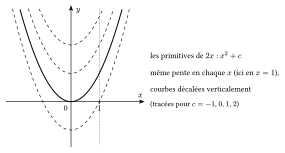
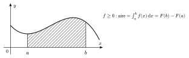
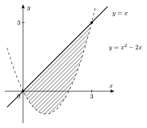

::: {.encadre #ana-primitive nature="Définition" titre="primitive"}
Une **primitive** de $f$ sur un intervalle $I$ est une fonction $F$ telle que $F'(x)=f(x)$ pour tout $x\in I$.

Si $F$ est une primitive de $f$ sur l'intervalle $I$, les primitives de $f$ sur $I$ sont les fonctions $F+c$, où $c$ est une constante.
:::

Deux primitives d'une même fonction ont la même dérivée : en chaque $x$, leurs graphiques ont la même pente. Sur un intervalle, ils se déduisent donc l'un de l'autre par un déplacement vertical.

{.th}

::: {.encadre nature="Remarque" titre="sur un intervalle"}
Sur $\mathbb{R}_0$, qui n'est pas un intervalle, $\dfrac1x$ a plus de primitives que $\ln|x|+c$ : on peut choisir une constante différente sur $]-\infty;0[$ et sur $]0;+\infty[$. Une condition comme $f(1)=1$ ne fixe la constante que sur l'intervalle qui contient $1$.
:::

::: {.encadre #ana-primitives-usuelles nature="Propriété" titre="primitives usuelles"}
| $f(x)$ | $x^r$ ($r\neq-1$) | $\dfrac1x$ | $\mathrm{e}^x$ | $\cos x$ | $\sin x$ | $\dfrac{1}{\cos^2x}$ |
|:--|:-:|:-:|:-:|:-:|:-:|:-:|
| $F(x)$ | $\dfrac{x^{r+1}}{r+1}$ | $\ln\lvert x\rvert$ | $\mathrm{e}^x$ | $\sin x$ | $-\cos x$ | $\tan x$ |

Une primitive de $f(ax+b)$ est $\dfrac1a\,F(ax+b)$ : par exemple, $\mathrm{e}^{2x}$ a pour primitive $\dfrac12\mathrm{e}^{2x}$.
:::

En lisant à l'envers la dérivée d'une composée, on obtient la méthode de substitution. En lisant à l'envers la dérivée d'un produit, on obtient l'intégration par parties.

::: {.encadre #ana-substitution nature="Propriété" titre="substitution"}
Si $F$ est une primitive de $f$, alors $F\big(u(x)\big)$ est une primitive de $f\big(u(x)\big)\cdot u'(x)$.
:::

::: {.encadre nature="Exemple"}
$2x\,\mathrm{e}^{x^2}$ a pour primitive $\mathrm{e}^{x^2}$ ; $\dfrac{2x}{x^2+1}$ a pour primitive $\ln\left(x^2+1\right)$ ; $\cos x\sin^2x$ a pour primitive $\dfrac{\sin^3x}{3}$.
:::

::: {.encadre #ana-parties nature="Propriété" titre="intégration par parties"}
Pour des fonctions $u$ et $v$ dérivables :
$$\int u\,v'\,\mathrm{d}x=u\,v-\int u'\,v\,\mathrm{d}x.$$
On choisit pour $u$ le facteur qui se simplifie en le dérivant (souvent un polynôme).
:::

::: {.encadre #ana-integrale nature="Propriété" titre="intégrale définie"}
Si $F$ est une primitive de $f$ sur un intervalle contenant $a$ et $b$ :
$$\int_a^bf(x)\,\mathrm{d}x=\big[F(x)\big]_a^b=F(b)-F(a).$$
Si $f\ge0$ sur $[a;b]$, cette intégrale est l'aire de la région comprise entre le graphique de $f$ et l'axe des abscisses, entre $x=a$ et $x=b$.
:::

{.th}

::: {.encadre nature="Exemple"}
Avec $u=x$ et $v'=\mathrm{e}^x$ : $\displaystyle\int_0^1x\,\mathrm{e}^{x}\,\mathrm{d}x=\big[x\,\mathrm{e}^{x}\big]_0^1-\int_0^1\mathrm{e}^{x}\,\mathrm{d}x=\mathrm{e}-(\mathrm{e}-1)=1$.
:::

::: {.encadre #ana-aire nature="Propriété" titre="aire entre deux courbes"}
L'aire de la région comprise entre les graphiques de $f$ et de $g$, entre $x=a$ et $x=b$, vaut $\displaystyle\int_a^b\big|f(x)-g(x)\big|\,\mathrm{d}x$.

En pratique, on calcule les abscisses des points d'intersection, puis on additionne les valeurs absolues des intégrales de $f-g$ entre deux intersections consécutives.
:::

{.th}

::: {.encadre nature="Exemple"}
La droite $y=x$ et la parabole $y=x^2-2x$ se coupent en $x=0$ et $x=3$. Aire : $\left|\displaystyle\int_0^3\left(x^2-3x\right)\mathrm{d}x\right|=\left|\left[\frac{x^3}{3}-\frac{3x^2}{2}\right]_0^3\right|=\left|9-\frac{27}{2}\right|=\frac92$.
:::
