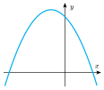
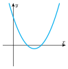
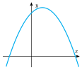
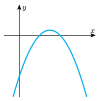
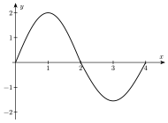
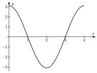
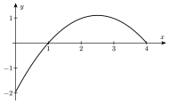
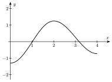
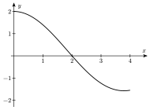
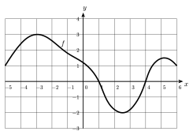

::::: {.qcm .exo #ana-e01 source="Examen 2020" reponse="B" theorie=""}
<!-- support 2026 : Q73 -->
Étant donné des constantes réelles et non nulles $A$, $B$, $a$, $b$, $c$ et $\omega$, quelle est l'expression analytique de la fonction qui est proportionnelle à sa dérivée seconde?

::: options
- $ax^2+bx+c$
- $A\cos(\omega x ) + B \sin(\omega x)$
- $A \ln (ax) $
- $Ax^n$
:::

:::::

::::: {.qcm .exo #ana-e02 source="Examen 2019" reponse="D" theorie=""}
<!-- support 2026 : Q74 -->
Considérons la fonction réelle $f$ dont l'expression analytique est donnée par $f(x) = \ln (-2x^2+x+1)$.

Quel est le domaine de définition de $f$?

::: options
- ${\displaystyle \left] -\infty ; \frac{1-\sqrt{5}}{2} \right[ \cup \left[\frac{1+\sqrt{5}}{2} ; +\infty\right[}$
- ${\displaystyle \left]-\infty ; - \frac{1}{2} \right[ \cup \left] 1 ; +\infty \right[}$
- ${\displaystyle \left[\frac{1-\sqrt{5}}{2};\frac{1+\sqrt{5}}{2}\right[}$
- ${\displaystyle \left]-\frac{1}{2};1\right[}$
:::

:::::

::::: {.qcm .exo #ana-e03 source="Examen 2018" reponse="A" theorie=""}
<!-- support 2026 : Q75 -->
Considérons la fonction $f$ dont l'expression analytique est ${\displaystyle f(x) = \frac{\mathrm{e}^{1-x}}{1+x^2}}$. Que vaut la pente de la tangente au graphe de $f$ au point d'abscisse $1$?

::: options
- $-1$
- ${\displaystyle -\frac{1}{2}}$
- ${\displaystyle \frac{1}{2}}$
- $1$
:::

:::::

::::: {.qcm .exo #ana-e04 source="Examen 2020" reponse="D" theorie=""}
<!-- support 2026 : Q76 -->
On considère l'unique extremum de la fonction du second degré $f$ définie explicitement par $$f(x) = 4x^2-1-8x$$

Laquelle des affirmations suivantes concernant la fonction évaluée en cet extremum est correcte? La fonction atteint ...

::: options
- un maximum et est positive en cet extremum.
- un maximum et est négative en cet extremum.
- un minimum et est positive en cet extremum.
- un minimum et est négative en cet extremum.
:::

:::::

::::: {.qcm .exo #ana-e05 source="Examen 2021" reponse="D" theorie=""}
<!-- support 2026 : Q77 -->
On considère la fonction $f$ définie explicitement par l'expression ${\displaystyle f(x) = \frac{x^2-9}{x^2+x-2}}$. Quelles sont les équations définissant les asymptotes verticales de cette fonction?

::: options
- $x=-3$ et $x=3$
- $x=0$ et $x=2$
- $x=0$ et $x=3$
- $x=1$ et $x=-2$
:::

:::::

::::: {.qcm .exo #ana-e06 source="Examen 2020" reponse="A" theorie=""}
<!-- support 2026 : Q78 -->
On considère la limite pour $x$ tendant vers $2$ de ${\displaystyle \frac{x^2-4}{\sqrt{2}-\sqrt{x}}}$. Cette limite a pour valeur...

::: options
- $-8\sqrt{2}$
- $-1$
- $1$
- $8\sqrt{2}$
:::

:::::

::::: {.qcm .exo #ana-e07 source="Examen 2018" reponse="C" theorie=""}
<!-- support 2026 : Q79 -->
Parmi les quatre graphiques ci-dessous (tous représentés dans le même repère orthonormé), un seul peut correspondre à celui de la fonction réelle définie par $f(x) = -x^2+x+2$. Lequel?

::: options
- 
- 
- 
- 
:::

:::::

::::: {.qcm .exo #ana-e08 source="Examen 2020" reponse="D" theorie=""}
<!-- support 2026 : Q80 -->
Considérons la fonction définie explicitement par $f(x) = 2 \sqrt[3]{x^4}-\sqrt{x}+1$. Que vaut la dérivée de $f$ en $1$?

::: options
- $5/6$
- $7/6$
- $11/6$
- $13/6$
:::

:::::

::::: {.qcm .exo #ana-e09 source="Examen 2019" reponse="A" theorie=""}
<!-- support 2026 : Q81 -->
Quel est l'ensemble des nombres réels $m$ tels que la fonction réelle définie par $f(x) = x^2-(1-m)x+m-2$ admette un minimum en un réel supérieur ou égal à ${\displaystyle \frac{9}{2}}$?

::: options
- $]-\infty;-8]$
- $]-\infty;-3]$
- $[8;+\infty[$
- $\emptyset$
:::

:::::

::::: {.qcm .exo #ana-e10 source="Examen 2021" reponse="B" theorie=""}
<!-- support 2026 : Q82 -->
On considère la fonction $f$ définie sur l'ensemble des nombres réels strictement positifs par l'expression $f(x) = \sqrt[3]{x}-x^{-1/6}$.

Que vaut la dérivée de cette fonction en $x=1$?

::: options
- $1/3$
- $1/2$
- $2/3$
- $5/6$
:::

:::::

::::: {.qcm .exo #ana-e11 source="Examen 2022" reponse="D" theorie=""}
<!-- support 2026 : Q83 -->
On considère la droite d'équation $y=x+1$ et la parabole d'équation $y=x^2-3x+1$. Que vaut l'aire de la région délimitée par ces deux courbes entre les deux points d'intersection?

::: options
- ${\displaystyle \frac{28}{3}}$
- ${\displaystyle \frac{29}{3}}$
- ${\displaystyle \frac{31}{3}}$
- ${\displaystyle \frac{32}{3}}$
:::

:::::

::::: {.qcm .exo #ana-e12 source="Examen 2021" reponse="C" theorie=""}
<!-- support 2026 : Q84 -->
Au cours de l'étude d'une fonction $f$ d'une variable réelle $x$, on note l'observation suivante pour la valeur particulière $x_0$ : $$f(x_0) f'(x_0) f''(x_0) < 0 $$
Parmi les propositions ci-dessous, quelle est celle qui correspond à une interprétation correcte du comportement de la fonction $f$ en $x_0$?

::: options
- $f(x_0) <0$, $f$ est croissante en $x_0$ et sa concavité est tournée vers le bas en ce point.
- $f(x_0) >0$, $f$ est décroissante en $x_0$ et sa concavité est tournée vers le bas en ce point.
- $f(x_0) >0$, $f$ est décroissante en $x_0$ et sa concavité est tournée vers le haut en ce point.
- $f(x_0) <0$, $f$ est décroissante en $x_0$ et sa concavité est tournée vers le haut en ce point.
:::

:::::

::::: {.qcm .exo #ana-e13 source="Examen 2023" reponse="A" theorie=""}
<!-- Examen 2023 (matin) : maths Q1 -->
On considère la fonction $f$ définie pour tout nombre réel $x$ par l'expression
$$f(x)=\frac{2x^3}{3}-\frac{7x^2}{2}-15x+12$$
Sur quelle partie de $\mathbb{R}$ cette fonction est-elle strictement croissante?

::: options
- $\left]-\infty,-\dfrac{3}{2}\right[\,\cup\,]5,+\infty[$
- $]-\infty,+\infty[$
- $\left[-\dfrac{7}{2},\dfrac{2}{3}\right]\cap[0,5]$
- $\left[-\dfrac{3}{2},5\right]$
:::

:::::

::::: {.qcm .exo #ana-e14 source="Examen 2023" reponse="C" theorie=""}
<!-- Examen 2023 (matin) : maths Q2 -->
On considère la fonction $f$ définie pour tout nombre réel non nul $x$ par l'expression
$$f(x)=2+(x-1)\mathrm{e}^x+\frac{3}{2}\ln\left(x^2\right)$$
Quelle est l'équation de la droite tangente à la courbe d'équation $y=f(x)$ au point d'abscisse $x=1$?

::: options
- $y=2\mathrm{e}\cdot x-2(\mathrm{e}-1)$
- $y=(\mathrm{e}+3)x+(\mathrm{e}+1)$
- $y=(\mathrm{e}+3)x-(\mathrm{e}+1)$
- $y=(\mathrm{e}+3)x+2$
:::

:::::

::::: {.qcm .exo #ana-e15 source="Examen 2025" reponse="A" theorie=""}
<!-- Examen 2025 (matin) : maths Q2 -->
On considère une fonction $f$ définie pour tout nombre réel $x\neq 0$, vérifiant
$$f(1)=1$$
et dont la dérivée vaut
$$f'(x)=x^3-\frac{3}{x^4}$$
Que vaut $f(2)$?

::: options
- $31/8$
- $2$
- $33/8$
- $1/3$
:::

:::::

::::: {.qcm .exo #ana-e16 source="Examen 2025" reponse="B" theorie=""}
<!-- Examen 2025 (matin) : maths Q4 -->
Dans un grand lac apprécié par les pêcheurs à la ligne, il a été déterminé que l'évolution du nombre de truites $N(t)$ ($N(t)>0$) au cours du temps $t$ (exprimé en années) obéit à l'équation suivante :
$$N'(t)=0{,}3\,N(t)-0{,}06\,t\,N(t)$$
où $N'$ désigne la dérivée de $N$ par rapport au temps $t$.

Pendant combien d'années le nombre de truites augmentera-t-il dans ce lac?

::: options
- Le nombre de truites augmentera toujours dans ce lac
- $5$
- $16{,}67$
- $33{,}33$
:::

:::::

::::: {.qcm .exo #ana-e17 source="Examen 2026" reponse="B" theorie=""}
<!-- Examen 2026 (matin) : maths Q4 -->
On considère les fonctions $f$ et $g$ définies pour tout nombre réel $x$ par
$$f(x)=(x+1)^2\qquad\text{et}\qquad g(x)=x-4$$
Pour quelle valeur de $x$ a-t-on $f(g(x))=g(f(x))$?

::: options
- $4/3$
- $3/2$
- $3$
- Cette égalité n'est jamais vraie
:::

:::::

::::: {.qcm .exo #ana-e18 source="Examen 2026" reponse="C" theorie=""}
<!-- Examen 2026 (matin) : maths Q7 -->
On considère la fonction $f'$ dont le graphique est donné par la figure suivante :

Parmi les quatre graphiques suivants, quel est celui qui correspond à une fonction $f$ dont $f'$ est la dérivée?

::: options
- 
- 
- 
- 
:::

:::::

::::: {.qcm .exo #ana-e19 source="Examen 2026" reponse="C" theorie=""}
<!-- Examen 2026 (matin) : maths Q9 -->
L'intensité sonore $I$ d'un bruit est caractérisée par le nombre
$$\alpha(I)=10\log\left(\frac{I}{I_0}\right)$$
où $\log$ désigne le logarithme décimal et $I_0$ est l'intensité du son le plus faible perceptible par l'oreille humaine. La valeur $\alpha(I)$ est exprimée en décibels.

Le nombre de décibels $\alpha(I_B)$ associé au son $B$ est supérieur de cinq décibels au nombre de décibels $\alpha(I_A)$ associé au son $A$.

Parmi les propositions ci-dessous, quelle est la relation qui relie les intensités $I_A$ et $I_B$ des deux sons?

::: options
- $I_B=\sqrt{0{,}5}\,I_A$
- $I_B=0{,}5\,I_A$
- $I_B=\sqrt{10}\,I_A$
- $I_B=10\,I_A$
:::

:::::

::::: {.qcm .exo #ana-e20 source="Prépa UMONS" reponse="D" theorie="ana-asymptotes ana-domaine"}
<!-- Simulation août 2026 (simulation-2026/simulation_medecine.typ) : question 4 -->
On considère $${\displaystyle f(x)=\frac{x^2-1}{x-1}-x}.$$ Laquelle des affirmations suivantes est correcte ?

::: options
- La fonction possède une asymptote horizontale $y=-1$.
- La fonction possède une asymptote verticale $x=-1$.
- La fonction possède une asymptote verticale $x=1$.
- La fonction possède une asymptote horizontale $y=1$.
:::

:::::

::::: {.qcm .exo #ana-e21 source="Prépa UMONS" reponse="C" theorie="ana-variations"}
<!-- Simulation août 2026 (simulation-2026/simulation_medecine.typ) : question 7 -->
On considère $f(x)=x^3-3x$. Laquelle des affirmations suivantes est correcte ?

::: options
- La fonction est strictement croissante.
- La fonction admet un minimum global uniquement.
- La fonction admet deux extrema locaux.
- La fonction est strictement décroissante.
:::

:::::

::::: {.qcm .exo #ana-e22 source="Prépa UMONS" reponse="C" theorie="ana-derivees-regles ana-derivee-def"}
<!-- Simulation août 2026 (simulation-2026/simulation_medecine.typ) : question 8 -->
On considère une fonction $f$ dérivable sur $\mathbb{R}$ telle que $f(9)=1$ et $f'(9)=-3$. Soit la fonction $g(x)=f(x^2)$.

Quel est le point d'intersection entre la tangente au graphe de $g$ au point d'abscisse $3$ et l'axe $Ox$ ?

::: options
- $(55;0)$
- ${\displaystyle \left(\frac{1}{18};0\right)}$
- ${\displaystyle \left(\frac{55}{18};0\right)}$
- ${\displaystyle \left(\frac{28}{9};0\right)}$
:::

:::::

::::: {.qcm .exo #ana-e23 source="Prépa UMONS" reponse="C" theorie="ana-integrale"}
<!-- Simulation août 2026 (simulation-2026/simulation_medecine.typ) : question 10 -->
Soit $f$ la fonction représentée ci-dessous. Parmi les nombres suivants, lequel est le plus proche de ${\displaystyle \int_{-4}^{5}f(x)\,\mathrm{d}x}$ ?

::: options
- $18$
- $22$
- $8$
- $11$
:::

:::::
