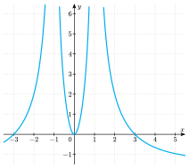

Résous d'abord les questions sur papier, sans calculatrice. Les solutions sont publiées à la fin de la phase d'entraînement.

<!-- Ticket de sortie : les jumeaux apparaissent quand la page de pilotage les sélectionne (etat.json). -->

:::::: ticket

::::: {.qcm .jumeau #ana-j01 source="Prépa UMONS" reponse="C" theorie="ana-domaine ana-conditions" jumeau-de="ana-q01"}
Quel est le domaine de définition de la fonction $f$ définie par ${\displaystyle f(x)=\frac{x-1}{-3x^2+2x}}$ ?

::: options
- $\mathbb{R}\backslash\{-3;2\}$
- ${\displaystyle \mathbb{R}\backslash\left\{0;\frac{3}{2}\right\}}$
- ${\displaystyle \mathbb{R}\backslash\left\{0;\frac{2}{3}\right\}}$
- $\mathbb{R}\backslash\{3;-2\}$
:::

::: details
Réponse C. La fonction n'est pas définie là où le dénominateur s'annule : $-3x^2+2x=x(2-3x)=0$ si $x=0$ ou $x=\frac23$. Le domaine est $\mathbb{R}\backslash\left\{0;\frac23\right\}$.

Les propositions A et D reprennent les coefficients du dénominateur, et B inverse la fraction.

:::

:::::

::::: {.qcm .jumeau #ana-j02 source="Prépa UMONS" reponse="C" theorie="ana-variations ana-concavite" jumeau-de="ana-q02"}
On considère la fonction définie explicitement par $f(x)=x^3+6x^2+12x+1$. Quelle est la proposition correcte concernant la fonction $f$ évaluée au point $-2$ ?

::: options
- La fonction $f$ atteint un maximum lorsque $x=-2$.
- La fonction $f$ atteint un minimum lorsque $x=-2$.
- Le graphique de $f$ présente un point d'inflexion en $x=-2$.
- Le point $x=-2$ ne définit pas un point d'inflexion et la fonction n'atteint ni un minimum, ni un maximum en $x=-2$.
:::

::: details
Réponse C. On calcule $f'(x)=3x^2+12x+12=3(x+2)^2\ge0$ : la dérivée s'annule en $-2$ sans changer de signe, donc il n'y a ni minimum ni maximum. Ensuite $f''(x)=6x+12=6(x+2)$ change de signe en $-2$ : le graphique y présente un point d'inflexion.

:::

:::::

::::: {.qcm .jumeau #ana-j03 source="Prépa UMONS" reponse="B" theorie="ana-exp" jumeau-de="ana-q03"}
Une culture de bactéries croît de manière exponentielle. On constate que le nombre de bactéries double en quinze jours. Combien de jours faudra-t-il attendre pour que la population soit multipliée par seize par rapport à sa valeur initiale ?

::: options
- 45 jours
- 60 jours
- 120 jours
- 240 jours
:::

::: details
Réponse B. Comme $16=2^4$, la population doit doubler $4$ fois : $4\times15=60$ jours.

Multiplier par $16$ ne demande pas $16\times 15=240$ jours ni $8\times15=120$ jours : la croissance est exponentielle, pas linéaire.

:::

:::::

::::: {.qcm .jumeau #ana-j04 source="Prépa UMONS" reponse="D" theorie="ana-derivees-regles ana-concavite" jumeau-de="ana-q04"}
Soit $f$ une fonction réelle, définie pour tout nombre réel $x$ et dérivable au moins deux fois, croissante et à concavité tournée vers le bas.

On considère la fonction $g$ définie par $g(x)=f(-x^2)$, également sur la droite réelle.

Parmi les propositions suivantes décrivant le comportement de la dérivée seconde $g''$ de la fonction $g$, quelle est celle qui est vraie ?

::: options
- $g''(x)\ge0$ pour $x\in\mathbb{R}$.
- $g''(x)\ge0$ pour $x<0$, $g''(0)=0$ et $g''(x)\le0$ pour $x>0$.
- $g''(x)\le0$ pour $x<0$, $g''(0)=0$ et $g''(x)\ge0$ pour $x>0$.
- $g''(x)\le0$ pour $x\in\mathbb{R}$.
:::

::: details
Réponse D. On dérive deux fois : $g'(x)=-2x\,f'(-x^2)$, puis $g''(x)=-2f'(-x^2)+4x^2f''(-x^2)$. Comme $f$ est croissante, $f'\ge0$ et le premier terme est $\le0$. Comme la concavité est tournée vers le bas, $f''\le0$ et le second terme est $\le0$. Donc $g''(x)\le0$ pour tout $x$.

Remarque : $g''(0)=-2f'(0)$ n'est pas nécessairement nul, ce qui écarte B et C.

:::

:::::

::::: {.qcm .jumeau #ana-j05 source="Prépa UMONS" reponse="B" theorie="ana-derivee-def ana-derivees-regles" jumeau-de="ana-q05"}
Que vaut la pente de la tangente au graphe de la fonction réelle définie par ${\displaystyle f(x)=\mathrm{e}^{\sin(2x)\cos(2x)}}$ au point d'abscisse $x=\frac{\pi}{4}$ ?

::: options
- $2$
- $-2$
- $-1$
- $0$
:::

::: details
Réponse B. Posons $u(x)=\sin(2x)\cos(2x)=\frac12\sin(4x)$. Alors $f'(x)=u'(x)\,\mathrm{e}^{u(x)}$ avec $u'(x)=2\cos(4x)$. En $x=\frac\pi4$ : $u=\frac12\sin\pi=0$, donc $\mathrm{e}^{u}=1$, et $u'=2\cos\pi=-2$. La pente vaut $-2$.

:::

:::::

::::: {.qcm .jumeau #ana-j06 source="Prépa UMONS" reponse="C" theorie="ana-variations" jumeau-de="ana-q06"}
Considérons la fonction $f$ de domaine $\mathbb{R}\backslash\{2\}$, dérivable sur son domaine, dont la dérivée $f'$ a le signe suivant :

- $f'(x)<0$ pour $x\in\left]-\infty;-3\right[\,\cup\,\left]0;2\right[$ ;
- $f'(x)>0$ pour $x\in\left]-3;0\right[\,\cup\,\left]2;+\infty\right[$.

Parmi les propositions suivantes, une seule est vraie. Laquelle ?

::: options
- La fonction $f$ admet un minimum local au point d'abscisse $x=0$.
- La fonction $f$ admet un minimum local au point d'abscisse $x=2$.
- La fonction $f$ admet un minimum local au point d'abscisse $x=-3$.
- Aucune des propositions précédentes n'est vraie.
:::

::: details
Réponse C. Un minimum local apparaît en un point du domaine où $f'$ passe du négatif au positif. En $x=-3$, $f'$ passe de $-$ à $+$ : minimum local. En $x=0$, $f'$ passe de $+$ à $-$ : c'est un maximum local. En $x=2$, le signe change bien de $-$ à $+$, mais $2$ n'appartient pas au domaine de $f$ : il n'y a pas de minimum en ce point.

:::

:::::

::::: {.qcm .jumeau #ana-j07 source="Prépa UMONS" reponse="D" theorie="ana-parties ana-integrale" jumeau-de="ana-q07"}
Que vaut ${\displaystyle \int_0^2 x\,\mathrm{e}^{3x}\,\mathrm{d}x}$ ?

::: options
- ${\displaystyle \frac{5\mathrm{e}^6-1}{9}}$
- ${\displaystyle \frac{\mathrm{e}^6-1}{3}}$
- ${\displaystyle \frac{2\mathrm{e}^6}{3}}$
- ${\displaystyle \frac{1+5\mathrm{e}^6}{9}}$
:::

::: details
Réponse D. On intègre par parties avec $u=x$ et $v'=\mathrm{e}^{3x}$ : $\displaystyle\int_0^2x\,\mathrm{e}^{3x}\,\mathrm{d}x=\left[\frac{x\,\mathrm{e}^{3x}}{3}\right]_0^2-\int_0^2\frac{\mathrm{e}^{3x}}{3}\,\mathrm{d}x=\frac{2\mathrm{e}^6}{3}-\frac{\mathrm{e}^6-1}{9}=\frac{5\mathrm{e}^6+1}{9}$.

La proposition $\frac{2\mathrm{e}^6}{3}$ oublie le second terme, et $\frac{\mathrm{e}^6-1}{3}$ intègre $\mathrm{e}^{3x}$ sans le facteur $x$.

:::

:::::

::::: {.qcm .jumeau #ana-j08 source="Prépa UMONS" reponse="C" theorie="ana-lim-calcul" jumeau-de="ana-q08"}
Que vaut la limite suivante : ${\displaystyle \lim\limits_{x\to 3}\frac{3-x}{x^2-9}}$ ?

::: options
- ${\displaystyle \frac{1}{6}}$
- $0$
- ${\displaystyle -\frac{1}{6}}$
- $+\infty$
:::

::: details
Réponse C. On factorise : $\dfrac{3-x}{x^2-9}=\dfrac{-(x-3)}{(x-3)(x+3)}=-\dfrac{1}{x+3}$ pour $x\neq3$. Quand $x\to3$, cette expression tend vers $-\dfrac16$.

:::

:::::

::::: {.qcm .jumeau #ana-j09 source="Prépa UMONS" reponse="B" theorie="ana-log-prop" jumeau-de="ana-q09"}
On considère la fonction $f$ définie explicitement par ${\displaystyle f(x)=\ln\left(9+6\mathrm{e}^x+\mathrm{e}^{2x}\right)}$ où $x$ est une variable réelle.

Laquelle des expressions suivantes définit également la fonction $f$ ?

::: options
- $2x$
- ${\displaystyle 2\big[x+\ln(3\mathrm{e}^{-x}+1)\big]}$
- ${\displaystyle \ln^2(3+\mathrm{e}^x)}$
- ${\displaystyle (3+\mathrm{e}^x)\ln(2)}$
:::

::: details
Réponse B. On reconnaît un carré : $9+6\mathrm{e}^x+\mathrm{e}^{2x}=(3+\mathrm{e}^x)^2$, donc $f(x)=2\ln(3+\mathrm{e}^x)$. Or $3+\mathrm{e}^x=\mathrm{e}^x\left(3\mathrm{e}^{-x}+1\right)$, donc $\ln(3+\mathrm{e}^x)=x+\ln(3\mathrm{e}^{-x}+1)$ et $f(x)=2\big[x+\ln(3\mathrm{e}^{-x}+1)\big]$.

Les autres propositions confondent $\ln(a^2)=2\ln(a)$ avec $\ln^2(a)$, ou ne gardent que le terme en $\mathrm{e}^{2x}$.

:::

:::::

::::: {.qcm .jumeau #ana-j10 source="Prépa UMONS" reponse="D" theorie="ana-composee" jumeau-de="ana-q10"}
On considère la fonction $f$ définie pour tout nombre réel $x$ différent de $2$ par ${\displaystyle f(x)=\frac{x}{x-2}}$. Parmi les ensembles suivants, quel est celui qui correspond au domaine de définition de la fonction $f\circ f$, où $\circ$ désigne la composition de fonctions ?

::: options
- $\mathbb{R}\backslash\{2\}$
- $\mathbb{R}\backslash\{4\}$
- $\mathbb{R}\backslash\{-2\}$
- $\mathbb{R}\backslash\{2;4\}$
:::

::: details
Réponse D. $(f\circ f)(x)=f(f(x))$ est définie lorsque $x\neq2$ et $f(x)\neq2$. Or $f(x)=2\iff x=2(x-2)\iff x=4$. Le domaine est donc $\mathbb{R}\backslash\{2;4\}$.

La formule simplifiée $f(f(x))=\dfrac{x}{4-x}$ n'exclut que $4$ : il faut aussi exclure $2$, qui est exclu du domaine de $f$.

:::

:::::

::::: {.qcm .jumeau #ana-j11 source="Prépa UMONS" reponse="B" theorie="ana-lim-infini ana-asymptotes" jumeau-de="ana-q11"}
On considère la fonction $f$ définie explicitement par $${\displaystyle f(x)=\frac{5}{x}-3+\frac{2x^2+1}{x^2+4}}$$ On constate que la fonction $f$ admet une asymptote horizontale. Quel est le point d'intersection de cette asymptote avec l'axe $Oy$ ?

::: options
- $(0;-3)$
- $(0;-1)$
- $(0;1)$
- $(0;2)$
:::

::: details
Réponse B. Quand $x\to\pm\infty$, $\frac5x\to0$ et $\frac{2x^2+1}{x^2+4}\to2$ (rapport des termes de plus haut degré). Donc $f(x)\to-3+2=-1$ : l'asymptote horizontale est la droite $y=-1$, qui coupe l'axe $Oy$ en $(0;-1)$.

:::

:::::

::::::

::::: {.qcm #ana-q01 source="Examen 2017" reponse="C" theorie="ana-domaine ana-conditions"}
<!-- support 2026 : Q21 -->
Quel est le domaine de définition de la fonction $f$ définie par ${\displaystyle f(x) = \frac{x+3}{-2x^2+3x}}$?

::: options
- $\mathbb{R} \backslash \{-2;3\}$
- ${\displaystyle \mathbb{R} \backslash \left\{0;\frac{2}{3}\right\}}$
- ${\displaystyle \mathbb{R} \backslash \left\{0;\frac{3}{2}\right\}}$
- $\mathbb{R} \backslash \{2;-3\}$
:::

::: indice
Quelle opération de l'expression impose une condition ?

:::

::: indice
Résous $-2x^2+3x=0$ en mettant $x$ en évidence.

:::

::: details
Réponse C.

Le dénominateur doit être non nul : $-2x^2+3x=x(3-2x)=0\iff x=0$ ou $x=\dfrac32$. Le domaine est $\mathbb{R}\backslash\left\{0;\dfrac32\right\}$.

:::

::: pieges
- Les valeurs qui annulent le **numérateur** ($-3$) appartiennent au domaine : $\frac{0}{\dots}=0$ existe.
- $\frac23$ : erreur en isolant $x$ dans $3-2x=0$.

:::

:::::

::::: {.qcm #ana-q02 source="Examen 2020" reponse="C" theorie="ana-variations ana-concavite ana-derivees-usuelles"}
<!-- support 2026 : Q22 -->
On considère la fonction définie explicitement par $f(x) = x^3-3x^2+3x-5$. Quelle est la proposition correcte concernant la fonction $f$ évaluée au point $1$?

::: options
- La fonction $f$ atteint un maximum lorsque $x=1$.
- La fonction $f$ atteint un minimum lorsque $x=1$.
- Le graphique de $f$ présente un point d'inflexion en $x=1$.
- Le point $x=1$ ne définit pas un point d'inflexion et la fonction n'atteint ni un minimum, ni un maximum en $x=1$.
:::

::: indice
Calcule $f'(x)$ et $f''(x)$. Que se passe-t-il pour chacune en $x=1$ : s'annule-t-elle, change-t-elle de signe ?

:::

::: indice
$f'(x)=3x^2-6x+3=3(x-1)^2$ et $f''(x)=6x-6$.

:::

::: details
Réponse C.

$f'(x)=3x^2-6x+3=3(x-1)^2\ge0$ : la dérivée s'annule en $1$ sans changer de signe. La fonction est croissante sur $\mathbb{R}$ et n'a pas d'extremum en $1$.

$f''(x)=6(x-1)$ change de signe en $1$ : la concavité change, le graphique présente un point d'inflexion en $x=1$.

:::

::: pieges
- $f'(1)=0$ ne suffit pas pour un extremum : il faut que $f'$ change de signe.
- $f''(1)=0$ ne suffit pas pour un point d'inflexion : il faut que $f''$ change de signe (c'est le cas ici).

:::

:::::

::::: {.qcm #ana-q03 source="Examen 2022" reponse="C" theorie="ana-exp"}
<!-- support 2026 : Q23 -->
Une culture de cellules croît de manière exponentielle. On constate que le nombre de cellules double en vingt jours.
Combien de jours faudra-t-il attendre pour que la population de cellules soit multipliée par huit par rapport à sa valeur initiale?

::: options
- 20 jours
- 40 jours
- 60 jours
- 80 jours
:::

::: indice
La population double tous les vingt jours. Combien de doublements faut-il pour multiplier par huit ?

:::

::: indice
$8=2^3$.

:::

::: details
Réponse C.

En croissance exponentielle, la population est multipliée par $2$ tous les vingt jours. Comme $8=2^3$, il faut trois doublements : $3\cdot20=60$ jours.

:::

::: pieges
- $80$ jours ($4\cdot20$) : multiplier par $8$, ce n'est pas doubler quatre fois ($2^4=16$).
- Raisonner de façon proportionnelle (« huit fois plus en quatre fois plus de temps ») ne convient pas à une croissance exponentielle.

:::

:::::

::::: {.qcm #ana-q04 source="Examen 2022" reponse="D" theorie="ana-derivees-regles ana-concavite ana-variations"}
<!-- support 2026 : Q24 -->
Soit $f$ une fonction réelle, définie pour tout nombre réel $x$ et dérivable au moins deux fois,  croissante et à concavité tournée vers le haut.

On considère la fonction $g$ définie par $g(x) = f(x^2)$, également sur la droite réelle.

Parmi les propositions suivantes décrivant le comportement de la dérivée seconde $g''$ de la fonction $g$, quelle est celle qui est vraie?

::: options
- $g''(x)\le0$ pour $x\in \mathbb{R}$.
- $g''(x)\le0$ pour $x<0$, $g''(0) = 0$ et $g''(x) \ge0$ pour $x>0$.
- $g''(x)\ge0$ pour $x<0$, $g''(0) = 0$ et $g''(x) \le0$ pour $x>0$.
- $g''(x)\ge0$ pour $x\in \mathbb{R}$.
:::

::: indice
Dérive $g(x)=f(x^2)$ deux fois en utilisant la dérivée d'une composée, puis celle d'un produit.

:::

::: indice
$g''(x)=2f'(x^2)+4x^2f''(x^2)$. Quel est le signe de $f'$ ? de $f''$ ?

:::

::: details
Réponse D.

$g'(x)=2x\,f'(x^2)$, puis $g''(x)=2f'(x^2)+2x\cdot2x\,f''(x^2)=2f'(x^2)+4x^2f''(x^2)$.

$f$ est croissante, donc $f'\ge0$ ; sa concavité est tournée vers le haut, donc $f''\ge0$. Les deux termes sont positifs ou nuls : $g''(x)\ge0$ pour tout réel $x$.

:::

::: pieges
- Oublier le facteur $2x$ de la dérivée de $x^2$, ou dériver $2x\,f'(x^2)$ sans la règle du produit.
- $g''(0)=2f'(0)$ n'est pas nécessairement nul.

:::

:::::

::::: {.qcm #ana-q05 source="Examen 2018" reponse="D" theorie="ana-derivee-def ana-derivees-regles"}
<!-- support 2026 : Q25 -->
Que vaut la pente de la tangente au graphe de la fonction réelle définie par ${\displaystyle f(x) = \mathrm{e}^{\sin(3x)\cos(3x)}}$ au point d'abscisse $x=\pi$?

::: options
- $-3$
- $-1$
- $0$
- $3$
:::

::: indice
La pente de la tangente est $f'(\pi)$. Comment dérive-t-on $\mathrm{e}^{u(x)}$ ?

:::

::: indice
$\sin(3x)\cos(3x)=\frac12\sin(6x)$, dont la dérivée est $3\cos(6x)$.

:::

::: details
Réponse D.

Posons $u(x)=\sin(3x)\cos(3x)=\frac12\sin(6x)$. Alors $f'(x)=u'(x)\,\mathrm{e}^{u(x)}$ avec $u'(x)=3\cos(6x)$.

En $x=\pi$ : $u(\pi)=\frac12\sin(6\pi)=0$ et $u'(\pi)=3\cos(6\pi)=3$. Donc $f'(\pi)=3\cdot\mathrm{e}^0=3$.

:::

::: pieges
- $0$ : on a calculé $u(\pi)$ au lieu de $f'(\pi)$.
- $-3$ ou $-1$ : erreur de signe ou oubli du facteur $3$ en dérivant $\sin(3x)$ ou $\cos(3x)$.

:::

:::::

::::: {.qcm #ana-q06 source="Examen 2018" reponse="A" theorie="ana-variations"}
<!-- support 2026 : Q26 -->
Considérons la fonction $f$ de domaine $\mathbb{R}\backslash\{\pm 1\}$ et dont la dérivée première $f'$ admet un graphe dont une portion est représentée ci-dessous.

 Parmi les propositions suivantes, une seule est vraie. Laquelle?

::: options
- La fonction $f$ admet un minimum local au point d'abscisse $x=-3$.
- La fonction $f$ admet un minimum local au point d'abscisse $x=0$.
- La fonction $f$ admet un minimum local au point d'abscisse $x=3$.
- Aucune des propositions précédentes n'est vraie.
:::

::: indice
Une fonction admet un minimum local là où sa dérivée passe du négatif au positif. Lis le signe de $f'$ de part et d'autre de chaque abscisse proposée.

:::

::: indice
En $-3$, $f'$ passe de $-$ à $+$. Que fait $f'$ autour de $0$ et autour de $3$ ?

:::

::: details
Réponse A.

- En $x=-3$, $f'$ est négative à gauche et positive à droite : $f$ admet un minimum local.
- En $x=0$, $f'$ s'annule mais reste positive de part et d'autre : pas d'extremum.
- En $x=3$, $f'$ passe de $+$ à $-$ : c'est un maximum local, pas un minimum.

:::

::: pieges
- Confondre le graphique de $f'$ avec celui de $f$ : le minimum de $f$ ne se lit pas au point le plus bas de la courbe dessinée.
- Un zéro de $f'$ sans changement de signe (en $0$) ne donne pas d'extremum.

:::

:::::

::::: {.qcm #ana-q07 source="Examen 2018" reponse="C" theorie="ana-parties ana-integrale ana-primitives-usuelles"}
<!-- support 2026 : Q27 -->
Que vaut ${\displaystyle \int_0^3 x \mathrm{e}^{2x} \,\mathrm{d}x}$?

::: options
- ${\displaystyle \frac{\mathrm{e}^6-1}{2}}$
- ${\displaystyle 1+2\mathrm{e}^3}$
- ${\displaystyle \frac{1+5\mathrm{e}^6}{4}}$
- ${\displaystyle \frac{9\mathrm{e}^6}{4}}$
:::

::: indice
La fonction est un produit d'un polynôme et d'une exponentielle. Quelle méthode convient ?

:::

::: indice
Intègre par parties avec $u=x$ et $v'=\mathrm{e}^{2x}$, donc $v=\frac12\mathrm{e}^{2x}$.

:::

::: details
Réponse C.

Par parties, avec $u=x$, $v=\frac12\mathrm{e}^{2x}$ :
$$\int_0^3x\,\mathrm{e}^{2x}\,\mathrm{d}x=\left[\frac{x\,\mathrm{e}^{2x}}{2}\right]_0^3-\int_0^3\frac{\mathrm{e}^{2x}}{2}\,\mathrm{d}x=\frac{3\mathrm{e}^6}{2}-\frac{\mathrm{e}^6-1}{4}=\frac{1+5\mathrm{e}^6}{4}.$$

:::

::: pieges
- $\frac{9\mathrm{e}^6}{4}$ : on a multiplié une primitive de $x$ par une primitive de $\mathrm{e}^{2x}$ ; une primitive d'un produit n'est pas le produit des primitives.
- $\frac{\mathrm{e}^6-1}{2}$ : on a intégré $\mathrm{e}^{2x}$ en oubliant le facteur $x$.

:::

:::::

::::: {.qcm #ana-q08 source="Examen 2018" reponse="A" theorie="ana-lim-calcul ana-limite"}
<!-- support 2026 : Q28 -->
Que vaut la limite suivante : ${\displaystyle \lim\limits_{x \to 2} \frac{2-x}{x^2-4}}$?

::: options
- ${\displaystyle -\frac{1}{4}}$
- $0$
- ${\displaystyle \frac{1}{4}}$
- $+\infty$
:::

::: indice
En remplaçant $x$ par $2$, on obtient $\frac00$ : il faut transformer l'expression. Quel facteur ont en commun le numérateur et le dénominateur ?

:::

::: indice
$x^2-4=(x-2)(x+2)$ et $2-x=-(x-2)$.

:::

::: details
Réponse A.

Pour $x\neq2$ : $\dfrac{2-x}{x^2-4}=\dfrac{-(x-2)}{(x-2)(x+2)}=-\dfrac{1}{x+2}$. Quand $x\to2$, cette expression tend vers $-\dfrac14$.

:::

::: pieges
- $\frac14$ : le signe de $2-x=-(x-2)$ a été oublié.
- $0$ ou $+\infty$ : un numérateur et un dénominateur qui tendent vers $0$ ne permettent pas de conclure sans transformer l'expression.

:::

:::::

::::: {.qcm #ana-q09 source="Examen 2021" reponse="D" theorie="ana-log-prop"}
<!-- support 2026 : Q29 -->
On considère la fonction $f$ définie explicitement par ${\displaystyle f(x) = \ln(2\mathrm{e}^x+1+\mathrm{e}^{2x})}$ où $x$ est une variable réelle.

Laquelle des expressions suivantes définit également la fonction $f$?

::: options
- ${\displaystyle (1+\mathrm{e}^x)\ln(2)}$
- ${\displaystyle \ln^2(1+\mathrm{e}^x)}$
- ${\displaystyle 2x}$
- ${\displaystyle 2\big[x+\ln(\mathrm{e}^{-x}+1)\big]}$
:::

::: indice
Peux-tu écrire $2\mathrm{e}^x+1+\mathrm{e}^{2x}$ comme un carré ?

:::

::: indice
$\mathrm{e}^{2x}+2\mathrm{e}^x+1=\left(\mathrm{e}^x+1\right)^2$. Ensuite, mets $\mathrm{e}^x$ en évidence dans $\mathrm{e}^x+1$.

:::

::: details
Réponse D.

$2\mathrm{e}^x+1+\mathrm{e}^{2x}=\left(\mathrm{e}^x+1\right)^2$, donc $f(x)=2\ln\left(\mathrm{e}^x+1\right)$.

Comme $\mathrm{e}^x+1=\mathrm{e}^x\left(1+\mathrm{e}^{-x}\right)$ : $\ln\left(\mathrm{e}^x+1\right)=x+\ln\left(\mathrm{e}^{-x}+1\right)$, et $f(x)=2\big[x+\ln\left(\mathrm{e}^{-x}+1\right)\big]$.

:::

::: pieges
- $\ln^2\left(1+\mathrm{e}^x\right)=\left[\ln\left(1+\mathrm{e}^x\right)\right]^2$ est différent de $\ln\left(1+\mathrm{e}^x\right)^2=2\ln\left(1+\mathrm{e}^x\right)$.
- $2x$ : on a traité $\ln$ d'une somme comme une somme de $\ln$ et gardé seulement $\ln\mathrm{e}^{2x}$.

:::

:::::

::::: {.qcm #ana-q10 source="Examen 2022" reponse="B" theorie="ana-composee"}
<!-- support 2026 : Q30 -->
On considère la fonction $f$ définie pour tout nombre réel $x$ différent de $-1$ par ${\displaystyle f(x) = \frac{x}{x+1}}$. Parmi les ensembles suivants, quel est celui qui correspond au domaine de définition de la fonction $f \circ f$, où $\circ$ désigne la composition de fonction?

::: options
- $\mathbb{R}\backslash\{-1\}$
- ${\displaystyle \mathbb{R}\backslash\left\{-1;-\frac{1}{2}\right\}}$
- ${\displaystyle \mathbb{R}\backslash\left\{-\frac{1}{2}\right\}}$
- $\mathbb{R}\backslash\{1\}$
:::

::: indice
Pour calculer $f\big(f(x)\big)$, il faut que $x$ soit dans le domaine de $f$, puis que $f(x)$ le soit aussi.

:::

::: indice
Résous $\frac{x}{x+1}=-1$.

:::

::: details
Réponse B.

Il faut $x\neq-1$ (domaine de $f$) et $f(x)\neq-1$. Or $\dfrac{x}{x+1}=-1\iff x=-x-1\iff x=-\dfrac12$.

Le domaine de $f\circ f$ est $\mathbb{R}\backslash\left\{-1;-\dfrac12\right\}$.

:::

::: pieges
- $\mathbb{R}\backslash\left\{-\frac12\right\}$ : la formule simplifiée $\frac{x}{2x+1}$ fait oublier que $-1$ est exclu dès la première application de $f$.
- $\mathbb{R}\backslash\{-1\}$ : c'est le domaine de $f$, pas celui de $f\circ f$.

:::

:::::

::::: {.qcm #ana-q11 source="Examen 2022" reponse="C" theorie="ana-lim-infini ana-asymptotes"}
<!-- support 2026 : Q31 -->
On considère la fonction $f$ définie explicitement par $${\displaystyle f(x) = \frac{3}{x}-2+\frac{4x^2-2}{x^2+1}}$$
On constate que la fonction $f$ admet une asymptote horizontale. Quel est le point d'intersection de cette asymptote avec l'axe $Oy$?

::: options
- $(0;-4)$
- $(0;-2)$
- $(0;2)$
- $(0;4)$
:::

::: indice
Une asymptote horizontale est donnée par la limite de $f$ en $+\infty$ ou en $-\infty$. Vers quoi tend chaque terme ?

:::

::: indice
$\frac3x\to0$ et $\frac{4x^2-2}{x^2+1}$ se comporte comme $\frac{4x^2}{x^2}$.

:::

::: details
Réponse C.

Quand $x\to\pm\infty$ : $\dfrac3x\to0$ et $\dfrac{4x^2-2}{x^2+1}\to4$. Donc $f(x)\to-2+4=2$.

L'asymptote horizontale est la droite $y=2$ ; elle coupe l'axe $Oy$ en $(0;2)$.

:::

::: pieges
- $(0;-2)$ : on a oublié la fraction, qui tend vers $4$ et non vers $0$.
- $(0;4)$ : on a oublié la constante $-2$.

:::

:::::
