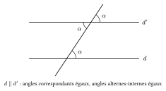
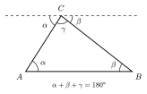
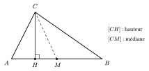

Deux droites sécantes forment quatre angles. Les angles opposés par le sommet sont égaux, et deux angles adjacents sur une même droite sont supplémentaires (leur somme vaut $180^\circ$). Lorsqu'une droite coupe deux droites parallèles, on retrouve les mêmes angles aux deux points d'intersection.

::: {.encadre #geo-angles nature="Propriété" titre="angles et droites parallèles"}
Une sécante coupe deux droites. Ces deux droites sont parallèles si et seulement si :

- deux angles **correspondants** sont égaux ;
- ou, de façon équivalente, deux angles **alternes-internes** sont égaux.
:::

{.th}

::: {.encadre #geo-triangle nature="Propriété" titre="somme des angles d'un triangle"}
La somme des amplitudes des angles d'un triangle vaut $180^\circ$ (ou $\pi$ radians).

Dans un triangle équilatéral, chaque angle vaut $60^\circ$ ; dans un triangle rectangle isocèle, les deux angles aigus valent $45^\circ$.
:::

La propriété se voit en traçant, par un sommet, la parallèle au côté opposé : les deux angles alternes-internes ainsi formés et l'angle du sommet remplissent un angle plat.

{.th}

::: {.encadre nature="Exemple"}
Un hexagone régulier se découpe, à partir de son centre, en $6$ triangles équilatéraux. Chaque angle de l'hexagone vaut donc $2\cdot 60^\circ=120^\circ$, et chaque côté a la même longueur que le rayon du cercle circonscrit.
:::

::: {.encadre #geo-perp nature="Définition" titre="droites perpendiculaires, médiatrice, hauteur"}
Deux droites sont **perpendiculaires** si elles se coupent en formant un angle droit.

La **médiatrice** d'un segment $[AB]$ est la droite perpendiculaire à $[AB]$ passant par son milieu ; c'est l'ensemble des points situés à égale distance de $A$ et de $B$.

La **hauteur** issue d'un sommet $C$ d'un triangle $ABC$ est la droite passant par $C$ et perpendiculaire à $(AB)$. Le point où elle coupe $(AB)$ est le **pied** de la hauteur.
:::

{.th}

::: {.encadre nature="Remarque" titre="hauteur et médiane"}
Le pied de la hauteur issue de $C$ n'est en général **pas** le milieu de $[AB]$. Il ne l'est que si le triangle est isocèle en $C$ ($CA=CB$).
:::
