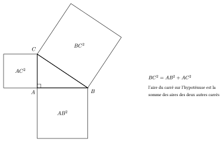
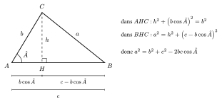

::: {.encadre #geo-pythagore nature="Propriété" titre="théorème de Pythagore"}
Le triangle $ABC$ est rectangle en $A$ si et seulement si $BC^2=AB^2+AC^2$.
:::

{.th}

::: {.encadre nature="Exemple"}
Un rectangle de côtés $9$ et $12$ a une diagonale de longueur $\sqrt{81+144}=\sqrt{225}=15$. Le triangle de côtés $3$, $4$, $5$ est rectangle car $9+16=25$.
:::

Dans un triangle quelconque, $BC^2$ n'est plus égal à $AB^2+AC^2$ : il faut tenir compte de l'angle en $A$. On note $a=BC$, $b=AC$, $c=AB$ et $\hat A$ l'angle en $A$. La hauteur $[CH]$ découpe le triangle en deux triangles rectangles, auxquels on applique Pythagore.

Dans le triangle $AHC$, rectangle en $H$ : $AH=b\cos\hat A$ et $h^2+AH^2=b^2$. Dans le triangle $BHC$ : $HB=c-AH$ et
$$a^2=h^2+(c-AH)^2=\underbrace{h^2+AH^2}_{b^2}+c^2-2c\cdot AH=b^2+c^2-2bc\cos\hat A.$$

{.th}

Si l'angle $\hat A$ est obtus, $H$ est en dehors du segment $[AB]$, du côté de $A$ : $HB=c+AH$ et $AH=-b\cos\hat A$, car $\cos\hat A<0$. Le calcul donne la même formule.

::: {.encadre #geo-alkashi nature="Propriété" titre="Pythagore généralisé (formule d'Al-Kashi)"}
Dans un triangle $ABC$ où $a=BC$, $b=AC$, $c=AB$ :
$$a^2=b^2+c^2-2bc\cos\hat A.$$
Si $\hat A=90^\circ$, $\cos\hat A=0$ et on retrouve Pythagore.
:::

::: {.encadre nature="Exemple"}
Si $\hat A=45^\circ$, alors $\cos\hat A=\frac{\sqrt2}{2}$ et $a^2=b^2+c^2-\sqrt2\,bc$. Si $\hat A=150^\circ$, alors $\cos\hat A=-\frac{\sqrt3}{2}$ et $a^2=b^2+c^2+\sqrt3\,bc$.
:::
