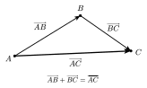
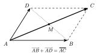
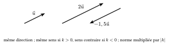
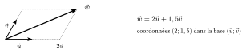

Un vecteur décrit un déplacement : il a une **direction** (celle d'une droite), un **sens** sur cette direction et une **norme** (une longueur). Le vecteur $\overrightarrow{AB}$ est le déplacement qui amène $A$ en $B$.

::: {.encadre #geo-vect-def nature="Définition" titre="égalité de vecteurs"}
Deux vecteurs sont **égaux** s'ils ont même direction, même sens et même norme.

$\overrightarrow{AB}=\overrightarrow{DC}$ si et seulement si $ABCD$ est un parallélogramme (éventuellement aplati).

Le vecteur $\overrightarrow{BA}$ est l'**opposé** de $\overrightarrow{AB}$ : $\overrightarrow{BA}=-\overrightarrow{AB}$.
:::

::: {.encadre nature="Exemple"}
Dans un parallélogramme $PQRS$ (sommets dans l'ordre), $\overrightarrow{PQ}=\overrightarrow{SR}$ et $\overrightarrow{PS}=\overrightarrow{QR}$. Dans un hexagone régulier, tous les côtés parallèles et de même sens représentent le même vecteur : on peut donc remplacer un vecteur par un autre, plus commode, qui lui est égal.
:::

Enchaîner deux déplacements, c'est les additionner : aller de $A$ en $B$ puis de $B$ en $C$ revient à aller de $A$ en $C$.

::: {.encadre #geo-chasles nature="Propriété" titre="relation de Chasles"}
Pour tous points $A$, $B$, $C$ :
$$\overrightarrow{AB}+\overrightarrow{BC}=\overrightarrow{AC}.$$
Pour une différence de deux vecteurs de même origine :
$$\overrightarrow{AC}-\overrightarrow{AB}=\overrightarrow{BC}.$$
:::

{.th}

::: {.encadre nature="Exemple"}
$\overrightarrow{AB}+\overrightarrow{CA}=\overrightarrow{CA}+\overrightarrow{AB}=\overrightarrow{CB}$. Pour tout point $O$ : $\overrightarrow{AB}=\overrightarrow{OB}-\overrightarrow{OA}$.
:::

::: {.encadre #geo-parallelogramme nature="Propriété" titre="règle du parallélogramme"}
Si $ABCD$ est un parallélogramme, alors $\overrightarrow{AB}+\overrightarrow{AD}=\overrightarrow{AC}$ et $\overrightarrow{AD}-\overrightarrow{AB}=\overrightarrow{BD}$.

Ses diagonales se coupent en leur milieu $M$ : $\overrightarrow{MC}=-\overrightarrow{MA}$ et $\overrightarrow{MD}=-\overrightarrow{MB}$.
:::

{.th}

::: {.encadre #geo-mult nature="Définition" titre="multiplication par un réel, colinéarité"}
Pour un réel $k$ et un vecteur $\vec u$ non nul, $k\,\vec u$ a la même direction que $\vec u$, le même sens si $k>0$ et le sens contraire si $k<0$, et pour norme $|k|\,\|\vec u\|$.

Deux vecteurs sont **colinéaires** si l'un est un multiple de l'autre. Trois points $A$, $B$, $C$ sont alignés si et seulement si $\overrightarrow{AB}$ et $\overrightarrow{AC}$ sont colinéaires.
:::

{.th}

::: {.encadre #geo-milieu nature="Propriété" titre="milieu d'un segment"}
$M$ est le milieu de $[AB]$ si et seulement si $\overrightarrow{AM}=\frac12\overrightarrow{AB}$, ou encore $\overrightarrow{MA}+\overrightarrow{MB}=\vec 0$.
:::

Dans le plan, deux vecteurs non colinéaires $\vec u$ et $\vec v$ suffisent pour atteindre n'importe quel point : on avance d'un certain nombre de fois $\vec u$, puis d'un certain nombre de fois $\vec v$.

::: {.encadre #geo-base nature="Définition" titre="base et coordonnées"}
Deux vecteurs non colinéaires $\vec u$ et $\vec v$ forment une **base** du plan. Tout vecteur $\vec w$ s'écrit alors d'une seule façon $\vec w=x\,\vec u+y\,\vec v$ (on dit que $\vec w$ est une **combinaison linéaire** de $\vec u$ et $\vec v$). Les réels $x$ et $y$ sont les **coordonnées** de $\vec w$ dans cette base.
:::

{.th}

::: {.encadre nature="Exemple"}
Dans un triangle $ABC$, soit $M$ le milieu de $[BC]$. Dans la base $\left(\overrightarrow{AB};\overrightarrow{AC}\right)$ :
$$\overrightarrow{AM}=\overrightarrow{AB}+\overrightarrow{BM}=\overrightarrow{AB}+\tfrac12\overrightarrow{BC}=\overrightarrow{AB}+\tfrac12\left(\overrightarrow{AC}-\overrightarrow{AB}\right)=\tfrac12\overrightarrow{AB}+\tfrac12\overrightarrow{AC}.$$
Les coordonnées de $\overrightarrow{AM}$ dans cette base sont $\left(\frac12;\frac12\right)$. La méthode : passer par Chasles, puis remplacer chaque vecteur qui n'est pas dans la base par une combinaison des vecteurs de la base.
:::

Dans un repère, on utilise la base formée des vecteurs unités des axes. Les coordonnées d'un vecteur sont alors les déplacements horizontal et vertical.

::: {.encadre #geo-coord nature="Propriété" titre="coordonnées dans un repère"}
Si $A(x_A;y_A)$ et $B(x_B;y_B)$ :
$$\overrightarrow{AB}=(x_B-x_A\,;\,y_B-y_A)\qquad\text{et le milieu de }[AB]\text{ est }\left(\frac{x_A+x_B}{2};\frac{y_A+y_B}{2}\right).$$
On additionne deux vecteurs et on les multiplie par un réel coordonnée par coordonnée.
:::

::: {.encadre nature="Exemple"}
Avec $A(1;3)$ et $B(4;-1)$ : $\overrightarrow{AB}=(3;-4)$ et $3\overrightarrow{AB}=(9;-12)$. Le quatrième sommet $D$ du parallélogramme $ABCD$ vérifie $\overrightarrow{AD}=\overrightarrow{BC}$, donc $D=A+C-B$ (coordonnée par coordonnée).
:::
