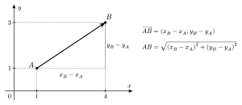
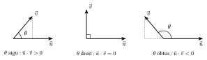

Une base est **orthonormée** si ses deux vecteurs sont perpendiculaires et de norme $1$. Les repères des questions sont presque toujours orthonormés ; c'est indispensable pour calculer des longueurs avec les coordonnées, car on applique alors Pythagore.

::: {.encadre #geo-norme nature="Propriété" titre="norme et distance dans une base orthonormée"}
Si $\vec u=(x;y)$ dans une base orthonormée : $\|\vec u\|=\sqrt{x^2+y^2}$.

La distance entre $A$ et $B$ vaut $AB=\left\|\overrightarrow{AB}\right\|=\sqrt{(x_B-x_A)^2+(y_B-y_A)^2}$.
:::

{.th}

::: {.encadre nature="Remarque" titre="la norme d'une somme"}
Une norme est toujours positive ou nulle. Pour un réel $k$, $\|k\,\vec u\|=|k|\,\|\vec u\|$. Par contre, $\|\vec u+\vec v\|$ n'est en général **pas** égal à $\|\vec u\|+\|\vec v\|$ : on calcule d'abord les coordonnées de $\vec u+\vec v$, puis sa norme.
:::

::: {.encadre #geo-ps-def nature="Définition" titre="produit scalaire"}
Le **produit scalaire** de deux vecteurs non nuls $\vec u$ et $\vec v$ qui forment un angle $\theta$ est le réel
$$\vec u\cdot\vec v=\|\vec u\|\,\|\vec v\|\cos\theta.$$
Si l'un des vecteurs est nul, $\vec u\cdot\vec v=0$.
:::

Le produit scalaire est positif si l'angle est aigu, négatif s'il est obtus, et nul si l'angle est droit. En développant comme un produit, on obtient une formule de calcul avec les coordonnées : dans une base orthonormée $(\vec\imath;\vec\jmath)$, on a $\vec\imath\cdot\vec\imath=\vec\jmath\cdot\vec\jmath=1$ et $\vec\imath\cdot\vec\jmath=0$.

{.th}

::: {.encadre #geo-ps-prop nature="Propriété" titre="calcul du produit scalaire"}
Pour tous vecteurs $\vec u$, $\vec v$, $\vec w$ et tout réel $k$ :
$$\vec u\cdot\vec v=\vec v\cdot\vec u,\qquad \vec u\cdot(\vec v+\vec w)=\vec u\cdot\vec v+\vec u\cdot\vec w,\qquad (k\vec u)\cdot\vec v=k\,(\vec u\cdot\vec v),\qquad \vec u\cdot\vec u=\|\vec u\|^2.$$
Dans une base orthonormée, si $\vec u=(x;y)$ et $\vec v=(x';y')$ : $\vec u\cdot\vec v=xx'+yy'$.
:::

::: {.encadre #geo-ortho nature="Propriété" titre="orthogonalité"}
Deux vecteurs sont orthogonaux si et seulement si leur produit scalaire est nul : $\vec u\perp\vec v\iff\vec u\cdot\vec v=0$.
:::

::: {.encadre nature="Exemple"}
Dans un carré $ABCD$ de côté $3$, $\overrightarrow{AB}$ et $\overrightarrow{AC}$ forment un angle de $45^\circ$ et $AC=3\sqrt2$, donc $\overrightarrow{AB}\cdot\overrightarrow{AC}=3\cdot3\sqrt2\cdot\frac{\sqrt2}{2}=9$. Avec des coordonnées $A(0;0)$, $B(3;0)$, $C(3;3)$ : $(3;0)\cdot(3;3)=9$.
:::

::: {.encadre nature="Remarque" titre="Al-Kashi avec le produit scalaire"}
Avec $a=BC$, $b=AC$, $c=AB$ : $a^2=\overrightarrow{BC}\cdot\overrightarrow{BC}=\left(\overrightarrow{AC}-\overrightarrow{AB}\right)\cdot\left(\overrightarrow{AC}-\overrightarrow{AB}\right)=b^2+c^2-2\,\overrightarrow{AB}\cdot\overrightarrow{AC}=b^2+c^2-2bc\cos\hat A$.

Ce calcul retrouve la formule d'Al-Kashi ([Propriété 2.2.2](02-pythagore.qmd#geo-alkashi)), mais il ne la démontre pas : il utilise la distributivité du produit scalaire, admise ici, et la justifier avec les coordonnées ($xx'+yy'$, $\sqrt{x^2+y^2}$) demande Pythagore.
:::

::: {.encadre nature="Remarque" titre="décomposer avec Chasles"}
Pour calculer un produit scalaire dans une figure, on décompose les vecteurs en vecteurs dont on connaît les normes et les angles (souvent des vecteurs orthogonaux), puis on développe. Ainsi, si $\vec u\perp\vec v$ : $(\vec u+\vec v)\cdot(\vec u-\vec v)=\|\vec u\|^2-\|\vec v\|^2$.
:::
