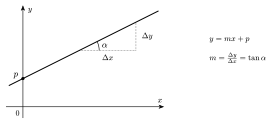
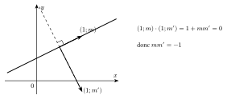

Une droite non verticale monte ou descend régulièrement : quand on avance de $1$ horizontalement, on monte toujours de la même quantité $m$, sa **pente**.

::: {.encadre #geo-droite-eq nature="Propriété" titre="équations d'une droite"}
- Une droite non verticale a une équation de la forme $y=mx+p$ : $m$ est sa **pente** et $p$ son **ordonnée à l'origine** (elle passe par $(0;p)$).
- Une droite verticale a une équation de la forme $x=k$.
- Toute droite a une équation **cartésienne** $ax+by+c=0$, avec $a$ et $b$ non tous deux nuls. Si $b\neq0$, sa pente vaut $-\dfrac{a}{b}$.
:::

::: {.encadre #geo-pente nature="Propriété" titre="pente, tangente et vecteur directeur"}
La pente de la droite passant par $A(x_A;y_A)$ et $B(x_B;y_B)$, avec $x_A\neq x_B$, vaut
$$m=\frac{y_B-y_A}{x_B-x_A}.$$
Si la droite fait un angle $\alpha$ avec l'axe des abscisses, $m=\tan\alpha$. Le vecteur $(1;m)$ est un vecteur directeur de la droite.
:::

{.th}

::: {.encadre #geo-droite-point nature="Propriété" titre="droite de pente donnée passant par un point"}
La droite de pente $m$ passant par le point $(x_0;y_0)$ a pour équation
$$y-y_0=m\,(x-x_0).$$
:::

::: {.encadre nature="Exemple"}
La droite passant par $(0;4)$ et $(3;0)$ a pour pente $\dfrac{0-4}{3-0}=-\dfrac43$ et pour équation $y=-\dfrac43x+4$, ou encore $4x+3y-12=0$.
:::

Deux droites parallèles montent de la même façon : elles ont la même pente. Pour deux droites perpendiculaires, on utilise des vecteurs directeurs $(1;m)$ et $(1;m')$ : leur produit scalaire $1+mm'$ doit être nul.

::: {.encadre #geo-par-perp nature="Propriété" titre="droites parallèles, droites perpendiculaires"}
Deux droites non verticales de pentes $m$ et $m'$ sont :

- **parallèles** si et seulement si $m=m'$ ;
- **perpendiculaires** si et seulement si $m\cdot m'=-1$, c'est-à-dire $m'=-\dfrac{1}{m}$.
:::

{.th}

::: {.encadre nature="Exemple"}
La droite de pente $3$ a pour perpendiculaires les droites de pente $-\frac13$. La perpendiculaire à $y=3x+2$ passant par $(1;4)$ a pour équation $y-4=-\frac13(x-1)$.
:::

::: {.encadre nature="Remarque" titre="inverse et opposé"}
La pente d'une perpendiculaire est l'**opposé de l'inverse** : il faut à la fois inverser et changer le signe. Prendre seulement l'inverse ou seulement l'opposé est l'erreur la plus fréquente.
:::

::: {.encadre #geo-intersection nature="Propriété" titre="intersection de deux droites"}
Le point d'intersection de deux droites a des coordonnées qui vérifient les deux équations : on résout le système formé par ces équations. Avec deux équations $y=mx+p$ et $y=m'x+p'$, on égale les seconds membres.
:::

::: {.encadre nature="Exemple"}
Pied de la perpendiculaire : soit $d\equiv y=x+1$ et $A(5;0)$. La perpendiculaire à $d$ par $A$ a pour pente $-1$ : $y=-(x-5)=5-x$. On égale : $x+1=5-x$, d'où $x=2$ et $y=3$. Le point $(2;3)$ est le pied de la perpendiculaire, c'est le point de $d$ le plus proche de $A$.
:::
