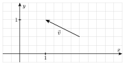
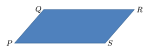
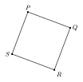

::::: {.qcm .exo #geo-e01 source="Examen 2021" reponse="C" theorie=""}
<!-- support 2026 : Q65 -->
Dans le plan muni d'un repère orthonormé $(OX;OY)$, on considère les points $A(1;2)$, $B(x;8)$ et $C(10;y)$ tels que $2\overrightarrow{AB} = \overrightarrow{BC}$. Que vaut $(x;y)$?

::: options
- $(2;16)$
- $(4;16)$
- $(4;20)$
- $(8;20)$
:::

:::::

::::: {.qcm .exo #geo-e02 source="Examen 2018" reponse="A" theorie=""}
<!-- support 2026 : Q66 -->
Dans le plan muni d'un repère orthonormé, on considère les trois droites suivantes :

- la droite $d_1$ d'équation $x+y=-2$;
- la droite $d_2$ d'équation $x=-2$;
- la droite $d_3$ d'équation $y-x=4$.

 Soit également, $A$ le point d'intersection entre les droites $d_1$ et $d_2$ et $B$ le point d'intersection entre $d_1$ et $d_3$.

 Quelle est la norme du vecteur $\overrightarrow{AB}$?

::: options
- $\sqrt{2}$
- $2$
- $\sqrt{10}$
- $\sqrt{26}$
:::

:::::

::::: {.qcm .exo #geo-e03 source="Examen 2017" reponse="C" theorie=""}
<!-- support 2026 : Q67 -->
Dans le plan muni d'un système d'axes orthonormés, on considère une droite $L$ de pente négative qui coupe l'axe des ordonnées au point $(0;2)$. On considère également le triangle $D$ formé par $L$, l'axe des abscisses et l'axe des ordonnées. Si l'aire de $D$ vaut $6$ unités, quelles sont les coordonnées du point d'intersection de $L$ avec l'axe des abscisses?

::: options
- $(0;0)$
- $(2;0)$
- $(6;0)$
- $(0;-2)$
:::

:::::

::::: {.qcm .exo #geo-e04 source="Examen 2022" reponse="C" theorie=""}
<!-- support 2026 : Q68 -->
Dans le plan muni d'un repère cartésien orthonormé, on considère la courbe $(C)$ d'équation $y=2x^2-8$. Soit $d_1$ la droite tangente à $(C)$ au point d'abscisse $x=1$ et $d_2$ la droite d'équation $y=-x$.

Quelles sont les coordonnées du point d'intersection de $d_1$ et $d_2$?

::: options
- ${\displaystyle (0;0)}$
- ${\displaystyle (1;-1)}$
- ${\displaystyle (2;-2)}$
- ${\displaystyle \left(\frac{\sqrt{33}-1}{2};-\frac{\sqrt{33}-1}{2}\right)}$
:::

:::::

::::: {.qcm .exo #geo-e05 source="Examen 2020" reponse="B" theorie=""}
<!-- support 2026 : Q69 -->
Dans le plan muni d'un repère orthonormé $(OX;OY)$, on considère la droite $d_1$ d'équation $y+2x-10=0$ et la droite $d_2$ parallèle à $d_1$ et passant par $A(2;2)$.

Quelle sont les coordonnées de l'intersection de $d_2$ avec l'axe $OY$?

::: options
- $(0;11/2)$
- $(0;6)$
- $(5;0)$
- $(6;0)$
:::

:::::

::::: {.qcm .exo #geo-e06 source="Prépa UMONS" reponse="D" theorie=""}
<!-- support 2026 : Q70 -->
Considérons le vecteur $\vec v$ représenté dans le repère cartésien donné ci-après.

 Parmi les propositions suivantes, laquelle est correcte?

::: options
- $\vec v = \begin{pmatrix}-1\\1/2\end{pmatrix}$
- $\vec v = \begin{pmatrix}4/3\\1/2\end{pmatrix}$
- $\vec v = \begin{pmatrix}1\\-1/2\end{pmatrix}$
- $\vec v = \begin{pmatrix}-4/3\\1/2\end{pmatrix}$
:::

:::::

::::: {.qcm .exo #geo-e07 source="Examen 2018" reponse="C" theorie=""}
<!-- support 2026 : Q71 -->
Dans le plan muni d'un repère orthonormé, on considère la droite $d$ d'équation $3y=2x+1$ et le point $A$ de coordonnées $(-3;1)$.

Parmi les propositions suivantes, une seule peut correspondre à une équation de la droite perpendiculaire à $d$ passant par $A$. Laquelle?

::: options
- $2y=-x-1$
- $2y=-3x-8$
- $2y=-3x-7$
- $2y=3x+11$
:::

:::::

::::: {.qcm .exo #geo-e08 source="Examen 2024" reponse="A" theorie=""}
<!-- support 2026 : Q72 -->
Dans le plan muni d'un repère cartésien $Oxy$, on considère la droite $d$ passant par le point $(1;5)$ et parallèle à la droite passant par les points $(0;240)$ et $(120;0)$. Quelle est l'abscisse de l'intersection entre la droite $d$ et l'axe $Ox$?

::: options
- $14/4$
- $9/2$
- $22/4$
- $13/2$
:::

:::::

::::: {.qcm .exo #geo-e09 source="Examen 2023" reponse="C" theorie=""}
<!-- Examen 2023 (matin) : maths Q9 -->
Dans un plan muni d'un repère cartésien orthonormé, on considère la droite qui passe par les points $(0;16)$ et $(10;0)$. On considère également une autre droite passant par l'origine et de pente $3/5$.

Que vaut l'abscisse $x$ du point d'intersection de ces deux droites?

::: options
- $80/12$
- $81/12$
- $80/11$
- $81/11$
:::

:::::

::::: {.qcm .exo #geo-e10 source="Examen 2023" reponse="D" theorie=""}
<!-- Examen 2023 (matin) : maths Q10 -->
Le dessin ci-dessous représente le parallélogramme $PQRS$ (les droites $PQ$ et $SR$ sont parallèles et les droites $PS$ et $QR$ sont parallèles). Notons $M$ le milieu du segment $[P,S]$ et $N$ le milieu du segment $[P,Q]$.

Parmi les propositions suivantes, laquelle exprime correctement le vecteur $2\overrightarrow{MN}$ comme combinaison linéaire des vecteurs $\overrightarrow{PS}$ et $\overrightarrow{RS}$?

::: options
- $2\overrightarrow{MN}=\overrightarrow{PS}+\overrightarrow{RS}$
- $2\overrightarrow{MN}=-\overrightarrow{PS}+\overrightarrow{RS}$
- $2\overrightarrow{MN}=\overrightarrow{PS}-\overrightarrow{RS}$
- $2\overrightarrow{MN}=-\overrightarrow{PS}-\overrightarrow{RS}$
:::

:::::

::::: {.qcm .exo #geo-e11 source="Examen 2025" reponse="B" theorie=""}
<!-- Examen 2025 (matin) : maths Q7 -->
Dans un plan muni d'un repère cartésien orthonormé, considérons la droite $d$ de pente $m=\sqrt{2}$ passant par le point $(-3;\sqrt{2})$ et la droite $d'$ perpendiculaire à $d$ et passant par le point $(0;3)$.

Que vaut l'abscisse du point d'intersection de $d'$ avec l'axe des abscisses?

::: options
- $\dfrac{3}{\sqrt{2}}$
- $3\sqrt{2}$
- $3+\sqrt{2}$
- $3-\sqrt{2}$
:::

:::::

::::: {.qcm .exo #geo-e12 source="Examen 2025" reponse="B" theorie=""}
<!-- Examen 2025 (matin) : maths Q10 -->
Dans le plan euclidien, on considère quatre points $P$, $Q$, $R$, $S$ qui forment un carré $PQRS$ de côtés de longueur $2$.

Que vaut le produit scalaire $\overrightarrow{PQ}\cdot\overrightarrow{RP}$?

::: options
- $4$
- $-4$
- $-2$
- $2$
:::

:::::

::::: {.qcm .exo #geo-e13 source="Examen 2026" reponse="C" theorie=""}
<!-- Examen 2026 (matin) : maths Q1 -->
On donne trois points $P$, $Q$ et $R$ tels que les vecteurs $\overrightarrow{PQ}$ et $\overrightarrow{QR}$ sont orthogonaux et chacun de norme unité.

Si $M$ désigne le milieu du segment $[P,Q]$, que vaut le produit scalaire de $\overrightarrow{PM}$ et de $\overrightarrow{MR}$?

::: options
- $-1/2$
- $-1/4$
- $1/4$
- $1/2$
:::

:::::

::::: {.qcm .exo #geo-e14 source="Examen 2026" reponse="A" theorie=""}
<!-- Examen 2026 (matin) : maths Q8 -->
Dans un plan muni d'un repère cartésien $Oxy$, on considère la droite $d$ passant par le point $(3;0)$ et parallèle à la droite qui passe par les deux points $(210;10)$ et $(220;5)$.

Parmi les propositions ci-dessous, quelle est celle qui correspond à une équation cartésienne de la droite $d$?

::: options
- $x+2y=3$
- $2x+y=6$
- $2x-y=6$
- $x-2y=3$
:::

:::::

::::: {.qcm .exo #geo-e15 source="Prépa UMONS" reponse="A" theorie="geo-ortho geo-coord"}
<!-- Simulation août 2026 (simulation-2026/simulation_medecine.typ) : question 2 -->
Dans un repère orthonormé, on considère les points $A(0;0)$, $B(2;1)$ et $C(t;2)$, où $t$ est un nombre réel.

On considère le triangle $ABC$. Quelle affirmation est correcte ?

::: options
- Le triangle est rectangle pour exactement deux valeurs distinctes de $t$.
- Le triangle n'est jamais rectangle.
- Le triangle est équilatéral pour exactement une valeur de $t$.
- Le triangle est isocèle pour exactement une valeur de $t$.
:::

:::::

::::: {.qcm .exo #geo-e16 source="Prépa UMONS" reponse="D" theorie="geo-par-perp geo-droite-point"}
<!-- Simulation août 2026 (simulation-2026/simulation_medecine.typ) : question 3 -->
On considère les points $A(2;1)$, $B(8;4)$ et $C(-3;-1)$. Soit $d$ la droite perpendiculaire à $AB$ et passant par $C$. Soit $M\in d$ tel que son ordonnée vaut $14$. Que vaut l'abscisse de $M$ ?

::: options
- ${\displaystyle -\frac{15}{2}}$
- ${\displaystyle \frac{21}{2}}$
- $-17$
- ${\displaystyle -\frac{21}{2}}$
:::

:::::
