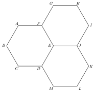

Résous d'abord les questions sur papier, sans calculatrice. Les solutions sont publiées à la fin de la phase d'entraînement.

<!-- Ticket de sortie : les jumeaux apparaissent quand la page de pilotage les sélectionne (etat.json). -->

:::::: ticket

::::: {.qcm .jumeau #geo-j01 source="Prépa UMONS" reponse="C" theorie="geo-vect-def geo-chasles" jumeau-de="geo-q01"}
On considère un hexagone régulier $ABCDEF$ (sommets nommés dans l'ordre) de centre $O$. Parmi les égalités vectorielles suivantes, une seule est vraie. Laquelle ?

::: options
- $\overrightarrow{AC}-\overrightarrow{AE}=\overrightarrow{CE}$
- $\overrightarrow{AB}+\overrightarrow{CD}=\overrightarrow{AD}$
- $\overrightarrow{AD}=2\,\overrightarrow{BC}$
- $\overrightarrow{BD}+\overrightarrow{CE}=\overrightarrow{AF}$
:::

::: details
Réponse C. La grande diagonale $[AD]$ est parallèle au côté $[BC]$, de même sens, et deux fois plus longue : $\overrightarrow{AD}=2\,\overrightarrow{BC}$.

Les autres égalités sont fausses. Par Chasles, $\overrightarrow{AC}-\overrightarrow{AE}=\overrightarrow{EC}$, qui est l'opposé de $\overrightarrow{CE}$. Ensuite, $\overrightarrow{AD}=\overrightarrow{AB}+\overrightarrow{BC}+\overrightarrow{CD}$, donc $\overrightarrow{AB}+\overrightarrow{CD}=\overrightarrow{AD}-\overrightarrow{BC}\neq\overrightarrow{AD}$. Enfin, si le côté vaut $1$, le vecteur $\overrightarrow{BD}+\overrightarrow{CE}$ a pour norme $3$ alors que $\overrightarrow{AF}$ a pour norme $1$.

:::

:::::

::::: {.qcm .jumeau #geo-j02 source="Prépa UMONS" reponse="A" theorie="geo-pente geo-par-perp" jumeau-de="geo-q02"}
Dans le plan muni d'un repère orthonormé, on considère la droite passant par les points $(0;5)$ et $(2;0)$. On considère également une autre droite d'équation $50x+ky+9=0$ où $k$ est un paramètre.

Pour quelle valeur de $k$ ces deux droites sont-elles perpendiculaires ?

::: options
- $k=-125$
- $k=-20$
- $k=20$
- $k=125$
:::

::: details
Réponse A. La première droite a pour pente $\dfrac{0-5}{2-0}=-\dfrac52$. La seconde a pour pente $-\dfrac{50}{k}$. Deux droites sont perpendiculaires lorsque le produit de leurs pentes vaut $-1$ : $\left(-\dfrac52\right)\left(-\dfrac{50}{k}\right)=\dfrac{125}{k}=-1$, donc $k=-125$.

Pour $k=20$, les pentes sont égales (droites parallèles).

:::

:::::

::::: {.qcm .jumeau #geo-j03 source="Prépa UMONS" reponse="C" theorie="geo-par-perp geo-droite-point" jumeau-de="geo-q03"}
Dans un repère cartésien orthonormé $Oxy$, considérons la droite $d_1$ d'équation $y=3x+2$ et la droite $d_2$ perpendiculaire à $d_1$ et la coupant au point de coordonnées $(4;7)$.

Quelles sont les coordonnées du point d'intersection de $d_2$ avec l'axe $Oy$ ?

::: options
- {\displaystyle \left(0;{\displaystyle \frac{17}{3}}\right)}
- {\displaystyle \left(0;{\displaystyle \frac{22}{3}}\right)}
- {\displaystyle \left(0;{\displaystyle \frac{25}{3}}\right)}
- {\displaystyle \left(0;{\displaystyle \frac{28}{3}}\right)}
:::

::: details
Réponse C. La droite $d_2$ a pour pente $-\dfrac13$ (opposé de l'inverse de $3$) et passe par $(4;7)$ : $y-7=-\dfrac13(x-4)$. Pour $x=0$, $y=7+\dfrac43=\dfrac{25}{3}$.

:::

:::::

::::: {.qcm .jumeau #geo-j04 source="Prépa UMONS" reponse="B" theorie="geo-perp geo-ortho geo-coord" jumeau-de="geo-q04"}
Dans le plan muni d'un repère orthonormé, on considère les points $A$ de coordonnées $(1;1)$, $B$ de coordonnées $(7;3)$ et $C$ de coordonnées $(4;7)$. Considérons également le point $H$ correspondant au pied de la hauteur issue de $C$ dans le triangle $ABC$.

Quelles sont les coordonnées de $H$ ?

::: options
- {\displaystyle \left({\displaystyle \frac{5}{2}};{\displaystyle \frac{11}{2}}\right)}
- {\displaystyle \left({\displaystyle \frac{11}{2}};{\displaystyle \frac{5}{2}}\right)}
- {\displaystyle \left(4;2\right)}
- {\displaystyle \left(6;3\right)}
:::

::: details
Réponse B. Le vecteur $\overrightarrow{AB}=(6;2)$ a même direction que $(3;1)$, donc $H=(1+3t;\,1+t)$ pour un réel $t$. Comme $\overrightarrow{CH}=(3t-3;\,t-6)$ est perpendiculaire à $\overrightarrow{AB}$, on a $3(3t-3)+(t-6)=0$, soit $10t=15$ et $t=\dfrac32$. Donc $H=\left(\dfrac{11}{2};\dfrac52\right)$.

Contrôle : $H$ est sur $(AB)$, de pente $\dfrac13$, car $\dfrac{5/2-1}{11/2-1}=\dfrac13$.

:::

:::::

::::: {.qcm .jumeau #geo-j05 source="Prépa UMONS" reponse="C" theorie="geo-base geo-parallelogramme" jumeau-de="geo-q05"}
On considère quatre points $P$, $Q$, $R$ et $S$ formant un parallélogramme tel que $\overrightarrow{PQ}$ a la même direction que $\overrightarrow{SR}$ et $\overrightarrow{PS}$ a la même direction que $\overrightarrow{QR}$.

Parmi les expressions suivantes, quelle est celle qui exprime le vecteur $\overrightarrow{QS}-3\overrightarrow{PQ}$ comme une combinaison linéaire des vecteurs $\overrightarrow{PS}$ et $\overrightarrow{PR}$ ?

::: options
- ${\displaystyle -3\overrightarrow{PS}+4\overrightarrow{PR}}$
- ${\displaystyle 4\overrightarrow{PS}-5\overrightarrow{PR}}$
- ${\displaystyle 5\overrightarrow{PS}-4\overrightarrow{PR}}$
- ${\displaystyle -5\overrightarrow{PS}+4\overrightarrow{PR}}$
:::

::: details
Réponse C. On a $\overrightarrow{QS}=\overrightarrow{QP}+\overrightarrow{PS}=-\overrightarrow{PQ}+\overrightarrow{PS}$, donc $\overrightarrow{QS}-3\overrightarrow{PQ}=\overrightarrow{PS}-4\overrightarrow{PQ}$. Dans le parallélogramme, $\overrightarrow{PR}=\overrightarrow{PQ}+\overrightarrow{PS}$, donc $\overrightarrow{PQ}=\overrightarrow{PR}-\overrightarrow{PS}$. Ainsi $\overrightarrow{PS}-4(\overrightarrow{PR}-\overrightarrow{PS})=5\overrightarrow{PS}-4\overrightarrow{PR}$.

:::

:::::

::::: {.qcm .jumeau #geo-j06 source="Prépa UMONS" reponse="C" theorie="geo-intersection geo-norme" jumeau-de="geo-q06"}
Dans le plan muni d'un repère orthonormé, on considère les trois droites suivantes : $d_1\equiv y=2x$, ${\displaystyle d_2\equiv y=\frac{x}{2}}$ et $d_3\equiv y=6-x$. Soient $A$ le point d'intersection de $d_1$ et $d_2$, $B$ le point d'intersection de $d_2$ et $d_3$ et $C$ le point d'intersection de $d_1$ et $d_3$. Que vaut le périmètre du triangle $ABC$ ?

::: options
- $\sqrt{48}$
- $\sqrt{8}+\sqrt{20}$
- $\sqrt{8}+2\sqrt{20}$
- $2\sqrt{8}+\sqrt{20}$
:::

::: details
Réponse C. On obtient $A(0;0)$ (de $2x=\frac x2$), $B(4;2)$ (de $\frac x2=6-x$) et $C(2;4)$ (de $2x=6-x$). Alors $AB=\sqrt{16+4}=\sqrt{20}$, $AC=\sqrt{4+16}=\sqrt{20}$ et $BC=\sqrt{4+4}=\sqrt8$. Le périmètre vaut $\sqrt8+2\sqrt{20}$.

:::

:::::

::::: {.qcm .jumeau #geo-j07 source="Prépa UMONS" reponse="B" theorie="geo-par-perp geo-intersection" jumeau-de="geo-q07"}
Dans le plan muni d'un repère orthonormé, on considère la droite $d_1$ d'équation $y+3x-6=0$ ainsi que la droite $d_2$ perpendiculaire à $d_1$ et passant par le point $A(8;2)$.

Quelles sont les coordonnées du point d'intersection de $d_1$ et $d_2$ ?

::: options
- $(0;-2/3)$
- $(2;0)$
- $(0;2)$
- $(-2;0)$
:::

::: details
Réponse B. La droite $d_1$ s'écrit $y=6-3x$ ; sa pente est $-3$, donc $d_2$ a pour pente $\dfrac13$ et pour équation $y-2=\dfrac{x-8}{3}$, soit $y=\dfrac x3-\dfrac23$. En égalant : $\dfrac x3-\dfrac23=6-3x$, donc $x-2=18-9x$, $x=2$ et $y=0$.

L'ordonnée à l'origine de $d_2$ est $-\dfrac23$, ce qui donne la proposition $(0;-2/3)$.

:::

:::::

::::: {.qcm .jumeau #geo-j08 source="Prépa UMONS" reponse="B" theorie="geo-parallelogramme geo-chasles" jumeau-de="geo-q08"}
On considère dans le plan quatre points $A$, $B$, $C$ et $D$ formant un parallélogramme $ABCD$ et $O$ le milieu des deux diagonales $[AC]$ et $[BD]$.

Quelle est l'égalité correcte parmi les quatre propositions suivantes ?

::: options
- $\overrightarrow{DC}=\overrightarrow{OA}-\overrightarrow{OB}$
- $\overrightarrow{DC}=\overrightarrow{OB}-\overrightarrow{OA}$
- $\overrightarrow{DC}=\overrightarrow{BO}-\overrightarrow{AO}$
- $\overrightarrow{DC}=\overrightarrow{OB}-\overrightarrow{AB}$
:::

::: details
Réponse B. Comme $O$ est le milieu de $[AC]$ et de $[BD]$, on a $\overrightarrow{OC}=-\overrightarrow{OA}$ et $\overrightarrow{OD}=-\overrightarrow{OB}$. Donc $\overrightarrow{DC}=\overrightarrow{OC}-\overrightarrow{OD}=-\overrightarrow{OA}+\overrightarrow{OB}=\overrightarrow{OB}-\overrightarrow{OA}$ (c'est aussi $\overrightarrow{AB}$).

Les propositions A et C valent $\overrightarrow{OA}-\overrightarrow{OB}=\overrightarrow{BA}$, l'opposé de $\overrightarrow{DC}$. La proposition D vaut $\overrightarrow{OB}-(\overrightarrow{OB}-\overrightarrow{OA})=\overrightarrow{OA}$.

:::

:::::

::::: {.qcm .jumeau #geo-j09 source="Prépa UMONS" reponse="C" theorie="geo-vect-def geo-coord" jumeau-de="geo-q09"}
Dans le plan cartésien orthonormé, on considère le parallélogramme de sommets $A(1;2)$, $B(4;6)$, $C(\alpha;\beta)$ et $D(40;5)$, où les constantes $\alpha$ et $\beta$ vérifient $\alpha>40$ et $\beta>6$.

Que vaut $(\alpha;\beta)$ ?

::: options
- $(41;7)$
- $(43;11)$
- $(43;9)$
- $(44;11)$
:::

::: details
Réponse C. Les trois dispositions possibles du quatrième sommet donnent $C=B+D-A=(43;9)$, $C=A+D-B=(37;1)$ ou $C=A+B-D=(-35;3)$. Seul le premier vérifie $\alpha>40$ et $\beta>6$.

Vérification : $\overrightarrow{AB}=(3;4)$ et $\overrightarrow{DC}=(43-40;\,9-5)=(3;4)$.

:::

:::::

::::: {.qcm .jumeau #geo-j10 source="Prépa UMONS" reponse="C" theorie="geo-coord geo-norme" jumeau-de="geo-q10"}
Dans le plan muni d'un repère orthonormé, on considère les points $A(1;0)$, $B(4;4)$ et $C(-10;11)$. Posons $\vec v=2\overrightarrow{AB}+\overrightarrow{BC}$. Parmi les propositions suivantes, laquelle est correcte ?

::: options
- $\|-3\vec v\|=33\sqrt{2}$
- $\|-3\vec v\|=30+21\sqrt{5}$
- $\|-3\vec v\|=51$
- $\|-3\vec v\|=-\sqrt{2601}$
:::

::: details
Réponse C. On a $\overrightarrow{AB}=(3;4)$ et $\overrightarrow{BC}=(-14;7)$, donc $\vec v=(6-14;\,8+7)=(-8;15)$ et $\|\vec v\|=\sqrt{64+225}=17$. Alors $\|-3\vec v\|=3\|\vec v\|=51$.

Une norme est positive, ce qui écarte $-\sqrt{2601}=-51$. La norme d'une somme n'est pas la somme des normes (proposition B), et la proposition A vient de l'oubli du facteur $2$ devant $\overrightarrow{AB}$.

:::

:::::

::::::

::::: {.qcm #geo-q01 source="Examen 2017" reponse="B" theorie="geo-vect-def geo-chasles"}
<!-- support 2026 : Q11 -->
La figure ci-dessous est composée de trois hexagones réguliers identiques.

 Parmi les égalités vectorielles suivantes, une seule est vraie. Laquelle?

::: options
- $\overrightarrow{FD} - \overrightarrow{FE} = \overrightarrow{AJ}$
- $\overrightarrow{AG} + \overrightarrow{DL} = \overrightarrow{CK}$
- $\overrightarrow{BD} + \overrightarrow{FI} = \overrightarrow{AJ}$
- $\overrightarrow{AD} - \overrightarrow{IH} = \overrightarrow{FH}$
:::

::: indice
Peux-tu remplacer chaque vecteur par un vecteur qui lui est égal, construit avec les côtés des hexagones ?

:::

::: indice
Note $\vec a=\overrightarrow{AF}$ (côté horizontal) et $\vec b=\overrightarrow{FE}$. Tous les côtés des hexagones sont égaux à $\pm\vec a$, $\pm\vec b$ ou $\pm(\vec a-\vec b)$. Exprime chaque membre en fonction de $\vec a$ et $\vec b$.

:::

::: details
Réponse B.

Notons $\vec a=\overrightarrow{AF}$ et $\vec b=\overrightarrow{FE}$ ; le troisième type de côté est $\overrightarrow{FG}=\vec a-\vec b$. En suivant les côtés :

- $\overrightarrow{AG}=\overrightarrow{AF}+\overrightarrow{FG}=\vec a+(\vec a-\vec b)=2\vec a-\vec b$ ;
- $\overrightarrow{DL}=\overrightarrow{DK}+\overrightarrow{KL}$ où $\overrightarrow{DK}=2\vec a$ et $\overrightarrow{KL}=\vec b-\vec a$, donc $\overrightarrow{DL}=\vec a+\vec b$ ;
- $\overrightarrow{CK}=3\vec a$.

Donc $\overrightarrow{AG}+\overrightarrow{DL}=3\vec a=\overrightarrow{CK}$.

Les autres égalités sont fausses : $\overrightarrow{FD}-\overrightarrow{FE}=\overrightarrow{ED}=\vec b-\vec a$ alors que $\overrightarrow{AJ}=2\vec a+\vec b$ ; $\overrightarrow{BD}+\overrightarrow{FI}=(\vec a+\vec b)+2\vec a=3\vec a+\vec b$ ; $\overrightarrow{AD}-\overrightarrow{IH}=2\vec b+\vec b=3\vec b$ alors que $\overrightarrow{FH}=2\vec a-\vec b$.

:::

::: pieges
- Par Chasles, $\overrightarrow{FD}-\overrightarrow{FE}=\overrightarrow{ED}$ et non $\overrightarrow{DE}$ : on part de l'extrémité du vecteur soustrait.
- Soustraire $\overrightarrow{IH}$ revient à ajouter $\overrightarrow{HI}$.
- Deux vecteurs parallèles ne sont égaux que s'ils ont aussi le même sens et la même norme.

:::

:::::

::::: {.qcm #geo-q02 source="Examen 2020" reponse="A" theorie="geo-pente geo-droite-eq geo-par-perp"}
<!-- support 2026 : Q12 -->
Dans le plan muni d'un repère orthonormé, on considère la droite passant par les points $(0;3)$ et $(2;0)$. On considère également une autre droite d'équation $60x+ky+21=0$ où $k$ est un paramètre.

Pour quelle valeur de $k$ ces deux droites sont-elles perpendiculaires?

::: options
- $k=-90$
- $k=-40$
- $k=40$
- $k=90$
:::

::: indice
Quelle est la pente de chaque droite ? Quelle relation lie les pentes de deux droites perpendiculaires ?

:::

::: indice
La pente de $60x+ky+21=0$ vaut $-\dfrac{60}{k}$. Écris que le produit des deux pentes vaut $-1$.

:::

::: details
Réponse A.

La première droite a pour pente $\dfrac{0-3}{2-0}=-\dfrac32$. La seconde s'écrit $y=-\dfrac{60}{k}x-\dfrac{21}{k}$ (pour $k\neq0$) et a pour pente $-\dfrac{60}{k}$.

Les droites sont perpendiculaires si et seulement si $\left(-\dfrac32\right)\left(-\dfrac{60}{k}\right)=-1$, soit $\dfrac{90}{k}=-1$ et $k=-90$.

:::

::: pieges
- $k=40$ : les pentes sont alors égales, les droites sont parallèles.
- $k=90$ : le produit des pentes vaut alors $+1$ (erreur de signe).
- La pente de $ax+by+c=0$ est $-\dfrac ab$, pas $\dfrac ab$ ni $-\dfrac ba$.

:::

:::::

::::: {.qcm #geo-q03 source="Examen 2021" reponse="C" theorie="geo-par-perp geo-droite-point"}
<!-- support 2026 : Q13 -->
Dans un repère cartésien orthonormé $Oxy$, considérons la droite $d_1$ d'équation $y=2x-1$ et la droite $d_2$ perpendiculaire à $d_1$ et la coupant au point de coordonnées $(5;9)$.

Quelles sont les coordonnées du point d'intersection de $d_2$ avec l'axe $Oy$?

::: options
- ${\displaystyle \left(0;\frac{19}{2}\right)}$
- ${\displaystyle \left(0;\frac{21}{2}\right)}$
- ${\displaystyle \left(0;\frac{23}{2}\right)}$
- ${\displaystyle \left(0;\frac{25}{2}\right)}$
:::

::: indice
Quelle est la pente de $d_2$ ? Par quel point passe-t-elle ?

:::

::: indice
$d_2$ a pour pente $-\dfrac12$ et passe par $(5;9)$ : son équation est $y-9=-\dfrac12(x-5)$. Remplace $x$ par $0$.

:::

::: details
Réponse C.

La droite $d_1$ a pour pente $2$, donc $d_2$ a pour pente $-\dfrac12$. Elle passe par $(5;9)$ : $y-9=-\dfrac12(x-5)$, soit $y=-\dfrac12x+\dfrac{23}{2}$.

Pour $x=0$, $y=\dfrac{23}{2}$. Le point cherché est $\left(0;\dfrac{23}{2}\right)$.

:::

::: pieges
- Prendre la pente $\frac12$ (inverse sans changement de signe) ou $-2$ (opposé sans inverse).
- Erreur de signe en développant $-\dfrac12(x-5)=-\dfrac12x+\dfrac52$.

:::

:::::

::::: {.qcm #geo-q04 source="Examen 2019" reponse="A" theorie="geo-perp geo-ortho geo-coord"}
<!-- support 2026 : Q14 -->
Dans le plan muni d'un repère orthonormé, on considère les points $A$ de coordonnées $(2;2)$, $B$ de coordonnées $(8;4)$ et $C$ de coordonnées $(5;8)$. Considérons également le point $H$ correspondant au pied de la hauteur issue de $C$ dans le triangle $ABC$.

Quelles sont les coordonnées de $H$?

::: options
- ${\displaystyle \left(\frac{13}{2} ;\frac{7}{2} \right)}$
- ${\displaystyle \left(\frac{7}{2} ;\frac{13}{2} \right)}$
- ${\displaystyle \left(5 ;3 \right)}$
- ${\displaystyle \left( 6;4 \right)}$
:::

::: indice
Le point $H$ est sur la droite $(AB)$ et le vecteur $\overrightarrow{CH}$ est orthogonal à $\overrightarrow{AB}$. Comment traduire ces deux conditions ?

:::

::: indice
Écris $H=A+t\,\overrightarrow{AB}$ avec $\overrightarrow{AB}=(6;2)$, puis impose $\overrightarrow{CH}\cdot\overrightarrow{AB}=0$.

:::

::: details
Réponse A.

On a $\overrightarrow{AB}=(6;2)$. Un point de $(AB)$ s'écrit $H=(2+6t\,;\,2+2t)$. Alors $\overrightarrow{CH}=(6t-3\,;\,2t-6)$ et
$$\overrightarrow{CH}\cdot\overrightarrow{AB}=6(6t-3)+2(2t-6)=40t-30=0,$$
d'où $t=\dfrac34$ et $H=\left(2+\dfrac92\,;\,2+\dfrac32\right)=\left(\dfrac{13}{2};\dfrac72\right)$.

Autre méthode : $(AB)$ a pour pente $\frac13$, la hauteur a pour pente $-3$ ; on résout $y=2+\frac13(x-2)$ et $y=8-3(x-5)$.

:::

::: pieges
- $(5;3)$ est le milieu de $[AB]$ : c'est le pied de la médiane, pas de la hauteur (le triangle n'est pas isocèle en $C$).
- $\left(\frac72;\frac{13}{2}\right)$ : coordonnées inversées.
- Vérifie que le point trouvé est bien sur $(AB)$ : ce n'est pas le cas de $(6;4)$.

:::

:::::

::::: {.qcm #geo-q05 source="Examen 2022" reponse="B" theorie="geo-base geo-chasles geo-parallelogramme"}
<!-- support 2026 : Q15 -->
On considère quatre points $P$, $Q$, $R$ et $S$ formant un parallélogramme tel que $\overrightarrow{PQ}$ a la même direction que $\overrightarrow{SR}$ et $\overrightarrow{PS}$ a la même direction que $\overrightarrow{QR}$.

Parmi les expressions suivantes, quelle est celle qui exprime le vecteur $\overrightarrow{QS}-2\overrightarrow{PQ}$ comme une combinaison linéaire des vecteurs $\overrightarrow{PS}$ et $\overrightarrow{PR}$?

::: options
- ${\displaystyle 3\overrightarrow{PS}-4\overrightarrow{PR}}$
- ${\displaystyle 4\overrightarrow{PS}-3\overrightarrow{PR}}$
- ${\displaystyle -3\overrightarrow{PS}+4\overrightarrow{PR}}$
- ${\displaystyle -4\overrightarrow{PS}+3\overrightarrow{PR}}$
:::

::: indice
Écris $\overrightarrow{QS}$ avec Chasles en passant par $P$, puis exprime $\overrightarrow{PQ}$ à l'aide de $\overrightarrow{PS}$ et $\overrightarrow{PR}$.

:::

::: indice
Dans le parallélogramme, $\overrightarrow{PR}=\overrightarrow{PQ}+\overrightarrow{PS}$, donc $\overrightarrow{PQ}=\overrightarrow{PR}-\overrightarrow{PS}$.

:::

::: details
Réponse B.

$\overrightarrow{QS}=\overrightarrow{QP}+\overrightarrow{PS}=-\overrightarrow{PQ}+\overrightarrow{PS}$, donc $\overrightarrow{QS}-2\overrightarrow{PQ}=\overrightarrow{PS}-3\overrightarrow{PQ}$.

Comme $\overrightarrow{PQ}=\overrightarrow{PR}-\overrightarrow{PS}$ :
$$\overrightarrow{PS}-3\left(\overrightarrow{PR}-\overrightarrow{PS}\right)=4\overrightarrow{PS}-3\overrightarrow{PR}.$$

:::

::: pieges
- $\overrightarrow{QS}=\overrightarrow{PQ}+\overrightarrow{PS}$ est faux : de $Q$ à $P$, c'est $-\overrightarrow{PQ}$.
- Les coefficients inversés ($3\overrightarrow{PS}-4\overrightarrow{PR}$) viennent d'une confusion entre les deux vecteurs de la base.

:::

:::::

::::: {.qcm #geo-q06 source="Examen 2019" reponse="C" theorie="geo-intersection geo-norme"}
<!-- support 2026 : Q16 -->
Dans le plan muni d'un repère orthonormé, on considère les trois droites suivantes : $d_1\equiv y =3x+1$, ${\displaystyle d_2 \equiv y = \frac{x}{2}+1}$ et $d_3 \equiv y=6-2x$. Soient $A$ le point d'intersection de $d_1$ et $d_2$, $B$ le point d'intersection de $d_2$ et $d_3$ et $C$ le point d'intersection de $d_1$ et $d_3$. Que vaut le périmètre du triangle $ABC$?

::: options
- $\sqrt{10}$
- $\sqrt{5}+\sqrt{10}$
- $\sqrt{10}+\sqrt{20}$
- $\sqrt{20}+\sqrt{40}$
:::

::: indice
Calcule les coordonnées des trois sommets en résolvant trois systèmes de deux équations.

:::

::: indice
$A(0;1)$, $B(2;2)$ et $C(1;4)$. Calcule les trois longueurs avec $\sqrt{(\Delta x)^2+(\Delta y)^2}$.

:::

::: details
Réponse C.

- $A$ : $3x+1=\frac x2+1$ donne $x=0$, donc $A(0;1)$.
- $B$ : $\frac x2+1=6-2x$ donne $x=2$, donc $B(2;2)$.
- $C$ : $3x+1=6-2x$ donne $x=1$, donc $C(1;4)$.

$AB=\sqrt{4+1}=\sqrt5$, $BC=\sqrt{1+4}=\sqrt5$, $AC=\sqrt{1+9}=\sqrt{10}$. Le périmètre vaut $2\sqrt5+\sqrt{10}=\sqrt{20}+\sqrt{10}$.

:::

::: pieges
- $\sqrt5+\sqrt{10}$ oublie un des deux côtés de longueur $\sqrt5$.
- $2\sqrt5=\sqrt{20}$ (et non $\sqrt{10}$) : $2\sqrt5=\sqrt{4}\sqrt5$.

:::

:::::

::::: {.qcm #geo-q07 source="Examen 2020" reponse="D" theorie="geo-par-perp geo-droite-point geo-intersection"}
<!-- support 2026 : Q17 -->
Dans le plan muni d'un repère orthonormé, on considère la droite $d_1$ d'équation $y+2x-4=0$ ainsi que la droite $d_2$ perpendiculaire à $d_1$ et passant par le point $A(7;5)$.

Quelles sont les coordonnées du point d'intersection de $d_1$ et $d_2$?

::: options
- $(0;3/2)$
- $(2;1)$
- $(-2;1)$
- $(1;2)$
:::

::: indice
Écris $d_1$ sous la forme $y=mx+p$. Quelle est la pente de $d_2$ ?

:::

::: indice
$d_2$ a pour pente $\frac12$ et passe par $(7;5)$. Égale les deux expressions de $y$.

:::

::: details
Réponse D.

$d_1\equiv y=4-2x$ a pour pente $-2$ ; $d_2$ a pour pente $\dfrac12$ et passe par $A(7;5)$ : $y=5+\dfrac12(x-7)=\dfrac12x+\dfrac32$.

On égale : $4-2x=\dfrac12x+\dfrac32$, soit $\dfrac52=\dfrac52x$, donc $x=1$ et $y=2$. Le point cherché est $(1;2)$.

Vérification : $(1;2)$ est sur $d_1$ car $2+2-4=0$.

:::

::: pieges
- $\left(0;\frac32\right)$ est l'intersection de $d_2$ avec l'axe $Oy$, pas avec $d_1$.
- $(2;1)$ : coordonnées inversées ; ce point n'est pas sur $d_1$.

:::

:::::

::::: {.qcm #geo-q08 source="Examen 2020" reponse="A" theorie="geo-parallelogramme geo-chasles"}
<!-- support 2026 : Q18 -->
On considère dans le plan quatre points $P$, $Q$, $R$ et $S$ formant un parallélogramme et $M$ le milieu des deux diagonales $PR$ et $QS$.

Quelle est l'égalité correcte parmi les quatre propositions suivantes?

::: options
- $\overrightarrow{SP} = \overrightarrow{MQ}-\overrightarrow{MR}$
- $\overrightarrow{SP} = \overrightarrow{MR}-\overrightarrow{MQ}$
- $\overrightarrow{SP} = \overrightarrow{QM}-\overrightarrow{RM}$
- $\overrightarrow{SP} = \overrightarrow{RM}-\overrightarrow{RQ}$
:::

::: indice
Écris $\overrightarrow{SP}$ comme une différence de deux vecteurs d'origine $M$.

:::

::: indice
$\overrightarrow{SP}=\overrightarrow{MP}-\overrightarrow{MS}$. Comme $M$ est le milieu des diagonales, $\overrightarrow{MP}=-\overrightarrow{MR}$ et $\overrightarrow{MS}=-\overrightarrow{MQ}$.

:::

::: details
Réponse A.

Par Chasles, $\overrightarrow{SP}=\overrightarrow{MP}-\overrightarrow{MS}$. Comme $M$ est le milieu de $[PR]$ et de $[QS]$, $\overrightarrow{MP}=-\overrightarrow{MR}$ et $\overrightarrow{MS}=-\overrightarrow{MQ}$. Donc
$$\overrightarrow{SP}=-\overrightarrow{MR}+\overrightarrow{MQ}=\overrightarrow{MQ}-\overrightarrow{MR}.$$

:::

::: pieges
- $\overrightarrow{MR}-\overrightarrow{MQ}=\overrightarrow{QR}=\overrightarrow{PS}$ : c'est l'opposé de $\overrightarrow{SP}$.
- $\overrightarrow{QM}-\overrightarrow{RM}=\overrightarrow{MR}-\overrightarrow{MQ}$ : même erreur de sens.

:::

:::::

::::: {.qcm #geo-q09 source="Examen 2022" reponse="C" theorie="geo-vect-def geo-coord"}
<!-- support 2026 : Q19 -->
Dans le plan cartésien orthonormé, on considère le parallélogramme de sommets $A(2;1)$, $B(5;4)$, $C(\alpha;\beta)$ et $D(50;3)$, où les constantes $\alpha$ et $\beta$ vérifient $\alpha>50$ et $\beta>4$.

Que vaut $(\alpha;\beta)$?

::: options
- $(51;7)$
- $(52;5)$
- $(53;6)$
- $(57;5)$
:::

::: indice
Dans un parallélogramme $ABCD$, quel vecteur est égal à $\overrightarrow{AB}$ ? Les conditions sur $\alpha$ et $\beta$ servent à choisir l'ordre des sommets.

:::

::: indice
$\overrightarrow{DC}=\overrightarrow{AB}=(3;3)$ donne $C=D+(3;3)$. Vérifie ensuite les conditions.

:::

::: details
Réponse C.

Avec les sommets dans l'ordre $ABCD$, $\overrightarrow{DC}=\overrightarrow{AB}=(3;3)$, donc $C=(50+3\,;\,3+3)=(53;6)$, qui vérifie bien $\alpha>50$ et $\beta>4$.

Les autres positions possibles du quatrième sommet, $A+D-B=(47;0)$ et $A+B-D=(-43;2)$, ne vérifient pas les conditions.

:::

::: pieges
- Additionner les coordonnées de $D$ et d'un autre sommet sans passer par un vecteur.
- Écrire $\overrightarrow{AB}=\overrightarrow{CD}$ : les sommets ne seraient plus dans l'ordre du parallélogramme.

:::

:::::

::::: {.qcm #geo-q10 source="Prépa UMONS" reponse="B" theorie="geo-coord geo-norme"}
<!-- support 2026 : Q20 -->
Dans le plan muni d'un repère orthonormé, on considère les points $A(2;-1)$, $B(3;4)$ et $C(-4;6)$. Posons $\vec v = 2 \overrightarrow{AB} + \overrightarrow{BC}$. Parmi les propositions suivantes, laquelle est correcte?

::: options
- $\|-7 \vec v \| = 7\sqrt{85} $
- $\|-7 \vec v \| = 91 $
- $\|-7 \vec v \| = 14\sqrt{26} +7 \sqrt{53} $
- $\|-7 \vec v \| = - \sqrt{8 281} $
:::

::: indice
Calcule d'abord les coordonnées de $\vec v$, puis sa norme. Comment la norme se comporte-t-elle quand on multiplie le vecteur par $-7$ ?

:::

::: indice
$\overrightarrow{AB}=(1;5)$ et $\overrightarrow{BC}=(-7;2)$, donc $\vec v=(-5;12)$. Utilise $\|k\vec v\|=|k|\,\|\vec v\|$.

:::

::: details
Réponse B.

$\overrightarrow{AB}=(1;5)$, $\overrightarrow{BC}=(-7;2)$, donc $\vec v=2(1;5)+(-7;2)=(-5;12)$ et $\|\vec v\|=\sqrt{25+144}=13$.

Alors $\|-7\vec v\|=|-7|\cdot13=91$.

:::

::: pieges
- $-\sqrt{8281}=-91$ : une norme n'est jamais négative.
- $14\sqrt{26}+7\sqrt{53}$ additionne les normes : $\|\vec u+\vec w\|\neq\|\vec u\|+\|\vec w\|$.
- $7\sqrt{85}$ oublie le coefficient $2$ devant $\overrightarrow{AB}$ (c'est $7\left\|\overrightarrow{AC}\right\|$).

:::

:::::
