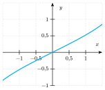
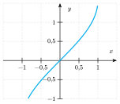
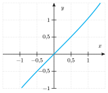
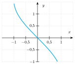

::::: {.qcm .exo #mel-e01 source="Examen 2020" reponse="A" theorie=""}
<!-- support 2026 : Q119 -->
On considère la limite pour $x$ tendant vers l'infini de ${\displaystyle \frac{4x^2-3x+1}{3-2x^2}}$. Cette limite a pour valeur :

::: options
- $-2$
- $1/3$
- $4/3$
- $+\infty$
:::

:::::

::::: {.qcm .exo #mel-e02 source="Examen 2017" reponse="A" theorie=""}
<!-- support 2026 : Q120 -->
Dans le plan muni d'un système d'axes orthonormés, on considère $A(1;1)$ et $B(3;2)$. Quelle est la norme (longueur) du vecteur $3\overrightarrow{AB}$?

::: options
- $3\sqrt{5}$
- $15$
- $18$
- $ \sqrt{5}$
:::

:::::

::::: {.qcm .exo #mel-e03 source="Examen 2018" reponse="C" theorie=""}
<!-- support 2026 : Q121 -->
Dans le cadre d'une expérience de remise en forme appelée « un kiwi pour la vie », Julie mange un kiwi tous les matins depuis quelques jours. Séduit par l'initiative, son collègue Marc a commencé la même démarche 10 jours après Julie. Dans 2 jours (à la fin de la journée), le nombre de kiwis mangés par Julie depuis qu'elle a commencé l'expérience sera égal au double du nombre de kiwis mangés par Marc depuis qu'il a commencé l'expérience.

Combien de kiwis auront été mangés par Julie ce soir depuis le début de l'expérience?

::: options
- $8$
- $10$
- $18$
- $20$
:::

:::::

::::: {.qcm .exo #mel-e04 source="Examen 2019" reponse="D" theorie=""}
<!-- support 2026 : Q122 -->
Considérons la limite $${\displaystyle L = \lim\limits_{x \to -\infty} \frac{\frac{4x+1}{x^2}}{\frac{1}{x}+\frac{2}{x^3}+\frac{3}{x^5}+\frac{4}{x^7}+\frac{5}{x^9}}}.$$

Parmi les propositions suivantes, laquelle est vraie?

::: options
- $L = -\infty$
- $L=-4$
- $L=0$
- $L=4$
:::

:::::

::::: {.qcm .exo #mel-e05 source="Examen 2019" reponse="C" theorie=""}
<!-- support 2026 : Q123 -->
Considérons la fonction $f$ dont l'expression analytique est donnée par ${\displaystyle f(x) = \arcsin\left(\frac{x^2}{2}-3 \right)}$.

Quel est le domaine de définition de $f$?

::: options
- $[2;2\sqrt{2}]$
- $[-\sqrt{5};-1]\cup [1;\sqrt{5}]$
- $[-2\sqrt{2};-2]\cup [2;2\sqrt{2}]$
- $]-\infty ; -2\sqrt{2}] \cup [-2;2] \cup [2\sqrt{2};+\infty[$
:::

:::::

::::: {.qcm .exo #mel-e06 source="Examen 2019" reponse="C" theorie=""}
<!-- support 2026 : Q124 -->
Considérons la fonction réelle $f$ dont l'expression analytique est donnée par ${\displaystyle f(x) = \frac{\sin\left(\frac{x}{3}\right)}{\cos\left( \frac{x}{4}\right)}}$ en tout point où le dénominateur est non nul. Que vaut $f'(\pi)$?

::: options
- $0$
- $1$
- ${\displaystyle \frac{\sqrt{2}}{6}+\frac{\sqrt{6}}{8}}$
- ${\displaystyle \frac{\sqrt{6}}{6}+\frac{\sqrt{2}}{8}}$
:::

:::::

::::: {.qcm .exo #mel-e07 source="Examen 2017" reponse="A" theorie=""}
<!-- support 2026 : Q125 -->
Une patiente hospitalisée en réanimation chirurgicale nécessite du Loxen IV selon la prescription : $3\,\mathrm{mg/h}$ en solution pure, au pousse-seringue électrique. Vous disposez d'ampoules de $10\,\mathrm{mL}$ de Loxen IV dosées à $1\,\mathrm{mg/mL}$. La seringue est à préparer avec quatre ampoules. À $8\,\mathrm{h}00$ ce matin, il restait $16\,\mathrm{mL}$ de Loxen IV dans la seringue. À quelle heure la seringue a-t-elle été posée?

::: options
- $00\,\mathrm{h}00$ (minuit)
- $00\,\mathrm{h}30$
- $01\,\mathrm{h}00$
- $02\,\mathrm{h}00$
:::

:::::

::::: {.qcm .exo #mel-e08 source="Examen 2024" reponse="B" theorie=""}
<!-- support 2026 : Q126 -->
Étant donné un nombre réel $x$, on considère les deux séries statistiques suivantes :

- Série 1 : $x - 2$ ; $x - 1$ ; $x$ ; $x + 1$ ; $x + 2$
- Série 2 : $x$ ; $x+1$ ; $x+2$ ; $x+3$ ; $x+4$

 Parmi les propositions suivantes concernant les deux séries, laquelle est vraie ?

::: options
- Il est impossible de comparer les écarts-type des deux séries sans connaître $x$.
- L'écart-type de la série 1 est identique à celui de la série 2.
- L'écart-type de la série 1 est plus grand que celui de la série 2.
- L'écart-type de la série 1 est plus petit que celui de la série 2.
:::

:::::

::::: {.qcm .exo #mel-e09 source="Examen 2024" reponse="D" theorie=""}
<!-- support 2026 : Q127 -->
On considère le cosinus et le sinus d'un angle $\alpha \in ]3\pi/2;7\pi/4[$ (en radians). Laquelle des combinaisons d'inégalités suivantes est correcte ?

::: options
- $\cos(\alpha) < 0$ et $|\sin(\alpha)| < |\cos(\alpha)|$
- $\cos(\alpha) < 0$ et $|\sin(\alpha)| > |\cos(\alpha)|$
- $\sin(\alpha) < 0$ et $|\sin(\alpha)| < |\cos(\alpha)|$
- $\sin(\alpha) < 0$ et $|\sin(\alpha)| > |\cos(\alpha)|$
:::

:::::

::::: {.qcm .exo #mel-e10 source="Examen 2024" reponse="B" theorie=""}
<!-- support 2026 : Q128 -->
Étant donné la fonction $f$ définie pour tout nombre réel $x$ par ${\displaystyle f(x) = \ln (x^2+3)}$, on considère la fonction $g$ définie par $g(x) = f(x-1)$.

Sur quelles parties de la droite réelle la fonction $g$ est-elle strictement décroissante?

::: options
- $]-\infty;-3[$
- $]-\infty;1[$
- $]-3;1[$
- $]1;+\infty$
:::

:::::

::::: {.qcm .exo #mel-e11 source="Examen 2024" reponse="A" theorie=""}
<!-- support 2026 : Q129 -->
Parmi les quatre expressions suivantes, laquelle est équivalente à $\cos^4(x)-\sin^4(x)$ pour tout réel $x$?

::: options
- $\cos(2x)$
- $\cos^2(x)$
- $\cos^2(2x)$
- $2\cos^2(x)$
:::

:::::

::::: {.qcm .exo #mel-e12 source="Examen 2024" reponse="B" theorie=""}
<!-- support 2026 : Q130 -->
Que vaut l'expression ${\displaystyle \lim\limits_{x \to -3} \left(\frac{x+3}{x^3+27} \right)^{1/3}}$?

::: options
- ${\displaystyle -3^{1/3}}$
- ${\displaystyle \frac{1}{3}}$
- ${\displaystyle \sqrt[3]{3}}$
- $3$
:::

:::::

::::: {.qcm .exo #mel-e13 source="Examen 2024" reponse="A" theorie=""}
<!-- support 2026 : Q131 -->
Un triangle rectangle définit une aire de $200\sqrt{3}\,\mathrm{cm²}$ et un de ses angles a une
amplitude de $30^\circ$. Quelle est la longueur (en centimètre) de son hypoténuse?

::: options
- $40$
- $50$
- $50\sqrt{2}$
- $100\sqrt{3}$
:::

:::::

::::: {.qcm .exo #mel-e14 source="Examen 2024" reponse="D" theorie=""}
<!-- support 2026 : Q132 -->
Étant donné un paramètre $\beta$ réel, on considère le système suivant : $$\begin{cases}
\beta x + \beta y = 1

 1+\beta y = 1
\end{cases}  $$ où $x$ et $y$ sont les inconnues.
Parmi les propositions suivantes, laquelle est correcte ?

::: options
- Le système admet plusieurs solutions quel que soit $\beta$.
- Le système admet une unique solution quel que soit $\beta$.
- Le système n'admet pas de solution quel que soit $\beta$.
- Le système n'admet pas de solution pour certaine(s) valeur(s) de $\beta$ uniquement.
:::

:::::

::::: {.qcm .exo #mel-e15 source="Examen 2024" reponse="B" theorie=""}
<!-- support 2026 : Q133 -->
On considère l'expression ${\displaystyle \sqrt{\frac{a+b}{a-b}} + \sqrt{\frac{a-b}{a+b}} }$. Parmi les quatre expressions suivantes, quelle est celle qui est équivalente à celle donnée ci-dessus ?

::: options
- $1$
- ${\displaystyle \frac{2|a|}{\sqrt{a^2-b^2}}}$
- ${\displaystyle \frac{2|b|}{\sqrt{a^2-b^2}}}$
- ${\displaystyle \sqrt{2} \sqrt{\frac{a^2+b^2}{a^2-b^2}} }$
:::

:::::

::::: {.qcm .exo #mel-e16 source="Examen 2024" reponse="D" theorie=""}
<!-- support 2026 : Q134 -->
Que vaut ${\displaystyle \int \mathrm{e} ^{-2\ln(x)} \ln(x) \,\mathrm{d}x}$ à une constante additive près?

::: options
- ${\displaystyle \frac{1}{x^2}}$
- ${\displaystyle \Big(\ln(x) \Big)^2}$
- ${\displaystyle - \frac{\ln(x^2)}{2x^2} - \frac{1}{2x^2}}$
- ${\displaystyle - \frac{\ln(x)}{x} - \frac{1}{x}}$
:::

:::::

::::: {.qcm .exo #mel-e17 source="Examen 2022" reponse="D" theorie=""}
<!-- support 2026 : Q135 -->
On considère la série statistique suivante : $-1$, $-x^2$, $2x$, $-3x^2$, $-1$ dont la moyenne est notée $m$. Laquelle des propositions suivantes est vraie quel que soit le nombre réel $x$?

::: options
- $m>0$
- $m<-2$
- $m=-1$
- $m\neq 0$
:::

:::::

::::: {.qcm .exo #mel-e18 source="TOSS 2017" reponse="B" theorie=""}
<!-- support 2026 : Q136 -->
Arthur a une moyenne de $12/20$ à l'issue de ses cinq premières interrogations. Quel doit être le résultat à la sixième interrogation pour porter sa moyenne à $13/20$ (toutes les interrogations sont sur $20$)

::: options
- $13/20$
- $18/20$
- $19,5/20$
- $20/20$
:::

:::::

::::: {.qcm .exo #mel-e19 source="Examen 2018" reponse="C" theorie=""}
<!-- support 2026 : Q137 -->
Soient $a$, $b$ et $c$ trois nombres réels strictement positifs et ${\displaystyle R = \frac{a^2b}{c}}$.

Parmi les égalités suivantes, une seule est vérifiée pour toutes les valeurs admissibles de $a$, $b$ et $c$. Laquelle?

::: options
- $\ln(Rc) = \ln(2a)+\ln(b)$
- $\ln(R) + \ln(c) = \ln(2a+b)$
- $\ln(R)-\ln(b)=2\ln(a)-\ln(c)$
- $\ln(R-b)=2\ln(a-c)$
:::

:::::

::::: {.qcm .exo #mel-e20 source="Examen 2020" reponse="C" theorie=""}
<!-- support 2026 : Q138 -->
Soit $f$ la fonction définie explicitement par $f(x) = \ln \big( 1-2|x-1|\big)$. Quel est le domaine de définition de $f$?

::: options
- $]-1/2;1/2[$
- $[-1/2;1/2]$
- $]1/2;3/2[$
- $[1/2;3/2]$
:::

:::::

::::: {.qcm .exo #mel-e21 source="Examen 2020" reponse="D" theorie=""}
<!-- support 2026 : Q139 -->
On considère un triangle $ABC$ qui est rectangle en $C$ et dont l'hypoténuse est deux fois plus longue que le côté $[BC]$. Que vaut l'amplitude de $\widehat{ABC}$?

::: options
- $15^\circ$
- $30^\circ$
- $45^\circ$
- $60^\circ$
:::

:::::

::::: {.qcm .exo #mel-e22 source="TOSS 2017" reponse="A" theorie=""}
<!-- support 2026 : Q140 -->
On se place dans un repère du plan et on se donne les points $A(1;0)$, $B(5;4)$ et $C(1;8)$. Soit $X$ le point du plan tel que $2\overrightarrow{XA}-3\overrightarrow{XB}+2\overrightarrow{XC} = \vec 0$. Quelle est la somme des coordonnées de $X$?

::: options
- $-7$
- $-5$
- $5$
- $7$
:::

:::::

::::: {.qcm .exo #mel-e23 source="Examen 2020" reponse="C" theorie="" masquee="true"}
<!-- support 2026 : hors document (après \end{document}) -->
Un virus se propage à une vitesse exponentielle dans une population. D'après le modèle calculé par les épidémiologistes, le nombre de personnes infectées triple tous les sept jours. Que vaut, selon ce modèle, le rapport entre le nombre de personnes infectées un jour et le nombre de personnes infectées la veille?

::: options
- $\ln(3)/7$
- $3^{-7}$
- $3^{1/7}$
- $\ln(3/7)$
:::

:::::

::::: {.qcm .exo #mel-e24 source="Examen 2019" reponse="B" theorie="" masquee="true"}
<!-- support 2026 : hors document (après \end{document}) -->
Dans le pays P, il y a deux types de médecins : ceux qui sont conventionnés et ceux qui ne le sont pas. Si je vais chez un médecin conventionné, il me facturera des honoraires dont une partie sera payée par la mutuelle. Je dois alors payer $8$ euros, le reste étant pris en charge par la mutuelle. Si je vais chez un médecin non conventionné, ses honoraires sont le double de ceux d'un médecin conventionné et la mutualité ne payera que la moitié de la somme qu'elle aurait payée pour un médecin conventionné. Je paye alors $40$ euros, le reste étant pris en charge par la mutuelle. Quels sont les honoraires d'un médecin non conventionné?

::: options
- $24$ euros
- $48$ euros
- $54$ euros
- $56$ euros
:::

:::::

::::: {.qcm .exo #mel-e25 source="Examen 2020" reponse="C" theorie="" masquee="true"}
<!-- support 2026 : hors document (après \end{document}) -->
La consommation en carburant d'un véhicule est proportionnelle à sa vitesse $v$ (supposée constante) et à la longueur $L$ du trajet qu'il parcourt à cette vitesse. Laquelle de ces formules décrit la consommation de ce véhicule en sachant que $k$ et $k'$ sont des constantes réelles et positives?

::: options
- $k(v+L)$
- $kv+k'L$
- $kvL$
- $kv+L$
:::

:::::

::::: {.qcm .exo #mel-e26 source="Examen 2022" reponse="D" theorie="" masquee="true"}
<!-- support 2026 : hors document (après \end{document}) -->
Un médecin doit administrer $50\,\mathrm{mL}$ d'une solution glucosée contenant $5\,\mathrm{mg}$ de glucose par $100\,\mathrm{mL}$ de solution à un patient.

 Le médecin a deux solutions à sa disposition : une contenant $4\,\mathrm{mg}$ de glucose par $100\,\mathrm{mL}$ de solution et une autre contenant $9\,\mathrm{mg}$ de glucose par $100\,\mathrm{mL}$ de solution. Il doit donc mélanger ces deux solutions pour obtenir les $50\,\mathrm{mL}$ de la solution souhaitée.

 Si le médecin ne souhaite pas gaspiller ces produits, combien de millilitres de solution contenant $4\,\mathrm{mg}$ de glucose par $100\,\mathrm{mL}$ doit-il prélever pour obtenir $50\,\mathrm{mL}$ de glucosée contenant $5\,\mathrm{mg}$ de glucose par $100\,\mathrm{mL}$?

::: options
- $10\,\mathrm{mL}$
- $20\,\mathrm{mL}$
- $25\,\mathrm{mL}$
- $40\,\mathrm{mL}$
:::

:::::

::::: {.qcm .exo #mel-e27 source="Examen 2019" reponse="B" theorie="" masquee="true"}
<!-- support 2026 : hors document (après \end{document}) -->
Soient $a$ et $b$ deux nombres réels non nuls tels que ${\displaystyle 0> \frac{1}{a} > \frac{1}{b}}$. Parmi les propositions suivantes concernant ces deux nombres, laquelle est nécessairement vraie?

::: options
- $b^2>a^2$
- $b^2<a^2$
- $b^2>a^2+1$
- $b^2<a^2-1$
:::

:::::

::::: {.qcm .exo #mel-e28 source="Examen 2020" reponse="B" theorie="" masquee="true"}
<!-- support 2026 : hors document (après \end{document}) -->
Pour fabriquer un litre de désinfectant, il faut $0,832\,\mathrm{L}$ d'alcool, $42\,\mathrm{mL}$ d'eau oxygénée, $15\,\mathrm{mL}$ de glycérine et de l'eau. Quelle est la quantité d'alcool nécessaire pour fabriquer $3/4 \,\mathrm{L}$ de désinfectant?

::: options
- $3/5\,\mathrm{L}$
- $624\,\mathrm{mL}$
- $0,680\,\mathrm{L}$
- $75\,\mathrm{cL}$
:::

:::::

::::: {.qcm .exo #mel-e29 source="Examen 2020" reponse="D" theorie="" masquee="true"}
<!-- support 2026 : hors document (après \end{document}) -->
Laquelle de ces expressions est égale à $\sqrt{4-2\sqrt{3}}$?

::: options
- $2-\sqrt{2\sqrt{3}}$
- $1-\sqrt{3}$
- $2-\sqrt{6}$
- $\sqrt{3}-1$
:::

:::::

::::: {.qcm .exo #mel-e30 source="Examen 2021" reponse="A" theorie="" masquee="true"}
<!-- support 2026 : hors document (après \end{document}) -->
On considère l'ensemble $A$ des nombres réels $a$ pour lesquels l'expression $a^2-9-a-3$ est strictement positive. Parmi les ensembles ci-dessous, un seul est égal à $A$. Lequel?

::: options
- $]-\infty;-3[ \cup ]4;+\infty[$
- $]-\infty;2[ \cup ]3;+\infty[$
- $]-3;4[$
- $]2;3[$
:::

:::::

::::: {.qcm .exo #mel-e31 source="Examen 2018" reponse="C" theorie="" masquee="true"}
<!-- support 2026 : hors document (après \end{document}) -->
Une grand-mère a décidé de récompenser le travail scolaire de ses petits-enfants en leur donnant une somme d'argent s'ils ont bien travaillé. En espérant favoriser les bons résultats, elle a choisi d'attribuer un montant proportionnel à la différence entre le pire résultat (évalué en $\%$) obtenu au bulletin que lui montre l'enfant et $50\%$. Sachant qu'elle a donné $15$€ à Elias dont le pire résultat est de $95\%$, laquelle des valeurs suivantes correspond au montant donné par la grand-mère à Jean dont le pire résultat est de $86\%$?

::: options
- $10$€
- $11$€
- $12$€
- $13$€
:::

:::::

::::: {.qcm .exo #mel-e32 source="Examen 2018" reponse="B" theorie="" masquee="true"}
<!-- support 2026 : hors document (après \end{document}) -->
Parmi les expressions suivantes supposées définies, une seule est égale à $${\displaystyle \frac{1}{(x-y)(y-z)} - \frac{1}{(y-z)(z-x)} - \frac{1}{(z-x)(x-y)}  }$$ Laquelle?

::: options
- ${\displaystyle \frac{y+z}{(x-y)(y-z)(z-x)}}$
- ${\displaystyle \frac{2}{(x-y)(y-z)}}$
- $0$
- ${\displaystyle \frac{x+y}{(x-y)(y-z)(z-x)}}$
:::

:::::

::::: {.qcm .exo #mel-e33 source="Examen 2021" reponse="B" theorie="" masquee="true"}
<!-- support 2026 : hors document (après \end{document}) -->
On considère la série de données suivantes : $2$, $4$, $6$, $8$. Parmi les données ci-dessous, laquelle fera diminuer l'écart-type?

::: options
- $0$
- $5$
- $8$
- $9$
:::

:::::

::::: {.qcm .exo #mel-e34 source="Examen 2021" reponse="D" theorie="" masquee="true"}
<!-- support 2026 : hors document (après \end{document}) -->
Une friterie vend son petit paquet de frites au prix de $2,5$ euros et son grand paquet au prix de $4$ euros. Un habitué remarque que le grand paquet contient le double de frites par rapport au petit paquet.

Que peut-on conclure quant au prix par frite pour le petit paquet?

::: options
- Il est $20\%$ plus bas que pour le grand paquet.
- Il est $20\%$ plus élevé que pour le grand paquet.
- Il est $25\%$ plus bas que pour le grand paquet.
- Il est $25\%$ plus élevé que pour le grand paquet.
:::

:::::

::::: {.qcm .exo #mel-e35 source="Examen 2021" reponse="B" theorie="" masquee="true"}
<!-- support 2026 : hors document (après \end{document}) -->
Un citoyen veut constituer un stock de gel hydroalcoolique. Sur un premier site Internet, il constate que l'on vend le nombre de bouteilles qu'il souhaite pour un total de $80$ euros. Sur un second site, on vent un lot de bouteilles pour $90$ euros. Dans ce lot, il y a 10 bouteilles de plus que dans le lot du premier site. Le prix par bouteille sur le second site est inférieur de $1$ euro par rapport à celui du premier site.

Quel est le prix de la bouteille de gel hydoalcoolique sur le premier site?

::: options
- $2$ euros
- $4$ euros
- $6$ euros
- $8$ euros
:::

:::::

::::: {.qcm .exo #mel-e36 source="Examen 2020" reponse="D" theorie="" masquee="true"}
<!-- support 2026 : hors document (après \end{document}) -->
Dans le plan muni d'un repère orthonormé où les axes sont gradués en centimètres, on considère les points $A(7;-3)$ et $B(2;7)$. Que vaut la norme du vecteur $\vec u$ si $\vec u = -3 \overrightarrow{BA}$

::: options
- $-15\sqrt{5} \,\mathrm{cm}$
- $7 \,\mathrm{cm}$
- $14 \,\mathrm{cm}$
- $15\sqrt{5} \,\mathrm{cm}$
:::

:::::

::::: {.qcm .exo #mel-e37 source="Examen 2019" reponse="D" theorie="" masquee="true"}
<!-- support 2026 : hors document (après \end{document}) -->
Dans le plan muni d'un repère orthonormé, on considère les droites $d_1$ d'équation $x+5y+9=0$, $d_2$ d'équation $7x-3y=13$ et $d_3$ d'équation $6x-4y=9$. Les droites $d_1$ et $d_2$ se coupent en un point $P$. Parmi les propositions suivantes, laquelle correspond à une équation de la droite passant par $P$ et perpendiculaire à $d_3$?

::: options
- ${\displaystyle y+\frac{3}{2}=-\frac{3}{2}x+1}$
- ${\displaystyle x=-\frac{3}{2}y+2}$
- ${\displaystyle 3x+2y=1}$
- $2x+3y+4=0$
:::

:::::

::::: {.qcm .exo #mel-e38 source="Examen 2021" reponse="D" theorie="" masquee="true"}
<!-- support 2026 : hors document (après \end{document}) -->
Dans le plan muni d'un repère orthonormé $(OX;OY)$, on considère les points $A(2;2)$, $B(4;1)$, $C(5;-2)$. Soit $d_1$ la droite comprenant les points $A$ et $B$ et $d_2$ la droite comprenant le point $C$ et perpendiculaire à $d_1$.

Quelles sont les coordonnées du point d'intersection de $d_1$ et $d_2$?

::: options
- $(0;6)$
- $(5;1)$
- $(6;-1)$
- $(6;0)$
:::

:::::

::::: {.qcm .exo #mel-e39 source="Examen 2018" reponse="B" theorie="" masquee="true"}
<!-- support 2026 : hors document (après \end{document}) -->
Dans le plan muni d'un repère orthonormé, on considère :

- les points $A(2;6)$ et $B(0,10)$;
- le vecteur $\vec u$ de composantes $\begin{pmatrix}-3\\2\end{pmatrix}$;
- le vecteur $\vec v$, orthogonal au vecteur $\vec u$, de même norme que $\vec u$ et de composante selon $x$ négative.

 Que vaut le produit scalaire entre $\vec v$ et $\overrightarrow{AB}$?

::: options
- $-16$
- $-8$
- $8$
- $16$
:::

:::::

::::: {.qcm .exo #mel-e40 source="Examen 2021" reponse="D" theorie="" masquee="true"}
<!-- support 2026 : hors document (après \end{document}) -->
Que vaut la limite suivante : ${\displaystyle \lim\limits_{x\to 2} \frac{8-6x^2}{x^2+2x-8}}$?

::: options
- $-\infty$
- $2$
- $4$
- La limite n'existe pas.
:::

:::::

::::: {.qcm .exo #mel-e41 source="Examen 2017" reponse="C" theorie="" masquee="true"}
<!-- support 2026 : hors document (après \end{document}) -->
Que vaut la limite ${\displaystyle \lim\limits_{x \to + \infty} \frac{(x-2)x}{8+3x^2}}$?

::: options
- ${\displaystyle \frac{-1}{4}}$
- $0$
- ${\displaystyle \frac{1}{3}}$
- $+\infty$
:::

:::::

::::: {.qcm .exo #mel-e42 source="Examen 2018" reponse="B" theorie="" masquee="true"}
<!-- support 2026 : hors document (après \end{document}) -->
Que vaut la limite suivante : ${\displaystyle \lim\limits_{x \to -\infty} \frac{x^5-2x^7-2}{3x^7+2x^5+4}}$?

::: options
- $-\infty$
- ${\displaystyle -\frac{2}{3}}$
- $0$
- ${\displaystyle \frac{2}{3}}$
:::

:::::

::::: {.qcm .exo #mel-e43 source="Examen 2018" reponse="C" theorie="" masquee="true"}
<!-- support 2026 : hors document (après \end{document}) -->
Que vaut ${\displaystyle \int_{-\frac{\pi}{2}}^\pi x \cos(2x) \,\mathrm{d}x}$?

::: options
- ${\displaystyle -\frac{1}{2}}$
- $0$
- ${\displaystyle \frac{1}{2}}$
- $1$
:::

:::::

::::: {.qcm .exo #mel-e44 source="Examen 2019" reponse="B" theorie="" masquee="true"}
<!-- support 2026 : hors document (après \end{document}) -->
Parmi les propositions suivantes, laquelle est égale à l'intégrale ${\displaystyle \int_1^2 3x \sqrt{x^2+1}\,\mathrm{d}x}$?

::: options
- ${\displaystyle \frac{5\sqrt{2}-2\sqrt{2}}{2}}$
- $5\sqrt{5}-2\sqrt{2}$
- ${\displaystyle \frac{3}{2} \big(5\sqrt{5}-2\sqrt{2} \big)}$
- $3\big(5\sqrt{5}-2\sqrt{2}\big)$
:::

:::::

::::: {.qcm .exo #mel-e45 source="Examen 2019" reponse="D" theorie="" masquee="true"}
<!-- support 2026 : hors document (après \end{document}) -->
Considérons la fonction $f$ dont l'expression analytique est donnée par ${\displaystyle f(x) = \ln \left( \frac{3x+1}{1-2x}\right)}$.
Parmi les propositions suivantes, laquelle correspond à la dérivée de $f$ en tout point du domaine de dérivabilité de $f$?

::: options
- ${\displaystyle \frac{-5x}{-6x^2+x+1}}$
- ${\displaystyle \frac{1-2x}{3x+1}}$
- ${\displaystyle \frac{-3(1-2x)}{2(3x+1)}}$
- ${\displaystyle \frac{5}{-6x^2+x+1}}$
:::

:::::

::::: {.qcm .exo #mel-e46 source="Examen 2019" reponse="C" theorie="" masquee="true"}
<!-- support 2026 : hors document (après \end{document}) -->
Je souhaite fabriquer une flûte de Pan. Cette flûte est constituée de plusieurs tubes de longueurs différentes, rangés par ordre décroissant de longueur. Le premier tube, qui est le plus long, mesure $16\,\mathrm{cm}$. La longueur de chaque tube suivant est calculée à partir de celle du tube précédent de la façon suivante : la longueur de chaque tube est égale à celle du tube précédent divisée par $2^{1/12}$.

 Sachant que la longueur du tube le plus court est la moitié de la longueur du tube le plus long, de combien de tubes ma flute de Pan est-elle constituée?

::: options
- $11$
- $12$
- $13$
- $14$
:::

:::::

::::: {.qcm .exo #mel-e47 source="Examen 2018" reponse="C" theorie="" masquee="true"}
<!-- support 2026 : hors document (après \end{document}) -->
Soit la fonction réelle définie par $f(x) = 3x^5-5x^3$. Combien d'extrema locaux possède-t-elle?

::: options
- Aucun.
- $1$
- $2$
- Plus de $2$.
:::

:::::

::::: {.qcm .exo #mel-e48 source="Examen 2019" reponse="C" theorie="" masquee="true"}
<!-- support 2026 : hors document (après \end{document}) -->
Considérons la fonction $f$ définie par ${\displaystyle f(x) = 1+\frac{2}{x}}$ pour tout réel $x$ strictement positif. Définissons la fonction $g$ par ${\displaystyle g(x) = \frac{f(3x)}{3}}$. Que vaut ${\displaystyle g\big(g(3)\big)}$?

::: options
- ${\displaystyle \frac{7}{15}}$
- ${\displaystyle \frac{11}{15}}$
- ${\displaystyle \frac{29}{33}}$
- ${\displaystyle \frac{29}{11}}$
:::

:::::

::::: {.qcm .exo #mel-e49 source="Examen 2019" reponse="C" theorie="" masquee="true"}
<!-- support 2026 : hors document (après \end{document}) -->
Notons $\mathrm{e}$ la base des logarithmes naturels. Parmi les propositions suivantes, laquelle est égale à l'intégrale ${\displaystyle \int_1^{\mathrm{e}} \frac{\ln(x)}{x} \,\mathrm{d}x }$?

::: options
- ${\displaystyle -\frac{1}{2}}$
- $0$
- ${\displaystyle \frac{1}{2}}$
- ${\displaystyle \frac{1}{\mathrm{e}}}$
:::

:::::

::::: {.qcm .exo #mel-e50 source="Examen 2018" reponse="B" theorie="" masquee="true"}
<!-- support 2026 : hors document (après \end{document}) -->
Parmi les figures ci-dessous, une seule peut être une partie de la représentation graphique de la fonction $f$ définie par $f(x) = \arcsin(x)$. Laquelle?

::: options
- 
- 
- 
- 
:::

:::::

::::: {.qcm .exo #mel-e51 source="Examen 2020" reponse="B" theorie="" masquee="true"}
<!-- support 2026 : hors document (après \end{document}) -->
À un stade de l'épidémie de COVID-19, il a été indiqué qu'en Belgique le nombre de patients positifs à la COVID-19 doublait tous les $3,33$ jours ou $4 800$ minutes. Si $a$, $b$, $N_0$, $K$, $A$, $B$, $D$ et $\omega$ sont des constantes réelles positives, quelle est parmi les propositions suivantes la fonction $N$ qui caractérise la croissance du virus au cours du temps $t$?

::: options
- $N(t) =at+b $
- $N(t) = N_0 \mathrm{e}^{Kt}$
- $N(t) = At^b$
- $N(t) = D\sin(\omega t)$
:::

:::::

::::: {.qcm .exo #mel-e52 source="Examen 2021" reponse="C" theorie="" masquee="true"}
<!-- support 2026 : hors document (après \end{document}) -->
Dans un repère cartésien orthonormé, on considère le triangle de sommets $A(0;3)$, $B(3;6)$, $C(4;4)$. Que vaut le cosinus de l'angle $\widehat{ABC}$?

::: options
- $\sqrt{6}/6$
- $\sqrt{8}/8$
- $\sqrt{10}/10$
- $\sqrt{12}/12$
:::

:::::

::::: {.qcm .exo #mel-e53 source="TOSS 2017" reponse="C" theorie="" masquee="true"}
<!-- support 2026 : hors document (après \end{document}) -->
Parmi les égalités suivantes, quelle est celle qui est vraie quels que soient les nombres réels $x$ et $y$ tels que $0<x<y$ et ${\displaystyle x+y=\frac{\pi}{2}}$?

::: options
- ${\displaystyle \sin(x) = \cos \left( \frac{\pi}{2}+y\right)}$
- $\cos(x) = - \sin(y)$
- $\cos(y) = \sin(x)$
- ${\displaystyle \cos(x) = \sin\left(y+\frac{\pi}{2}\right)}$
:::

:::::

::::: {.qcm .exo #mel-e54 source="Examen 2019" reponse="A" theorie="" masquee="true"}
<!-- support 2026 : hors document (après \end{document}) -->
La norme d'un vecteur $\vec v$ est notée $\|\vec v \|$ et le produit scalaire des vecteurs $\vec u$ et $\vec v$ est noté $\vec u \cdot \vec v$. Soient $\vec u$ et $\vec v$ des vecteurs tels que $\|\vec u\|=3$, $\|\vec v \| =12$ et $\vec u \cdot \vec v = 8$. Que vaut $\|\vec u + \vec v\|$?

::: options
- $13$
- $15$
- $23$
- $169$
:::

:::::

::::: {.qcm .exo #mel-e55 source="Examen 2017" reponse="B" theorie="" masquee="true"}
<!-- support 2026 : hors document (après \end{document}) -->
Pour quelle valeur de $x$ l'échantillon $\{1;3;5;7;x\}$ a-t-il une moyenne égale à $3$?

::: options
- $-4$
- $-1$
- $1$
- $5$
:::

:::::

::::: {.qcm .exo #mel-e56 source="TOSS 2017" reponse="C" theorie="" masquee="true"}
<!-- support 2026 : hors document (après \end{document}) -->
Soit $\alpha$ la mesure d'un angle en degrés comprise entre $0^\circ$ et $360^\circ$. Supposons que $\sin(\alpha) = -\sin(10^\circ)$. Quelle est l'affirmation correcte pour la valeur de $\alpha$?

::: options
- $100^\circ$ ou $80^\circ$
- $170^\circ$ ou $280^\circ$
- $190^\circ$ ou $350^\circ$
- Aucune des affirmations précédentes n'est correcte.
:::

:::::

::::: {.qcm .exo #mel-e57 source="TOSS 2017" reponse="D" theorie="" masquee="true"}
<!-- support 2026 : hors document (après \end{document}) -->
Dans le plan muni d'un repère orthonormé, on considère la droite $d$ d'équation cartésienne $3x+2y=6$. La droite $d'$ est perpendiculaire à $d$ et comprend le point $P$ ayant pour coordonnées $(1;1)$. Parmi les équations suivantes, laquelle est une équation de $d'$?

::: options
- $3x+2y=5$
- $2x+3y=5$
- $3y-2x=5$
- $3y-2x=1$
:::

:::::

::::: {.qcm .exo #mel-e58 source="Examen 2020" reponse="A" theorie="" masquee="true"}
<!-- support 2026 : hors document (après \end{document}) -->
Soit $f$ la fonction définie explicitement par ${\displaystyle f(x) = \frac{x-2}{x+1}}$. On sait que la courbe d'équation $y=f(x)$ admet une asymptote horizontale et une asymptote verticale. Quel est le point d'intersection de ces deux asymptotes?

::: options
- $(-1;1)$
- $(-1;2)$
- $(1;-1)$
- $(2;-1)$
:::

:::::
