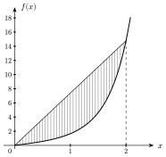
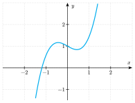
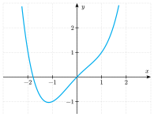
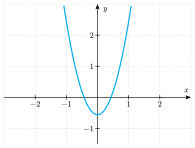
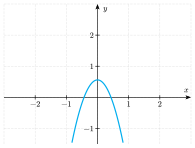
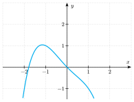
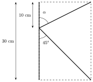

Onze questions en $50$ minutes, sans calculatrice : c'est le rythme de la partie mathématique du concours. L'épreuve n'est pas corrigée en séance : le correctif est publié sur ce site après l'épreuve, et tu peux poser tes questions lors de la séance de questions-réponses.

::::: {.qcm #mes-q01 source="Examen 2022" reponse="B" theorie=""}
<!-- support 2026 : Q108 -->
On considère la fonction $f$ définie explicitement par l'expression ${\displaystyle f(x) = x \mathrm{e}^{x^2/2}}$.

Que vaut l'aire (en gris sur le graphique) comprise entre le segment de droite joignant les deux points $(0;0)$ et $\big(2;f(2)\big)$ et la courbe définie par la fonction $f$ sous le segment?

::: options
- ${\displaystyle \mathrm{e}^{2}-1}$
- ${\displaystyle \mathrm{e}^{2}+1}$
- ${\displaystyle 2\mathrm{e}^{2}-1}$
- ${\displaystyle 2\mathrm{e}^{2}}$
:::

::: details
La droite passe par $(0;0)$ et $\big(2;f(2)\big)=\left(2;2\mathrm{e}^2\right)$ : sa pente vaut $\dfrac{2\mathrm{e}^2}{2}=\mathrm{e}^2$ et son équation est $y=\mathrm{e}^2x$.

Sur $[0;2]$, le segment est au-dessus de la courbe. L'aire vaut donc
$$\int_0^2\left(\mathrm{e}^2x-x\,\mathrm{e}^{x^2/2}\right)\mathrm{d}x=\left[\frac{\mathrm{e}^2x^2}{2}\right]_0^2-\left[\mathrm{e}^{x^2/2}\right]_0^2=2\mathrm{e}^2-\left(\mathrm{e}^2-1\right)=\mathrm{e}^2+1.$$

Une primitive de $x\,\mathrm{e}^{x^2/2}$ s'obtient par substitution : c'est $\mathrm{e}^{x^2/2}$, car la dérivée de $\frac{x^2}{2}$ est $x$.

:::

::: pieges
- Le point d'abscisse $2$ du graphique n'est pas $(2;14)$ : il faut calculer $f(2)=2\mathrm{e}^2$.
- $\mathrm{e}^2-1$ : erreur de signe en soustrayant $\left[\mathrm{e}^{x^2/2}\right]_0^2=\mathrm{e}^2-1$.

:::

:::::

::::: {.qcm #mes-q02 source="Prépa UMONS" reponse="C" theorie=""}
<!-- support 2026 : Q109 -->
Soit le plan muni d'un repère orthonormé. Considérons le vecteur $\vec u$ dont la norme vaut $3$ et le vecteur $\vec v$ dont la norme vaut $4$. Si l'angle entre $\vec u$ et $\vec v$ est de $120^\circ$, que vaut la norme du vecteur $4\vec u-\vec v$?

::: options
- $8$
- $\sqrt{112}$
- $\sqrt{208}$
- Il manque au moins une donnée pour répondre à la question.
:::

::: details
Pour calculer une norme, on passe par son carré, qui est un produit scalaire :
$$\|4\vec u-\vec v\|^2=(4\vec u-\vec v)\cdot(4\vec u-\vec v)=16\,\vec u\cdot\vec u-8\,\vec u\cdot\vec v+\vec v\cdot\vec v.$$
Or $\vec u\cdot\vec u=\|\vec u\|^2=9$, $\vec v\cdot\vec v=16$ et $\vec u\cdot\vec v=3\cdot4\cdot\cos120^\circ=12\cdot\left(-\frac12\right)=-6$.

Donc $\|4\vec u-\vec v\|^2=144+48+16=208$ et $\|4\vec u-\vec v\|=\sqrt{208}$.

:::

::: pieges
- $8$ : on a calculé $4\|\vec u\|-\|\vec v\|=12-4$ ; la norme d'une différence n'est pas la différence des normes.
- $\sqrt{112}$ : erreur de signe sur $\cos120^\circ=-\frac12$.
- Les coordonnées des vecteurs ne sont pas nécessaires : les normes et l'angle suffisent.

:::

:::::

::::: {.qcm #mes-q03 source="Prépa UMONS" reponse="D" theorie=""}
<!-- support 2026 : Q110 -->
Considérons $\vec u$ et $\vec v$ tels que leur produit scalaire soit égal à $-20$, en sachant que $\|\vec u\| = 3$ et $\|\vec v\| = 5$. Parmi les propositions suivantes, laquelle est correcte?

::: options
- L'angle entre $\vec u$ et $\vec v$ est obtus.
- $\|\vec u + \vec v\| = 8$
- $\|\vec u +\vec v\| = \sqrt{74}$
- Les vecteurs $\vec u$ et $\vec v$ n'existent pas.
:::

::: details
Si les vecteurs existaient, on aurait $\vec u\cdot\vec v=\|\vec u\|\,\|\vec v\|\cos\theta$, donc $3\cdot5\cdot\cos\theta=-20$ et $\cos\theta=-\dfrac{20}{15}=-\dfrac43$.

Or un cosinus est toujours compris entre $-1$ et $1$. Aucun angle ne convient : de tels vecteurs n'existent pas.

Autrement dit, $|\vec u\cdot\vec v|\le\|\vec u\|\,\|\vec v\|=15$ pour tous vecteurs, et $|-20|>15$.

:::

::: pieges
- « L'angle est obtus » : c'est la conclusion qu'on tire d'un produit scalaire négatif, mais ici il n'y a pas d'angle.
- $\|\vec u+\vec v\|^2=9+2(-20)+25=-6$ serait négatif : c'est un autre signe que les données sont impossibles.

:::

:::::

::::: {.qcm #mes-q04 source="Prépa UMONS" reponse="A" theorie=""}
<!-- support 2026 : Q111 -->
Soit le plan muni d'un repère orthonormé.  Considérons les points $A(3;2)$ et $B(11;-2)$ ainsi que la droite $d' \equiv y = 2x +1$. Posons $I$ le point d'intersection entre les droites $AB$ et $d'$. Considérons la droite $d$ dont un vecteur directeur est le vecteur $\vec v \begin{pmatrix}-3\\6\end{pmatrix} $ et passant par $I$.

Parmi les propositions suivantes, laquelle est correcte?

::: options
- $d \equiv y=-2x+5$
- $d \equiv y=2x-5$
- $d \equiv y=2x+5$
- $d \equiv y=-2x-5$
:::

::: details
**Droite $AB$.** Sa pente vaut $\dfrac{-2-2}{11-3}=-\dfrac12$, donc $AB\equiv y=-\dfrac12x+p$. Comme $A(3;2)$ est sur la droite, $2=-\dfrac32+p$, d'où $p=\dfrac72$ et $AB\equiv y=-\dfrac12x+\dfrac72$.

**Point $I$.** On égale : $-\dfrac12x+\dfrac72=2x+1$, soit $-x+7=4x+2$, d'où $x=1$ et $y=2\cdot1+1=3$. Donc $I(1;3)$.

**Droite $d$.** Le vecteur directeur $\begin{pmatrix}-3\\6\end{pmatrix}$ donne la pente $\dfrac{6}{-3}=-2$, donc $d\equiv y=-2x+p$. Comme $I\in d$ : $3=-2+p$, d'où $p=5$ et $d\equiv y=-2x+5$.

:::

::: pieges
- La pente associée au vecteur directeur $\begin{pmatrix}a\\b\end{pmatrix}$ est $\frac ba$, pas $\frac ab$.
- $y=2x+5$ : erreur de signe sur la pente $\frac{6}{-3}$.

:::

:::::

::::: {.qcm #mes-q05 source="Prépa UMONS" reponse="D" theorie=""}
<!-- support 2026 : Q112 -->
Considérons l'équation suivante, où $x$ est une inconnue à valeur dans $\mathbb{R}$ :  $$\ln(2x)+\ln(x+2)-\ln(12+x)=\ln(2).$$
Posons $\mathbb{S}$ l'ensemble de solution de cette équation. Parmi les propositions suivantes, laquelle est correcte?

::: options
- $\mathbb{S}=\emptyset$
- $\mathbb{S}=\{-4;3\}$
- $\mathbb{S} = \{6\}$
- Aucune des autres propositions n'est correcte.
:::

::: details
**Conditions d'existence.** Il faut $2x>0$, $x+2>0$ et $12+x>0$, c'est-à-dire $x>0$.

**Résolution.** Pour $x>0$, l'équation s'écrit $\ln\dfrac{2x(x+2)}{12+x}=\ln2$, donc $\dfrac{2x(x+2)}{12+x}=2$, soit $2x^2+4x=24+2x$, c'est-à-dire $x^2+x-12=0$.

$\Delta=1+48=49$, d'où $x=\dfrac{-1-7}{2}=-4$ ou $x=\dfrac{-1+7}{2}=3$. Seule $x=3$ vérifie $x>0$ : $\mathbb{S}=\{3\}$, qui ne figure pas parmi les propositions A, B, C.

Vérification : $\ln6+\ln5-\ln15=\ln\dfrac{30}{15}=\ln2$.

:::

::: pieges
- $\{-4;3\}$ : on a oublié les conditions d'existence ; $\ln(2\cdot(-4))$ n'existe pas.
- Les conditions d'existence se déterminent sur l'équation de départ, avant de regrouper les logarithmes.

:::

:::::

::::: {.qcm #mes-q06 source="Examen 2021" reponse="A" theorie=""}
<!-- support 2026 : Q113 -->
On considère un angle $\alpha$ tel que ${\displaystyle \frac{\pi}{2} \le \alpha \le \pi}$ et ${\displaystyle \cos(\alpha) = - \frac{\sqrt{3}}{2}}$.

Que vaut $\sin(2\alpha)$?

::: options
- ${\displaystyle -\frac{\sqrt{3}}{2}}$
- ${\displaystyle -\frac{1}{2}}$
- ${\displaystyle \frac{1}{2}}$
- ${\displaystyle \frac{\sqrt{3}}{2}}$
:::

::: details
Dans le deuxième quadrant, le cosinus vaut $-\dfrac{\sqrt3}{2}$ pour $\alpha=\dfrac{5\pi}{6}$. Alors $2\alpha=\dfrac{5\pi}{3}$, dans le quatrième quadrant, et $\sin\dfrac{5\pi}{3}=-\dfrac{\sqrt3}{2}$.

Autre méthode : $\sin\alpha=+\sqrt{1-\frac34}=\frac12$ (positif dans le deuxième quadrant), et $\sin2\alpha=2\sin\alpha\cos\alpha=2\cdot\frac12\cdot\left(-\frac{\sqrt3}{2}\right)=-\dfrac{\sqrt3}{2}$.

:::

::: pieges
- $\frac{\sqrt3}{2}$ : on a pris $\sin\alpha$ négatif, alors qu'il est positif dans le deuxième quadrant.
- $\sin2\alpha\neq2\sin\alpha$.

:::

:::::

::::: {.qcm #mes-q07 source="Examen 2021" reponse="C" theorie=""}
<!-- support 2026 : Q114 -->
Un gouvernement a prévu une aide $A$ pour les cafés et restaurants fermés en raison de l'épidémie de la COVID-19. Cette aide comprend une part fixe $F$ et une seconde part variable proportionnelle à la fois au revenu $R$ déclaré pour l'année 2019 et au nombre total $N$ d'heures payées à des travailleurs occupés par l'établissement en 2019.

Si $k$ est une constante réelle positive, laquelle parmi les propositions suivantes décrit mathématiquement l'aide $A$ prévue par le gouvernement?

::: options
- $A=kFRN$
- $A=F+k(R+N)$
- $A=F+kRN$
- $A=k(F+R+N)$
:::

::: details
L'aide est la somme d'une part fixe $F$ et d'une part variable. La part variable est proportionnelle **à la fois** à $R$ et à $N$ : elle s'écrit $kRN$. Donc $A=F+kRN$.

:::

::: pieges
- $F+k(R+N)$ : une grandeur proportionnelle à $R$ et à $N$ est proportionnelle à leur produit, pas à leur somme.
- $kFRN$ : la part fixe s'ajoute, elle ne multiplie pas.

:::

:::::

::::: {.qcm #mes-q08 source="Examen 2019" reponse="B" theorie=""}
<!-- support 2026 : Q115 -->
La courbe ci-dessous est une partie de la représentation graphique d'une fonction $f$ définie sur $\mathbb{R}$.

 Parmi les courbes suivantes, laquelle peut représenter la dérivée de la fonction $f$?

::: options
- 
- 
- 
- 
:::

::: details
On lit les variations de $f$ sur le graphique : $f$ est croissante, atteint un maximum local en $x\approx-\frac12$, décroît, atteint un minimum local en $x\approx\frac12$, puis croît.

La dérivée est donc positive, s'annule en changeant de signe vers $-\frac12$, est négative, s'annule vers $\frac12$, puis redevient positive. Seul le graphique B a ce signe : positif, nul vers $-\frac12$, négatif, nul vers $\frac12$, positif.

:::

::: pieges
- Ne pas chercher une courbe qui « ressemble » à celle de $f$ : on compare le **signe** de la dérivée aux variations de $f$.
- Les zéros de $f'$ correspondent aux extrema de $f$, pas à ses racines.

:::

:::::

::::: {.qcm #mes-q09 source="Prépa UMONS" reponse="C" theorie=""}
<!-- support 2026 : Q116 -->
Soit $f$ une fonction paire dont le domaine de définition est l'ensemble des réels. Posons $a$ un réel. Parmi les propositions suivantes, laquelle est toujours correcte?

::: options
- $f$ possède un nombre pair de racines.
- $f$ possède un nombre impair de racines.
- $f(1-a) = f(a-1)$.
- $f$ n'est pas impaire.
:::

::: details
Une fonction $f$ est paire si $f(-x)=f(x)$ pour tout réel $x$. Avec $x=1-a$, on a $-x=a-1$, donc $f(a-1)=f(1-a)$ : la proposition C est toujours vraie.

Les autres sont fausses en général : $x\mapsto x^2$ est paire et a une seule racine (A fausse) ; $x\mapsto x^2-4$ est paire et a deux racines (B fausse) ; la fonction nulle est à la fois paire et impaire (D fausse).

:::

::: pieges
- Une affirmation « toujours correcte » est réfutée par un seul contre-exemple : il suffit de tester des fonctions paires simples.

:::

:::::

::::: {.qcm #mes-q10 source="Examen 2022" reponse="C" theorie=""}
<!-- support 2026 : Q117 -->
Un publicitaire crée un logo en forme de K (voir le schéma). Ce logo est formé d'une ligne verticale de $30\,\mathrm{cm}$ et de deux lignes obliques partant d'un même point sur la ligne verticale, situé $10\,\mathrm{cm}$ sous l'extrémité supérieure de la ligne verticale. Les quatre extrémités du K correspondent aux coins d'un rectangle.

Le schéma n'est pas à l'échelle.

Sachant que l'amplitude de l'angle entre la ligne verticale et la ligne oblique vers le bas est de $45^\circ$, que vaut $\sin(\alpha)$?

::: options
- ${\displaystyle \frac{2}{3}}$
- ${\displaystyle \frac{\sqrt{2}}{2}}$
- ${\displaystyle \frac{2\sqrt{5}}{5}}$
- ${\displaystyle 1}$
:::

::: details
Notons $A$ le point de départ des deux obliques, $B$ l'extrémité supérieure de la ligne verticale et $C$ le coin supérieur droit du rectangle.

La partie de la ligne verticale sous $A$ mesure $30-10=20\,\mathrm{cm}$. L'oblique inférieure fait un angle de $45^\circ$ avec la verticale : le triangle qu'elle forme est rectangle isocèle, donc la largeur du rectangle vaut aussi $20\,\mathrm{cm}$.

Le triangle $ABC$ est rectangle en $B$, avec $AB=10$ et $BC=20$. Par Pythagore, $AC=\sqrt{100+400}=\sqrt{500}=10\sqrt5$. L'angle $\alpha$ est en $A$ et le côté opposé est $BC$ :
$$\sin\alpha=\frac{BC}{AC}=\frac{20}{10\sqrt5}=\frac{2}{\sqrt5}=\frac{2\sqrt5}{5}.$$

:::

::: pieges
- $\frac{\sqrt2}{2}$ : l'angle $\alpha$ n'est pas de $45^\circ$ ; seul l'angle du bas l'est.
- $\frac23$ : on a utilisé les longueurs verticales $20$ et $30$ au lieu des côtés du triangle $ABC$.

:::

:::::

::::: {.qcm #mes-q11 source="Examen 2022" reponse="B" theorie=""}
<!-- support 2026 : Q118 -->
Dans un magasin, chaque article possède un prix de base auquel on ajoute $20\%$ de ce prix pour établir le prix affiché à faire payer au client lors de son achat (ce pourcentage représente la TVA).

Durant les soldes, une personne achète un article dont le prix de base (sans TVA) est de $x$ euros. Elle obtient une réduction de $40\%$ sur le prix affiché (TVA comprise).

Quel prix la personne va-t-elle payer pour cet article (TVA comprise et en euros) durant ces soldes?

::: options
- $0,64x$
- $0,72x$
- $x$
- $1,40x$
:::

::: details
Le prix affiché vaut le prix de base augmenté de $20\,\%$ : $1{,}2\,x$. La réduction de $40\,\%$ porte sur ce prix affiché : on le multiplie par $0{,}6$.

Le prix payé vaut $0{,}6\cdot1{,}2\,x=0{,}72\,x$.

:::

::: pieges
- $1{,}40x$ ou $x$ : on ne peut pas additionner ou soustraire les pourcentages $+20\,\%$ et $-40\,\%$, car ils ne portent pas sur la même grandeur.

:::

:::::
