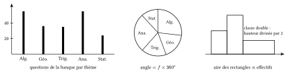

::: {.encadre #sta-vocabulaire nature="Définition" titre="série statistique, effectif, fréquence"}
Une **série statistique** est la liste des valeurs d'une variable observée sur les individus d'une population (ou d'un échantillon).

- L'**effectif** $n_i$ d'une valeur est le nombre d'individus qui ont cette valeur ; l'effectif total $n$ est la somme des effectifs.
- La **fréquence** d'une valeur est $f_i=\dfrac{n_i}{n}$. Elle s'exprime souvent en pourcentage ; la somme des fréquences vaut $1$ (ou $100\,\%$).
:::

Le choix des calculs et des graphiques dépend de la nature de la variable observée. Il faut donc la déterminer avant tout calcul.

::: {.encadre #sta-variables nature="Définition" titre="nature d'une variable"}
- Une variable est **qualitative** si ses valeurs sont des catégories, qui ne se mesurent pas : la couleur des yeux, la section d'études, le groupe sanguin. Ses valeurs s'appellent des **modalités**. Même codées par des nombres (un code postal, un numéro de local), elles restent qualitatives : additionner deux codes postaux n'a pas de sens.
- Une variable est **quantitative** si ses valeurs sont des nombres obtenus par un comptage ou une mesure, sur lesquels les opérations ont un sens : un nombre d'enfants, une taille, une note.

Une variable quantitative est :

- **discrète** si ses valeurs possibles peuvent être **énumérées**, c'est-à-dire écrites l'une après l'autre dans une liste (finie ou non) : une première valeur, une deuxième, une troisième, et ainsi de suite, sans en oublier. Le nombre d'enfants ($0$, $1$, $2$, $3$…) ou le nombre de questions réussies sur $11$ ($0$, $1$, …, $11$) sont discrets. Entre deux valeurs possibles voisines, il n'y a aucune autre valeur possible ;
- **continue** si elle peut prendre toutes les valeurs d'un intervalle : une taille, une masse, une durée, une concentration. Entre deux valeurs possibles, aussi proches soient-elles, il y en a toujours une autre (leur moyenne, par exemple) : on ne peut pas les écrire l'une après l'autre. Ses valeurs proviennent d'une mesure, et on les regroupe en **classes** $[a;b[$.
:::

::: {.encadre nature="Remarque" titre="les données, elles, sont toujours en nombre fini"}
Une série statistique ne contient qu'un nombre fini de données, mesurées avec une précision limitée : des tailles relevées au centimètre près ne prennent que des valeurs comme $172$, $173$, $174$… À priori, toutes les données quantitatives récoltées sont donc « discrètes ». C'est la **nature de la variable étudiée** qui est discrète ou continue : la taille peut prendre toutes les valeurs d'un intervalle, même si on ne la relève qu'au centimètre près. Pour une variable continue, on regroupe les données en classes et on les représente par un histogramme.
:::

::: {.encadre nature="Exemple"}
Pour un groupe d'étudiants : la section (médecine, dentisterie) est qualitative ; le nombre de frères et sœurs est quantitative discrète ; la taille en centimètres est quantitative continue.
:::

::: {.encadre #sta-nature-outils nature="Propriété" titre="ce que l'on peut calculer et représenter"}
| nature de la variable | représentation | indicateurs |
|:--|:--|:--|
| qualitative | diagramme en bâtons, diagramme circulaire | mode (et médiane si les modalités sont ordonnées) |
| quantitative discrète | diagramme en bâtons | mode, médiane, quartiles, moyenne, écart-type |
| quantitative continue (en classes) | histogramme | classe modale, médiane, quartiles, moyenne et écart-type à partir des centres des classes |
:::

::: {.encadre nature="Remarque" titre="pas de moyenne pour une variable qualitative"}
La moyenne des sections d'études n'a pas de sens, et la médiane non plus, car ces modalités ne sont pas rangées dans un ordre naturel : seul le mode peut être donné. Lorsque les modalités sont naturellement ordonnées (insuffisant, satisfaisant, bien, très bien), la variable est dite qualitative **ordinale** : on peut alors donner une médiane, mais toujours pas de moyenne.
:::

::: {.encadre nature="Remarque" titre="les codes postaux de Wallonie"}
Les codes postaux sont des nombres, mais ils désignent des communes : la variable « code postal » est qualitative. Par exemple, Mons a le code $7000$, Liège $4000$, Namur $5000$, Charleroi $6000$, Wavre $1300$ et Arlon $6700$.^[Source : bpost, liste des codes postaux belges.]

La « moyenne » de $7000$ (Mons) et de $4000$ (Liège) vaut $5500$, le code de Dinant : ce calcul n'a aucun sens, Dinant n'est pas une commune « moyenne » entre Mons et Liège. La médiane n'en a pas davantage : les codes sont rangés par zone géographique (le premier chiffre correspond à une zone), pas selon une grandeur. Une série de codes postaux, par exemple les domiciles des inscrits aux cours préparatoires, se décrit comme toute variable qualitative : par l'effectif ou la fréquence de chaque commune, représentés par un diagramme en bâtons ou un diagramme circulaire. Le mode indique alors seulement la commune la plus représentée.
:::

::: {.encadre #sta-graphiques nature="Propriété" titre="lire un graphique"}
- **Diagramme en bâtons** (variable discrète ou qualitative) : la hauteur de chaque bâton est l'effectif (ou la fréquence) de la valeur.
- **Diagramme circulaire** : chaque secteur a un angle proportionnel à la fréquence ; une fréquence $f$ correspond à un angle $f\cdot360^\circ$. Un demi-disque représente $50\,\%$, un quart $25\,\%$.
- **Histogramme** (variable regroupée en classes) : chaque classe est représentée par un rectangle dont l'**aire** est proportionnelle à l'effectif. Si toutes les classes ont la même amplitude, la hauteur est proportionnelle à l'effectif.
:::

{.th}

::: {.encadre nature="Exemple"}
Sur $600$ personnes interrogées, un secteur de $90^\circ$ représente $\frac{90}{360}=25\,\%$, soit $150$ personnes.
:::

::: {.encadre nature="Remarque" titre="lire l'axe avant de calculer"}
Avant toute lecture, on vérifie ce que porte l'axe vertical (effectifs ou fréquences) et si les classes d'un histogramme ont la même amplitude. Avec un graphique de fréquences seules, on ne peut pas retrouver les effectifs sans connaître l'effectif total.
:::
