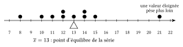
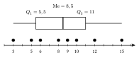

La moyenne répartit équitablement le total : si chacun recevait la même valeur, ce serait la moyenne.

::: {.encadre #sta-moyenne nature="Définition" titre="moyenne"}
La **moyenne** des valeurs $x_1,x_2,\dots,x_n$ est
$$\overline{x}=\frac{x_1+x_2+\cdots+x_n}{n}.$$
Si les valeurs $x_i$ apparaissent avec les effectifs $n_i$ : $\overline{x}=\dfrac{\sum n_ix_i}{n}=\sum f_ix_i$.

Pour des données regroupées en classes, on remplace chaque classe par son **centre**.
:::

Si on place des masses égales sur une règle, à l'endroit de chaque valeur, la règle tient en équilibre sur la moyenne : la somme des écarts à la moyenne est nulle, les écarts positifs compensant les écarts négatifs. Pour la série $8$, $10$, $11$, $12$, $12$, $13$, $14$, $14$, $15$, $21$, la moyenne vaut $\frac{130}{10}=13$. Les écarts négatifs ($-5$, $-3$, $-2$, $-1$, $-1$) ont pour somme $-12$, les écarts positifs ($1$, $1$, $2$, $8$) ont pour somme $12$ : la seule valeur $21$, éloignée, compense pour une grande part les valeurs situées sous la moyenne.

{.th}

::: {.encadre nature="Exemple"}
Les notes $12$, $15$, $15$, $18$ ont pour moyenne $\dfrac{12+2\cdot15+18}{4}=15$. Le total des notes vaut $n\cdot\overline{x}=60$.
:::

::: {.encadre #sta-moyenne-prop nature="Propriété" titre="propriétés de la moyenne"}
- Le total des valeurs vaut $n\,\overline{x}$ : connaître la moyenne et l'effectif donne la somme.
- Si on ajoute une constante $c$ à chaque valeur, la moyenne augmente de $c$ ; si on multiplie chaque valeur par $k$, la moyenne est multipliée par $k$.
- Ajouter à la série une valeur égale à la moyenne ne change pas la moyenne.
:::

::: {.encadre nature="Remarque" titre="moyenne et valeurs extrêmes"}
La moyenne est sensible aux valeurs extrêmes : une seule valeur très grande peut la tirer bien au-dessus de la plupart des données. Elle ne coïncide en général ni avec la médiane ni avec une valeur de la série.
:::

::: {.encadre #sta-mediane nature="Définition" titre="mode, médiane, quartiles"}
- Le **mode** est la valeur (ou la classe) de plus grand effectif.
- La **médiane** partage la série **ordonnée** en deux groupes de même effectif : si $n$ est impair, c'est la valeur du milieu ; si $n$ est pair, c'est la moyenne des deux valeurs du milieu.
- Le **premier quartile** $Q_1$ est la médiane de la moitié inférieure de la série ordonnée, et le **troisième quartile** $Q_3$ la médiane de la moitié supérieure (lorsque $n$ est impair, on laisse la médiane hors des deux moitiés).
:::

{.th}

Environ un quart des valeurs sont inférieures à $Q_1$, la moitié inférieures à la médiane et trois quarts inférieures à $Q_3$. Entre $Q_1$ et $Q_3$ se trouve environ la moitié des valeurs.

::: {.encadre nature="Exemple"}
Série ordonnée $3,5,6,8,9,10,12,15$ ($n=8$) : médiane $\frac{8+9}{2}=8{,}5$ ; moitié inférieure $3,5,6,8$, d'où $Q_1=\frac{5+6}{2}=5{,}5$ ; moitié supérieure $9,10,12,15$, d'où $Q_3=11$.
:::

::: {.encadre nature="Remarque" titre="conventions"}
Plusieurs conventions de calcul des quartiles existent ; elles donnent des valeurs proches mais parfois différentes. Sur ce site, on utilise celle ci-dessus. La médiane, elle, est définie sans ambiguïté.
:::
