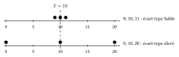
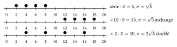

Deux séries peuvent avoir la même moyenne et être très différentes : $9,10,11$ et $0,10,20$ ont toutes deux pour moyenne $10$. Pour mesurer la dispersion autour de la moyenne, on regarde les écarts $x_i-\overline{x}$. Leur moyenne est toujours nulle (les écarts positifs compensent les négatifs) ; on fait donc la moyenne de leurs **carrés**.

::: {.encadre #sta-ecart-type nature="Définition" titre="variance et écart-type"}
La **variance** d'une série est la moyenne des carrés des écarts à la moyenne :
$$V=\frac{(x_1-\overline{x})^2+(x_2-\overline{x})^2+\cdots+(x_n-\overline{x})^2}{n}.$$
L'**écart-type** est sa racine carrée : $\sigma=\sqrt V$. Il s'exprime dans la même unité que les données.
:::

{.th}

En développant les carrés, on obtient une formule plus rapide : il suffit de connaître la moyenne des valeurs et la moyenne de leurs carrés.

::: {.encadre #sta-variance-calcul nature="Propriété" titre="formule de calcul"}
La variance est la moyenne des carrés moins le carré de la moyenne :
$$V=\overline{x^2}-\overline{x}^{\,2}\qquad\text{où}\qquad\overline{x^2}=\frac{x_1^2+x_2^2+\cdots+x_n^2}{n}.$$
:::

::: {.encadre nature="Exemple"}
Série $1,2,4,5$ : $\overline x=3$. Par la définition, $V=\dfrac{4+1+1+4}{4}=\dfrac52$. Par la formule, $\overline{x^2}=\dfrac{1+4+16+25}{4}=\dfrac{23}{2}$ et $V=\dfrac{23}{2}-9=\dfrac52$. Donc $\sigma=\sqrt{\dfrac52}$.
:::

::: {.encadre #sta-ecart-type-prop nature="Propriété" titre="propriétés de l'écart-type"}
- $\sigma\ge0$, et $\sigma=0$ si et seulement si toutes les valeurs sont égales.
- Plus les valeurs sont éloignées de la moyenne, plus l'écart-type est grand.
- Ajouter une constante à chaque valeur ne change pas l'écart-type ; multiplier chaque valeur par $k$ multiplie l'écart-type par $|k|$.
:::

{.th}

::: {.encadre nature="Exemple"}
Les séries $\{1;5;9\}$ et $\{3;5;7\}$ ont la même moyenne $5$ ; la première est plus dispersée et a le plus grand écart-type ($\sqrt{32/3}$ contre $\sqrt{8/3}$). La série $\{101;105;109\}$ a le même écart-type que $\{1;5;9\}$.
:::

::: {.encadre nature="Remarque" titre="retirer ou ajouter des données"}
Retirer des données peut faire augmenter, diminuer ou laisser inchangé l'écart-type : tout dépend de leur position par rapport à la moyenne. Retirer des valeurs très éloignées de la moyenne le diminue ; retirer des valeurs proches de la moyenne l'augmente.
:::
