::::: {.qcm .exo #sta-e01 source="Examen 2018" reponse="B" theorie=""}
<!-- support 2026 : Q96 -->
Dans une Faculté de médecine de $3000$ étudiants, il y a trois sections : les Sciences biomédicales, la Médecine et la Dentisterie. Les étudiants sont répartis dans les sections comme illustré dans le graphique ci-dessous.

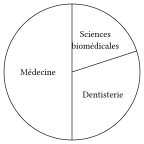

 Parmi les propositions suivantes, une seule peut correspondre au nombre d'étudiants qu'il y a **en plus** en section Médecine qu'en Section Sciences biomédicales. Laquelle?

::: options
- $600$
- $900$
- $1500$
- $2100$
:::

:::::

::::: {.qcm .exo #sta-e02 source="Examen 2022" reponse="D" theorie=""}
<!-- support 2026 : Q97 -->
On considère la série statistique suivante : $-1$, $-x^2$, $2x$, $-3x^2$, $-1$ dont la moyenne est notée $m$. Laquelle des propositions suivantes est vraie quel que soit le nombre réel $x$?

::: options
- $m>0$
- $m<-2$
- $m=-1$
- $m\neq 0$
:::

:::::

::::: {.qcm .exo #sta-e03 source="Examen 2022" reponse="C" theorie=""}
<!-- support 2026 : Q98 -->
Un étudiant a présenté successivement trois examens.
Si au quatrième examen il obtient une note égale à celle du premier examen, sa moyenne (des quatre
examens) vaudra $10$ ; si à ce quatrième examen, il obtient une note égale à celle du deuxième
examen, sa moyenne vaudra $12$ et enfin s'il obtient une note égale à celle du troisième examen à ce
quatrième examen, sa moyenne vaudra $14$.
Quelles ont été, dans l'ordre chronologique, les notes des trois premiers examens ?

::: options
- $2$, $10$ et $26$.
- $3$, $11$ et $23$.
- $4$, $12$ et $20$.
- $5$, $9$ et $21$.
:::

:::::

::::: {.qcm .exo #sta-e04 source="Examen 2022" reponse="D" theorie=""}
<!-- support 2026 : Q99 -->
Le diagramme en bâtons ci-dessous correspond au nombre d'enfants, dans l'ensemble des différentes écoles d'une grande commune, infectés par la COVID-19 durant les 10 derniers mois, en fonction de l'âge des enfants (en années).

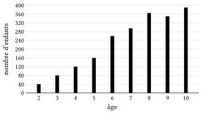

 Quel est le nombre d'enfants infectés dans les écoles maternelles (ce sont les enfants qui ont de 2 à 5 ans) ?

::: options
- $30$
- $170$
- $260$
- $400$
:::

:::::

::::: {.qcm .exo #sta-e05 source="Prépa UMONS" reponse="B" theorie=""}
<!-- support 2026 : Q100 -->
Une entreprise donne les renseignements suivants sur le salaire mensuel brut des employés.

| Moyenne | Premier quartile | Médiane | Troisième quartile |
|---|---|---|---|
| $3 400$ euros | $1 780$ euros | $2 590$ euros | $3 720$ euros |

Parmi les propositions suivantes, laquelle est correcte?

::: options
- Au moins la moitié des personnes employés gagnent $3 400$ euros
- La moitié des personnes employées gagnent entre $1 780$ et $3 720$ euros
- $2 590$ est le salaire de la majorité des personnes employées
- Une personne employée sur deux gagne moins de $3 400$ euros
:::

:::::

::::: {.qcm .exo #sta-e06 source="Examen 2017" reponse="D" theorie=""}
<!-- support 2026 : Q101 -->
Des quatre histogrammes représentés ci-dessous, lequel correspond au jeu de
données ayant le plus petit écart-type ?

::: options
- 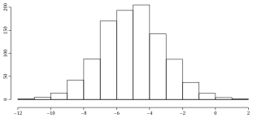
- 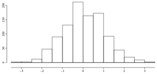
- 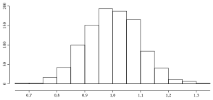
- 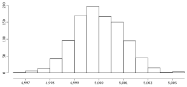
:::

:::::

::::: {.qcm .exo #sta-e07 source="Prépa UMONS" reponse="D" theorie=""}
<!-- support 2026 : Q102 -->
Considérons le diagramme en bâtonnets donné ci-après, illustrant le nombre de personnes ayant lu une certaine quantité de livres durant les vacances d'été.

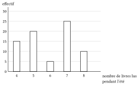

 Parmi les propositions suivantes, laquelle est correcte?

::: options
- $70$ personnes ont été interrogées pour cette étude.
- La médiane vaut $7$
- Le mode vaut $6$
- La moyenne vaut ${\displaystyle \frac{89}{15}}$
:::

:::::

::::: {.qcm .exo #sta-e08 source="Prépa UMONS" reponse="A" theorie=""}
<!-- support 2026 : Q103 -->
Au concours de Mathématiques sans Frontières, le nombre de points obtenus par les
écoles de Belgique se répartit selon l'histogramme suivant :

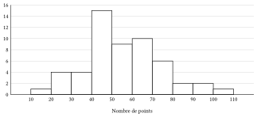

Quel est, en point, le score moyen des écoles?

::: options
- ${\displaystyle \frac{1495}{27}}$
- ${\displaystyle \frac{650}{54}} $
- $50$
- Il manque au moins une information pour répondre
:::

:::::

::::: {.qcm .exo #sta-e09 source="Prépa UMONS" reponse="B" theorie=""}
<!-- support 2026 : Q104 -->
Considérons le diagramme circulaire donné ci-après, représentant les fréquences d'un sondage sur la couleur préférée de $600$ personnes.

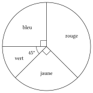

Parmi les propositions suivantes, laquelle est correcte?

::: options
- $300$ personnes ont répondu « bleu ».
- $62,5\%$ des personnes ont répondu « jaune » ou « rouge » .
- Deux fois plus de personnes ont répondu « rouge » par rapport à « vert ».
- $37,5\%$ des personnes n'ont pas répondu « rouge ».
:::

:::::

::::: {.qcm .exo #sta-e10 source="Prépa UMONS" reponse="B" theorie=""}
<!-- support 2026 : Q105 -->
Considérons le graphe des effectifs donné ci-après.

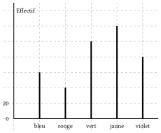

Parmi les propositions suivantes, laquelle est correcte?

::: options
- L'effectif de « violet » est de $40$
- La fréquence de « vert » est de $25\%$
- La fréquence de « jaune » est de $60\%$
- Le mode est « rouge »
:::

:::::

::::: {.qcm .exo #sta-e11 source="Prépa UMONS" reponse="B" theorie=""}
<!-- support 2026 : Q106 -->
Considérons une série statistique quelconque. Laquelle des valeurs suivantes peut toujours être déterminées?

::: options
- La moyenne
- Le mode
- La médiane
- L'écart-type
:::

:::::

::::: {.qcm .exo #sta-e12 source="Prépa UMONS" reponse="C" theorie=""}
<!-- support 2026 : Q107 -->
Les résultats de Luke aux dernières évaluations sont les suivants : $12/20$, $20/30$ et $8/10$. La dernière évaluation est sur $40$. Parmi les propositions suivantes, laquelle est correcte?

::: options
- Un score de $70\%$ à la dernière évaluation lui permet d'obtenir une moyenne aux quatre évaluation de $14/20$.
- Il lui est impossible d'obtenir une moyenne de $16/20$ sur l'ensemble des évaluations
- Avec un score d'au moins $10$ à la quatrième évaluation, sa moyenne sur les quatre évaluations sera supérieure à $50\%$
- Un score de $30$ à la quatrième évaluation laisse la moyenne inchangée sur l'ensemble des évaluations par rapport à la moyenne sur les trois premières.
:::

:::::

::::: {.qcm .exo #sta-e13 source="Examen 2023" reponse="B" theorie=""}
<!-- Examen 2023 (matin) : maths Q5 -->
Voici un graphique représentant le taux d'accès à l'enseignement supérieur des hommes et des femmes ayant obtenu un diplôme de secondaire.

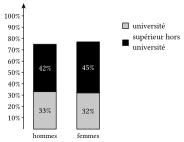

Supposons que parmi les personnes ayant obtenu leur diplôme de secondaire, $60\,\%$ sont des femmes et $40\,\%$ des hommes.

Que vaut le taux d'accès (en $\%$) à l'enseignement supérieur hors université parmi les personnes ayant obtenu un diplôme de secondaire?

::: options
- $43{,}5\,\%$
- $43{,}8\,\%$
- $76{,}0\,\%$
- $87{,}0\,\%$
:::

:::::

::::: {.qcm .exo #sta-e14 source="Examen 2025" reponse="B" theorie=""}
<!-- Examen 2025 (matin) : maths Q3 -->
Un hôpital emploie $2\,000$ personnes soignantes. On retrouve la répartition de ce personnel dans le diagramme circulaire ci-dessous.

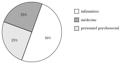

Le nombre d'infirmières dans cet hôpital est insuffisant. Pour des raisons budgétaires, l'hôpital décide de remplacer $20\,\%$ de son personnel psychosocial par des infirmières.

Quel pourcentage du personnel soignant seront des infirmières après ce changement?

::: options
- $80\,\%$
- $55\,\%$
- $60\,\%$
- $70\,\%$
:::

:::::

::::: {.qcm .exo #sta-e15 source="Examen 2026" reponse="C" theorie=""}
<!-- Examen 2026 (matin) : maths Q2 -->
On considère la série définie par les quatre nombres suivants : $-1$ ; $-1$ ; $1$ ; $1$.

Que valent respectivement la moyenne et l'écart-type de cette série?

::: options
- $0$ et $0$
- $0$ et $1/2$
- $0$ et $1$
- $0$ et $\sqrt{2}$
:::

:::::

::::: {.qcm .exo #sta-e16 source="Prépa UMONS" reponse="C" theorie="sta-moyenne-prop"}
<!-- Simulation août 2026 (simulation-2026/simulation_medecine.typ) : question 6 -->
Une série de $7$ valeurs a une moyenne de $12$. On ajoute une valeur $x$ et la nouvelle moyenne devient $13$. Que vaut $x$ ?

::: options
- $18$
- $19$
- $20$
- $21$
:::

:::::

::::: {.qcm .exo #sta-e17 source="Prépa UMONS" reponse="B" theorie="sta-variance-calcul sta-ecart-type"}
<!-- Simulation août 2026, variante du corrigé (simulation-2026/qcm_maths_corrige.typ) : question 4 -->
Une série statistique de $4$ valeurs a une moyenne de $10$ et un écart-type de $2$ (écart-type de la série, avec division par $n$). On ajoute la valeur $14$ à la série.

Quel est le nouvel écart-type ?

::: options
- $2{,}2$
- $2{,}4$
- $2{,}6$
- $3$
:::

:::::
