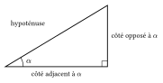
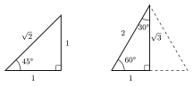
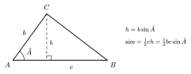

Dans des triangles rectangles qui ont le même angle aigu $\alpha$, les côtés sont proportionnels (les triangles sont semblables). Les rapports entre côtés ne dépendent donc que de $\alpha$ : ce sont ses nombres trigonométriques.

::: {.encadre #tri-rect nature="Définition" titre="nombres trigonométriques d'un angle aigu"}
Dans un triangle rectangle, pour un angle aigu $\alpha$ :
$$\sin\alpha=\frac{\text{côté opposé}}{\text{hypoténuse}},\qquad \cos\alpha=\frac{\text{côté adjacent}}{\text{hypoténuse}},\qquad \tan\alpha=\frac{\text{côté opposé}}{\text{côté adjacent}}=\frac{\sin\alpha}{\cos\alpha}.$$
:::

{.th}

::: {.encadre nature="Exemple"}
Une échelle de $4\,\mathrm{m}$ fait un angle de $60^\circ$ avec le sol. Le pied est à $4\cos60^\circ=2\,\mathrm{m}$ du mur et le haut à $4\sin60^\circ=2\sqrt3\,\mathrm{m}$ du sol.
:::

Les valeurs pour $30^\circ$, $45^\circ$ et $60^\circ$ n'ont pas besoin d'être apprises par cœur : elles se retrouvent en quelques secondes avec deux triangles et le théorème de Pythagore.

::: {.encadre #tri-retrouver nature="Méthode" titre="retrouver les valeurs particulières"}
1. **Pour $45^\circ$**, on coupe un carré de côté $1$ par une diagonale. On obtient un triangle rectangle isocèle : ses deux angles aigus valent $45^\circ$, et son hypoténuse mesure $\sqrt{1^2+1^2}=\sqrt2$. Donc
$$\sin45^\circ=\cos45^\circ=\frac{1}{\sqrt2}=\frac{\sqrt2}{2}\qquad\text{et}\qquad\tan45^\circ=\frac11=1.$$
2. **Pour $30^\circ$ et $60^\circ$**, on coupe un triangle équilatéral de côté $2$ par une hauteur. Elle tombe au milieu de la base : on obtient un triangle rectangle d'hypoténuse $2$, de petit côté $1$ et de hauteur $\sqrt{2^2-1^2}=\sqrt3$. Ses angles valent $60^\circ$ (angle du triangle équilatéral) et $30^\circ$ (la moitié de $60^\circ$). Le côté opposé à l'angle de $30^\circ$ est le petit côté :
$$\sin30^\circ=\frac12,\qquad\cos30^\circ=\frac{\sqrt3}{2},\qquad\tan30^\circ=\frac{1}{\sqrt3}=\frac{\sqrt3}{3},$$
$$\sin60^\circ=\frac{\sqrt3}{2},\qquad\cos60^\circ=\frac12,\qquad\tan60^\circ=\frac{\sqrt3}{1}=\sqrt3.$$
3. **Pour $0$ et $90^\circ$**, on lit les coordonnées des points $(1;0)$ et $(0;1)$ du cercle trigonométrique.
:::

{.th}

::: {.encadre nature="Remarque" titre="un moyen de contrôle"}
Pour $0$, $\frac\pi6$, $\frac\pi4$, $\frac\pi3$, $\frac\pi2$, le sinus vaut successivement $\frac{\sqrt0}{2}$, $\frac{\sqrt1}{2}$, $\frac{\sqrt2}{2}$, $\frac{\sqrt3}{2}$, $\frac{\sqrt4}{2}$ ; le cosinus prend les mêmes valeurs dans l'ordre inverse. Le sinus croît avec l'angle sur $\left[0;\frac\pi2\right]$ : on vérifie ainsi qu'on n'a pas échangé $\sin30^\circ$ et $\sin60^\circ$.
:::

::: {.encadre #tri-valeurs nature="Propriété" titre="valeurs usuelles"}
| angle | $0$ | $\frac{\pi}{6}=30^\circ$ | $\frac{\pi}{4}=45^\circ$ | $\frac{\pi}{3}=60^\circ$ | $\frac{\pi}{2}=90^\circ$ |
|:--|:-:|:-:|:-:|:-:|:-:|
| $\sin$ | $0$ | $\frac12$ | $\frac{\sqrt2}{2}$ | $\frac{\sqrt3}{2}$ | $1$ |
| $\cos$ | $1$ | $\frac{\sqrt3}{2}$ | $\frac{\sqrt2}{2}$ | $\frac12$ | $0$ |
| $\tan$ | $0$ | $\frac{\sqrt3}{3}$ | $1$ | $\sqrt3$ | non défini |
:::

::: {.encadre nature="Remarque" titre="ordre de grandeur"}
Sur $\left[0;\frac\pi2\right]$, le sinus croît de $0$ à $1$ et le cosinus décroît de $1$ à $0$. On peut donc comparer sans calcul : $\cos20^\circ>\cos50^\circ$. Comme $0\le\cos\alpha\le1$, on a aussi $\cos^2\alpha\le\cos\alpha$.
:::

Un triangle quelconque se découpe en triangles rectangles en traçant une hauteur. La hauteur issue de $C$ mesure $b\sin\hat A$, ce qui donne l'aire du triangle ; deux tels triangles forment un parallélogramme.

::: {.encadre #tri-aire nature="Propriété" titre="aire d'un triangle, d'un parallélogramme"}
L'aire d'un triangle dont deux côtés mesurent $b$ et $c$ et forment un angle $\hat A$ vaut $\dfrac12\,bc\sin\hat A$.

L'aire d'un parallélogramme de côtés $b$ et $c$ formant un angle $\hat A$ vaut $bc\sin\hat A$.
:::

{.th}

::: {.encadre nature="Exemple"}
Un losange de côté $6$ dont un angle vaut $30^\circ$ a pour aire $6\cdot6\cdot\frac12=18$.
:::

::: {.encadre #tri-alkashi nature="Propriété" titre="formule d'Al-Kashi"}
Dans un triangle $ABC$ où $a=BC$, $b=AC$ et $c=AB$ :
$$a^2=b^2+c^2-2bc\cos\hat A.$$
C'est le théorème de Pythagore généralisé (voir la théorie de géométrie) : si $\hat A$ est droit, $\cos\hat A=0$.
:::
