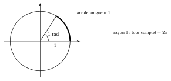
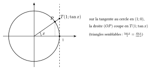
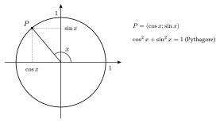
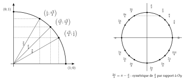
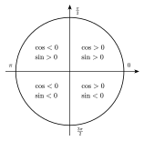

Pour définir le sinus et le cosinus de n'importe quel angle, on utilise un cercle de rayon $1$ centré à l'origine d'un repère orthonormé. On mesure les angles à partir de l'axe des abscisses, dans le sens contraire des aiguilles d'une montre.

::: {.encadre #tri-radian nature="Définition" titre="radian"}
Sur un cercle de rayon $1$, l'angle de $1$ **radian** intercepte un arc de longueur $1$. Le cercle complet mesure $2\pi$, donc
$$360^\circ=2\pi\ \mathrm{rad}\qquad\text{et}\qquad 180^\circ=\pi\ \mathrm{rad}.$$
:::

{.th}

::: {.encadre nature="Exemple"}
$30^\circ=\dfrac{\pi}{6}$, $120^\circ=\dfrac{2\pi}{3}$, $\dfrac{5\pi}{4}=225^\circ$. Sur un cercle de rayon $r$, un angle de $\theta$ radians intercepte un arc de longueur $r\theta$.
:::

::: {.encadre #tri-cercle nature="Définition" titre="cosinus et sinus d'un réel"}
Au réel $x$ correspond le point $P$ du cercle trigonométrique tel que l'angle orienté entre l'axe des abscisses et $[OP]$ vaut $x$. Par définition, $P=(\cos x\,;\,\sin x)$. Si $\cos x\neq0$, $\tan x=\dfrac{\sin x}{\cos x}$.
:::

La tangente se lit aussi sur le cercle : sur la droite verticale $x=1$, tangente au cercle en $(1;0)$, la droite $(OP)$ passe par le point d'ordonnée $\tan x$.

{.th}

{.th}

Pour un angle aigu, cette définition coïncide avec celle du triangle rectangle (l'hypoténuse $[OP]$ mesure $1$). Elle donne aussi un signe : le cosinus est positif à droite de l'axe vertical, le sinus est positif au-dessus de l'axe horizontal.

::: {.encadre #tri-signes nature="Propriété" titre="signes, périodicité, bornes"}
- Pour tout réel $x$ : $-1\le\cos x\le1$ et $-1\le\sin x\le1$.
- Le cosinus et le sinus sont **périodiques** de période $2\pi$ : $\cos(x+2k\pi)=\cos x$ et $\sin(x+2k\pi)=\sin x$ pour tout entier $k$.
- Dans le premier quadrant, cosinus et sinus sont positifs ; dans le deuxième, $\cos x<0<\sin x$ ; dans le troisième, les deux sont négatifs ; dans le quatrième, $\sin x<0<\cos x$.
:::

Sur le cercle trigonométrique, les points associés à $\frac\pi6$, $\frac\pi4$ et $\frac\pi3$ ont pour coordonnées les cosinus et sinus trouvés avec les triangles. Les autres angles particuliers ($\frac{2\pi}{3}$, $\frac{5\pi}{6}$, $\frac{5\pi}{4}$…) s'en déduisent par symétrie : on repère le point du premier quadrant qui a la même « position », puis on choisit les signes selon le quadrant.

{.th}

::: {.encadre nature="Exemple"}
$\frac{2\pi}{3}=\pi-\frac\pi3$ : le point est le symétrique de celui de $\frac\pi3$ par rapport à l'axe des ordonnées. Donc $\cos\frac{2\pi}{3}=-\frac12$ et $\sin\frac{2\pi}{3}=\frac{\sqrt3}{2}$.

$\frac{5\pi}{4}=\pi+\frac\pi4$ : le point est le symétrique de celui de $\frac\pi4$ par rapport à l'origine. Donc $\cos\frac{5\pi}{4}=\sin\frac{5\pi}{4}=-\frac{\sqrt2}{2}$.
:::

{.th}

::: {.encadre nature="Exemple"}
$\dfrac{25\pi}{6}=4\pi+\dfrac{\pi}{6}$, donc $\cos\dfrac{25\pi}{6}=\cos\dfrac\pi6=\dfrac{\sqrt3}{2}$.
:::

Le point $P=(\cos x;\sin x)$ est sur le cercle de rayon $1$ : par Pythagore, ses coordonnées vérifient $\cos^2x+\sin^2x=1$.

::: {.encadre #tri-fondamentale nature="Propriété" titre="relation fondamentale"}
Pour tout réel $x$ :
$$\cos^2x+\sin^2x=1.$$
Si $\cos x\neq0$, en divisant par $\cos^2x$ : $1+\tan^2x=\dfrac{1}{\cos^2x}$.
:::

::: {.encadre nature="Exemple"}
Si $\cos x=\frac35$ et $x$ est dans le quatrième quadrant, $\sin^2x=1-\frac{9}{25}=\frac{16}{25}$ et $\sin x=-\frac45$ (négatif dans ce quadrant). Alors $\tan x=\dfrac{-4/5}{3/5}=-\dfrac43$.
:::

::: {.encadre nature="Remarque" titre="choisir le signe"}
La relation fondamentale donne $\cos x=\pm\sqrt{1-\sin^2x}$. C'est le quadrant de $x$ qui fixe le signe : il faut toujours le regarder.
:::
