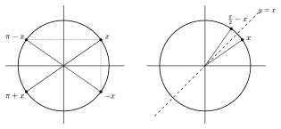

Sur le cercle, des symétries et un quart de tour relient les points associés à $x$, $-x$, $\pi-x$, $\pi+x$, $\frac\pi2-x$ et $\frac\pi2+x$. Il suffit de dessiner le cercle pour retrouver les formules.

::: {.encadre #tri-vocabulaire nature="Définition" titre="vocabulaire des angles associés"}
Deux angles $x$ et $y$ sont :

- **opposés** si leur somme est nulle : $y=-x$ ;
- **supplémentaires** si leur somme vaut $\pi$ : $y=\pi-x$ ;
- **antisupplémentaires** si leur différence vaut $\pi$ : $y=\pi+x$ ;
- **complémentaires** si leur somme vaut $\frac\pi2$ : $y=\frac\pi2-x$ ;
- **anticomplémentaires** si leur différence vaut $\frac\pi2$ : $y=\frac\pi2+x$.
:::

::: {.encadre nature="Exemple"}
$\frac\pi6$ et $\frac{5\pi}{6}$ sont supplémentaires ; $\frac\pi6$ et $\frac{7\pi}{6}$ sont antisupplémentaires ; $\frac\pi6$ et $\frac\pi3$ sont complémentaires ; $\frac\pi6$ et $\frac{2\pi}{3}$ sont anticomplémentaires.
:::

::: {.encadre #tri-associes nature="Propriété" titre="angles associés"}
Pour tout réel $x$ :

| angle | $-x$ | $\pi-x$ | $\pi+x$ | $\frac\pi2-x$ | $\frac\pi2+x$ |
|:--|:-:|:-:|:-:|:-:|:-:|
| $\cos$ | $\cos x$ | $-\cos x$ | $-\cos x$ | $\sin x$ | $-\sin x$ |
| $\sin$ | $-\sin x$ | $\sin x$ | $-\sin x$ | $\cos x$ | $\cos x$ |

- $x$ et $-x$ (opposés) : symétrie par rapport à l'axe des abscisses ;
- $x$ et $\pi-x$ (supplémentaires) : symétrie par rapport à l'axe des ordonnées ;
- $x$ et $\pi+x$ (antisupplémentaires) : symétrie par rapport à l'origine ;
- $x$ et $\frac\pi2-x$ (complémentaires) : symétrie par rapport à la droite $y=x$, qui échange cosinus et sinus ;
- $x$ et $\frac\pi2+x$ (anticomplémentaires) : rotation d'un quart de tour autour de l'origine.
:::

{.th}

::: {.encadre nature="Exemple"}
$\cos\dfrac{2\pi}{3}=\cos\left(\pi-\dfrac\pi3\right)=-\dfrac12$ ; $\cos\left(\dfrac{5\pi}{2}-x\right)=\cos\left(\dfrac{5\pi}{2}-x-2\pi\right)=\cos\left(\dfrac\pi2-x\right)=\sin x$.
:::

::: {.encadre nature="Remarque" titre="se ramener aux formules"}
Pour un angle comme $3\pi-x$ ou $-\frac{3\pi}{2}-x$, on retire ou on ajoute d'abord un multiple de $2\pi$ pour se ramener à une ligne du tableau.
:::
