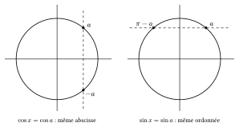

Deux points du cercle ont la même abscisse s'ils sont symétriques par rapport à l'axe horizontal, et la même ordonnée s'ils sont symétriques par rapport à l'axe vertical. En ajoutant la périodicité, on obtient toutes les solutions.

::: {.encadre #tri-equations nature="Propriété" titre="équations élémentaires"}
Pour tout entier $k$ :
$$\cos x=\cos a\iff x=a+2k\pi\ \text{ou}\ x=-a+2k\pi$$
$$\sin x=\sin a\iff x=a+2k\pi\ \text{ou}\ x=\pi-a+2k\pi$$
:::

{.th}

::: {.encadre nature="Exemple"}
$2\sin2x=1\iff\sin2x=\dfrac12=\sin\dfrac{\pi}{6}\iff 2x=\dfrac{\pi}{6}+2k\pi$ ou $2x=\dfrac{5\pi}{6}+2k\pi\iff x=\dfrac{\pi}{12}+k\pi$ ou $x=\dfrac{5\pi}{12}+k\pi$.

On divise **aussi** la période par $2$ : $2k\pi$ devient $k\pi$.
:::

::: {.encadre nature="Remarque" titre="solutions dans un intervalle"}
Lorsque l'énoncé impose un intervalle, on écrit toutes les solutions puis on garde celles qui y appartiennent. Si l'équation porte sur $2x$ et que $x\in\left[\frac\pi2;\pi\right]$, alors $2x\in[\pi;2\pi]$ : on cherche d'abord $2x$ dans cet intervalle.
:::

Une équation qui contient plusieurs nombres trigonométriques se ramène souvent, grâce aux formules, à une équation du second degré en $\sin x$ ou en $\cos x$, ou à un produit nul.

::: {.encadre nature="Exemple"}
$\cos x=\sin2x\iff\cos x=2\sin x\cos x\iff\cos x\,(1-2\sin x)=0\iff\cos x=0$ ou $\sin x=\dfrac12$. On ne divise pas par $\cos x$, sinon on perd les solutions $x=\frac\pi2+k\pi$.
:::
