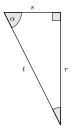
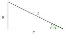

::::: {.qcm .exo #tri-e01 source="Examen 2018" reponse="C" theorie=""}
<!-- support 2026 : Q85 -->
Soit un triangle rectangle $A$ dont un des angles a une amplitude de $30^\circ$ et dont l'hypoténuse mesure $8\,\mathrm{cm}$. Quelle est l'aire du triangle $A$?

::: options
- ${\displaystyle \frac{8\sqrt{3}}{3}}\,\mathrm{cm²}$
- $8\sqrt{2}\,\mathrm{cm²}$
- $8\sqrt{3}\,\mathrm{cm²}$
- $16\,\mathrm{cm²}$
:::

:::::

::::: {.qcm .exo #tri-e02 source="Prépa UMONS" reponse="B" theorie=""}
<!-- support 2026 : Q86 -->
Considérons $ABC$ un triangle quelconque dont les côtés $a$, $b$ et $c$ sont opposés respectivement aux sommets $A$, $B$ et $C$ et les amplitudes, mesurées en radians, $\alpha$, $\beta$ et $\gamma$ sont celles des angles des sommets $A$, $B$ et $C$ respectivement. Parmi les propositions suivantes, laquelle est erronée?

::: options
- $\alpha + \beta + \gamma = \pi$
- $\cos(\alpha) = \cos(\beta+ \gamma)$
- ${\displaystyle \sin(\alpha) = \sin(\beta + \gamma)}$
- $ \sin(\alpha)\cos(\beta) + \sin(\beta) \cos(\alpha)$ $= \sin(\alpha+\beta) $
:::

:::::

::::: {.qcm .exo #tri-e03 source="Examen 2017" reponse="B" theorie=""}
<!-- support 2026 : Q87 -->
En considérant l'illustration donnée à la figure ci-dessous (pas à l'échelle), si $\alpha = 60^\circ$ et $s=3\,\mathrm{cm}$, que vaut $r$?

::: options
- $6\,\mathrm{cm}$
- $3\sqrt{3}\,\mathrm{cm}$
- $6\sqrt{3}\,\mathrm{cm}$
- Il manque des données pour répondre à la question
:::

:::::

::::: {.qcm .exo #tri-e04 source="Examen 2021" reponse="C" theorie=""}
<!-- support 2026 : Q88 -->
On considère le nombre $x$ tel que $0<x<2\pi$ et vérifiant ${\displaystyle \cos \left( x-\frac{\pi}{2}\right)=1}$. Que vaut ${\displaystyle \sin \left(x+\frac{\pi}{2} \right)}$?

::: options
- $-1$
- $-\sqrt{2}/2$
- $0$
- $\sqrt{2}/2$
:::

:::::

::::: {.qcm .exo #tri-e05 source="Examen 2020" reponse="D" theorie=""}
<!-- support 2026 : Q89 -->
On considère le nombre $x$ tel que ${\displaystyle -\frac{\pi}{2}<x<0}$ et vérifiant $\sin(x) = -2/3$. Que vaut $\cos(x)$?

::: options
- $-\sqrt{5}/3$
- $-\sqrt{3}/3$
- $\sqrt{3}/3$
- $\sqrt{5}/3$
:::

:::::

::::: {.qcm .exo #tri-e06 source="Examen 2020" reponse="C" theorie=""}
<!-- support 2026 : Q90 -->
Considérons un triangle $ABC$. Supposons que le côté $[BC]$ mesure $5\,\mathrm{cm}$, que l'angle $\widehat{ACB}$ a une amplitude de $30^\circ$ et que l'angle $\widehat{CBA}$ a une amplitude de $90^\circ$.

Quelle est la longueur du côté $[AB]$?

::: options
- $\sqrt{3}/3 \,\mathrm{cm}$
- $3/\sqrt{5}\,\mathrm{cm}$
- $5\sqrt{3}/3\,\mathrm{cm}$
- $5\sqrt{3}\,\mathrm{cm}$
:::

:::::

::::: {.qcm .exo #tri-e07 source="Examen 2018" reponse="D" theorie=""}
<!-- support 2026 : Q91 -->
La figure ci-dessous présente un triangle rectangle.

 Parmi les propositions suivantes, laquelle équivaut à la tangente de l'angle $\alpha$ pour toutes les valeurs admissibles des nombres réels $x$, $y$ et $z$?

::: options
- ${\displaystyle \frac{x}{z}}$
- ${\displaystyle \frac{y}{z}}$
- ${\displaystyle \frac{x}{y}}$
- ${\displaystyle \frac{y}{x}}$
:::

:::::

::::: {.qcm .exo #tri-e08 source="Examen 2021" reponse="A" theorie=""}
<!-- support 2026 : Q92 -->
Considérons le cosinus et le sinus d'un angle $\alpha$ dont l'amplitude est strictement comprise entre $3\pi/4$ et $\pi$. Pour un tel angle, laquelle de ces combinaisons d'inégalités est correcte?

::: options
- $\cos(\alpha) < 0$ et $|\sin(\alpha)| < |\cos(\alpha)|$
- $\cos(\alpha) < 0$ et $|\sin(\alpha)| > |\cos(\alpha)|$
- $\sin(\alpha) < 0$ et $|\sin(\alpha)| < |\cos(\alpha)|$
- $\sin(\alpha) < 0$ et $|\sin(\alpha)| > |\cos(\alpha)|$
:::

:::::

::::: {.qcm .exo #tri-e09 source="Prépa UMONS" reponse="A" theorie=""}
<!-- support 2026 : Q93 -->
Un poteau parfaitement vertical par rapport au sol parfaitement horizontal projette une ombre sur le sol. La longueur de cette ombre vaut $11\,\mathrm{m}$ quand le soleil fait un angle de $30^\circ$ au dessus de l'horizon.

Parmi les propositions suivantes, laquelle est correcte?

::: options
- Le poteau a une hauteur de ${\displaystyle \frac{11\sqrt{3}}{3}}\,\mathrm{m}$
- Le poteau a une hauteur de ${\displaystyle \frac{11}{2}}\,\mathrm{m}$
- Le poteau a une hauteur de ${\displaystyle \frac{11\sqrt{3}}{2}}\,\mathrm{m}$
- Les autres propositions sont toutes fausses.
:::

:::::

::::: {.qcm .exo #tri-e10 source="Examen 2021" reponse="D" theorie=""}
<!-- support 2026 : Q94 -->
Considérons un triangle $ABC$ pour lequel les côtés $[AB]$ et $[BC]$ ont la même longueur et où $${\displaystyle \cos (\widehat{ABC})=\frac{\sqrt{3}}{2}}.$$ Que vaut l'amplitude de $\widehat{ACB}$?

::: options
- $30^\circ$
- $60^\circ$
- $70^\circ$
- $75^\circ$
:::

:::::

::::: {.qcm .exo #tri-e11 source="Examen 2022" reponse="D" theorie=""}
<!-- support 2026 : Q95 -->
Dans le plan muni d'un repère cartésien orthonormé, on considère les points $A(0;0))$, $B(x;3)$, $C(x;0)$, où le nombre réel $x$ vérifie $x>0$ et $\widehat{CAB}=30^\circ$. Que vaut $x$?

::: options
- $3$
- $2\sqrt{3}$
- $3\sqrt{2}$
- $3\sqrt{3}$
:::

:::::

::::: {.qcm .exo #tri-e12 source="Examen 2023" reponse="C" theorie=""}
<!-- Examen 2023 (matin) : maths Q3 -->
Le périmètre d'un losange vaut $80\,\mathrm{m}$ et l'amplitude d'un de ses angles vaut $60^\circ$.

Que vaut l'aire définie par ce losange?

::: options
- $200\sqrt{2}\,\mathrm{m}^2$
- $400\sqrt{2}\,\mathrm{m}^2$
- $200\sqrt{3}\,\mathrm{m}^2$
- $400\sqrt{3}\,\mathrm{m}^2$
:::

:::::

::::: {.qcm .exo #tri-e13 source="Examen 2023" reponse="D" theorie=""}
<!-- Examen 2023 (matin) : maths Q8 -->
Si $x$ est un angle quelconque, quelle est, parmi les relations suivantes, celle qui est toujours vérifiée?

::: options
- $\cos(x^2)=(\cos x)^2-(\sin x)^2$
- $\cos(x^2)=2\cos(x)\sin(x)$
- $\cos(x^2)=2\left(\cos\dfrac{x}{2}\right)^2-1$
- $\cos(x^2)=2\left(\cos\dfrac{x^2}{2}\right)^2-1$
:::

:::::

::::: {.qcm .exo #tri-e14 source="Examen 2025" reponse="C" theorie=""}
<!-- Examen 2025 (matin) : maths Q5 -->
On considère l'équation
$$\cos(x^2)+\sin(x^2)=1$$
pour $x$ réel.

Dans les propositions suivantes, quel ensemble fait partie de l'ensemble des solutions de cette équation?

::: options
- $\mathbb{R}$
- $\left\{\sqrt{(2k+1)\dfrac{\pi}{4}} : k=0,1,2,\ldots\right\}$
- $\left\{\sqrt{\dfrac{\pi}{2}+2k\pi} : k=0,1,2,\ldots\right\}$
- $\left\{\sqrt{k\dfrac{\pi}{2}} : k=0,1,2,\ldots\right\}$
:::

:::::

::::: {.qcm .exo #tri-e15 source="Examen 2025" reponse="D" theorie=""}
<!-- Examen 2025 (matin) : maths Q8 -->
Quelle est la valeur de l'expression $\cos\left(\dfrac{17\pi}{3}\right)$ parmi les propositions ci-dessous?

::: options
- $\dfrac{\sqrt{3}}{2}$
- $\dfrac{-\sqrt{3}}{2}$
- $\dfrac{-1}{2}$
- $\dfrac{1}{2}$
:::

:::::

::::: {.qcm .exo #tri-e16 source="Examen 2026" reponse="C" theorie=""}
<!-- Examen 2026 (matin) : maths Q5 -->
On considère l'équation
$$2\cos(2x)+1=0$$
Parmi les propositions suivantes, laquelle correspond à l'ensemble des solutions de cette équation?

::: options
- $\left\{x=\dfrac{\pi}{3}+k\dfrac{\pi}{2} : k\in\mathbb{Z}\right\}$
- $\left\{x=\dfrac{\pi}{3}+k\pi : k\in\mathbb{Z}\right\}$
- $\left\{x=\dfrac{\pi}{3}+k\pi : k\in\mathbb{Z}\right\}\cup\left\{x=\dfrac{2\pi}{3}+k\pi : k\in\mathbb{Z}\right\}$
- $\left\{x=\dfrac{\pi}{3}+k\dfrac{\pi}{2} : k\in\mathbb{Z}\right\}\cup\left\{x=-\dfrac{\pi}{3}+k\dfrac{\pi}{2} : k\in\mathbb{Z}\right\}$
:::

:::::

::::: {.qcm .exo #tri-e17 source="Examen 2026" reponse="D" theorie=""}
<!-- Examen 2026 (matin) : maths Q6 -->
On considère les relations $\sin(x)=-\dfrac{1}{2}$ et $\cos(x)>0$.

Parmi les propositions suivantes, quelle est la valeur de $x$ qui satisfait ces relations?

::: options
- $17\pi/6$
- $19\pi/6$
- $22\pi/6$
- $23\pi/6$
:::

:::::

::::: {.qcm .exo #tri-e18 source="Prépa UMONS" reponse="B" theorie="tri-fondamentale"}
<!-- Simulation août 2026 (simulation-2026/simulation_medecine.typ) : question 5 -->
On considère un angle $\alpha\in\left[0;\frac{\pi}{2}\right]$ tel que ${\displaystyle \sin(\alpha)=\frac{3}{5}}$. Que vaut $1+\tan^2(\alpha)$ ?

::: options
- ${\displaystyle \frac{25}{9}}$
- ${\displaystyle \frac{25}{16}}$
- ${\displaystyle \frac{9}{16}}$
- ${\displaystyle \frac{16}{9}}$
:::

:::::
