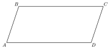
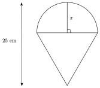

Résous d'abord les questions sur papier, sans calculatrice. Les solutions sont publiées à la fin de la phase d'entraînement.

<!-- Ticket de sortie : les jumeaux apparaissent quand la page de pilotage les sélectionne (etat.json). -->

:::::: ticket

::::: {.qcm .jumeau #tri-j01 source="Prépa UMONS" reponse="C" theorie="tri-rect" jumeau-de="tri-q01"}
Quel est le périmètre d'un rectangle dont la diagonale mesure $10\,\mathrm{cm}$ et dont un des côtés mesure $6\,\mathrm{cm}$ ?

::: options
- $48\,\mathrm{cm}$
- $14\,\mathrm{cm}$
- $28\,\mathrm{cm}$
- Aucune des propositions précédentes
:::

::: details
Réponse C. Par Pythagore, l'autre côté mesure $\sqrt{10^2-6^2}=\sqrt{64}=8\,\mathrm{cm}$. Le périmètre vaut $2(6+8)=28\,\mathrm{cm}$.

La proposition $14\,\mathrm{cm}$ est le demi-périmètre, et $48$ est l'aire du rectangle (en $\mathrm{cm}^2$).

:::

:::::

::::: {.qcm .jumeau #tri-j02 source="Prépa UMONS" reponse="C" theorie="tri-duplication tri-equations" jumeau-de="tri-q02"}
Sachant que ${\displaystyle 0\le\alpha\le\frac{\pi}{2}}$ et que $\sin(\alpha)=\cos(2\alpha)$, que vaut $\alpha$ ?

::: options
- ${\displaystyle \frac{\pi}{4}}$
- ${\displaystyle \frac{\pi}{3}}$
- ${\displaystyle \frac{\pi}{6}}$
- ${\displaystyle \frac{\pi}{2}}$
:::

::: details
Réponse C. Avec $\cos(2\alpha)=1-2\sin^2(\alpha)$, l'équation devient $2\sin^2(\alpha)+\sin(\alpha)-1=0$, soit $(2\sin(\alpha)-1)(\sin(\alpha)+1)=0$. Comme $\alpha\in\left[0;\frac{\pi}{2}\right]$, $\sin(\alpha)\geq 0$, donc $\sin(\alpha)=\frac12$ et $\alpha=\frac{\pi}{6}$.

Contrôle : $\sin\frac\pi6=\frac12$ et $\cos\frac\pi3=\frac12$.

:::

:::::

::::: {.qcm .jumeau #tri-j03 source="Prépa UMONS" reponse="B" theorie="tri-aire tri-valeurs" jumeau-de="tri-q03"}
Considérons un parallélogramme $ABCD$ dont l'aire vaut $30\,\mathrm{cm}^2$, dont le côté $[AB]$ mesure $4\,\mathrm{cm}$ et dont l'angle $\widehat{BAD}$ a une amplitude de $60^\circ$.

Quelle est la longueur du côté $[AD]$ ?

::: options
- ${\displaystyle \frac{15}{2}\,\mathrm{cm}}$
- $5\sqrt{3}\,\mathrm{cm}$
- $15\,\mathrm{cm}$
- ${\displaystyle \frac{15\sqrt{3}}{4}\,\mathrm{cm}}$
:::

::: details
Réponse B. L'aire d'un parallélogramme vaut $AB\cdot AD\cdot\sin(\widehat{BAD})$. Donc $30=4\cdot AD\cdot\frac{\sqrt3}{2}=2\sqrt3\,AD$ et $AD=\dfrac{15}{\sqrt3}=5\sqrt3\,\mathrm{cm}$.

Si l'on prend $\sin(60^\circ)=\frac12$, on trouve $15$ ; si l'on oublie le sinus, on trouve $\frac{15}{2}$.

:::

:::::

::::: {.qcm .jumeau #tri-j04 source="Prépa UMONS" reponse="C" theorie="tri-valeurs" jumeau-de="tri-q04"}
Considérons les trois nombres suivants : $A=\cos(10^\circ)$, $B=\cos(60^\circ)$ et $C=\cos^2(60^\circ)$. Parmi les ordres proposés ci-dessous, lequel est correct ?

::: options
- $A\le B\le C$
- $C\le A\le B$
- $C\le B\le A$
- $B\le A\le C$
:::

::: details
Réponse C. Sur $[0^\circ;90^\circ]$, le cosinus est décroissant : $\cos(10^\circ)>\cos(60^\circ)=\frac12$, donc $A>B$. Le carré d'un nombre compris entre $0$ et $1$ est plus petit que ce nombre : $C=\frac14<\frac12=B$. Ainsi $C\le B\le A$.

:::

:::::

::::: {.qcm .jumeau #tri-j05 source="Prépa UMONS" reponse="C" theorie="tri-signes tri-valeurs" jumeau-de="tri-q05"}
Considérons la somme $I=\sin(\alpha)+\sin(2\alpha)+\sin(3\alpha)+\ldots+\sin(49\alpha)+\sin(50\alpha)$.

Quelle est la valeur de $I$ lorsque ${\displaystyle \alpha=\frac{\pi}{3}}$ ?

::: options
- $I=0$
- ${\displaystyle I=\frac{\sqrt{3}}{2}}$
- $I=\sqrt{3}$
- $I=2\sqrt{3}$
:::

::: details
Réponse C. Les valeurs de $\sin\left(k\frac\pi3\right)$ se répètent tous les $6$ termes : $\frac{\sqrt3}{2},\ \frac{\sqrt3}{2},\ 0,\ -\frac{\sqrt3}{2},\ -\frac{\sqrt3}{2},\ 0$. La somme de $6$ termes consécutifs vaut $0$. Comme $50=8\cdot6+2$, il reste les deux premiers termes : $\frac{\sqrt3}{2}+\frac{\sqrt3}{2}=\sqrt3$.

:::

:::::

::::: {.qcm .jumeau #tri-j06 source="Prépa UMONS" reponse="D" theorie="tri-associes" jumeau-de="tri-q06"}
Parmi les propositions suivantes, laquelle est égale à ${\displaystyle \sin(3\pi-x)+\cos\left(-\frac{\pi}{2}-x\right)+\cos(x+\pi)}$ pour tout $x\in\mathbb{R}$ ?

::: options
- $2\sin(x)-\cos(x)$
- $\cos(x)$
- $-2\sin(x)-\cos(x)$
- $-\cos(x)$
:::

::: details
Réponse D. On a $\sin(3\pi-x)=\sin(\pi-x)=\sin(x)$, puis $\cos\left(-\frac\pi2-x\right)=\cos\left(\frac\pi2+x\right)=-\sin(x)$ et $\cos(x+\pi)=-\cos(x)$. La somme vaut $\sin(x)-\sin(x)-\cos(x)=-\cos(x)$.

:::

:::::

::::: {.qcm .jumeau #tri-j07 source="Prépa UMONS" reponse="B" theorie="tri-rect tri-valeurs" jumeau-de="tri-q07"}
Je dessine une maison stylisée : un carré de côté $x$ surmonté d'un toit en forme de triangle équilatéral de côté $x$ (le côté du triangle est le côté supérieur du carré). La hauteur totale de la maison, du bas du carré au sommet du toit, vaut $30\,\mathrm{cm}$.

Quelle est la valeur de $x$ ?

::: options
- ${\displaystyle \frac{60}{2+\sqrt{2}}}$
- ${\displaystyle \frac{60}{2+\sqrt{3}}}$
- ${\displaystyle \frac{30}{1+\sqrt{3}}}$
- $15$
:::

::: details
Réponse B. La hauteur d'un triangle équilatéral de côté $x$ vaut $\frac{\sqrt3}{2}x$. La hauteur totale est donc $x+\frac{\sqrt3}{2}x=30$, soit $x\cdot\frac{2+\sqrt3}{2}=30$ et $x=\dfrac{60}{2+\sqrt3}$.

La proposition $\frac{30}{1+\sqrt3}$ vient d'une hauteur du toit prise égale à $\sqrt3\,x$, et $15$ de l'oubli du toit.

:::

:::::

::::: {.qcm .jumeau #tri-j08 source="Prépa UMONS" reponse="C" theorie="tri-fondamentale tri-signes" jumeau-de="tri-q08"}
Considérons un angle $\alpha$ situé dans le premier quadrant du cercle trigonométrique, tel que $\sin(\alpha)=1/4$. Que vaut $\tan(\alpha)$ ?

::: options
- $3/4$
- $\sqrt{3}/3$
- $\sqrt{15}/15$
- $\sqrt{15}/4$
:::

::: details
Réponse C. Dans le premier quadrant, $\cos(\alpha)>0$ et $\cos^2(\alpha)=1-\frac1{16}=\frac{15}{16}$, donc $\cos(\alpha)=\frac{\sqrt{15}}{4}$. Alors $\tan(\alpha)=\dfrac{1/4}{\sqrt{15}/4}=\dfrac{1}{\sqrt{15}}=\dfrac{\sqrt{15}}{15}$.

La proposition $\sqrt{15}/4$ est le cosinus, et $\sqrt3/3$ vient de $\cos^2(\alpha)=4-1$ au lieu de $16-1$.

:::

:::::

::::: {.qcm .jumeau #tri-j09 source="Prépa UMONS" reponse="B" theorie="tri-alkashi tri-valeurs" jumeau-de="tri-q09"}
Considérons un triangle $ABC$ pour lequel $a$ désigne la longueur du côté $[BC]$, $b$ celle du côté $[AC]$, $c$ celle du côté $[AB]$ et où l'angle $\widehat{BAC}$ a une amplitude de $120^\circ$.

Parmi les expressions suivantes, une seule est correcte pour exprimer $a^2$. Laquelle ?

::: options
- $b^2+c^2-bc$
- $b^2+c^2+bc$
- $b^2+c^2$
- ${\displaystyle b^2+c^2+\frac{\sqrt{3}}{2}bc}$
:::

::: details
Réponse B. La loi des cosinus donne $a^2=b^2+c^2-2bc\cos(120^\circ)=b^2+c^2-2bc\left(-\frac12\right)=b^2+c^2+bc$.

L'expression $b^2+c^2-bc$ correspond à un angle de $60^\circ$, et $b^2+c^2$ à un angle droit.

:::

:::::

::::: {.qcm .jumeau #tri-j10 source="Prépa UMONS" reponse="C" theorie="tri-duplication tri-equations" jumeau-de="tri-q10"}
On considère un angle $\alpha$, exprimé en radians, qui vérifie les inégalités ${\displaystyle \frac{\pi}{2}\le\alpha\le\pi}$ ainsi que la relation suivante : $${\displaystyle \cos^4(\alpha)-\sin^4(\alpha)=-\frac{\sqrt{3}}{2}}$$ Que vaut cet angle $\alpha$ ?

::: options
- ${\displaystyle \alpha=\frac{5\pi}{12}}$
- ${\displaystyle \alpha=\frac{3\pi}{4}}$
- ${\displaystyle \alpha=\frac{7\pi}{12}}$
- ${\displaystyle \alpha=\frac{5\pi}{6}}$
:::

::: details
Réponse C. On factorise : $\cos^4(\alpha)-\sin^4(\alpha)=(\cos^2\alpha-\sin^2\alpha)(\cos^2\alpha+\sin^2\alpha)=\cos(2\alpha)$. On cherche donc $\cos(2\alpha)=-\frac{\sqrt3}{2}$ avec $2\alpha\in[\pi;2\pi]$. La seule solution est $2\alpha=\frac{7\pi}{6}$, d'où $\alpha=\frac{7\pi}{12}$.

La valeur $\frac{5\pi}{12}$ vérifie aussi la relation, mais elle n'appartient pas à $\left[\frac\pi2;\pi\right]$.

:::

:::::

::::::

::::: {.qcm #tri-q01 source="Examen 2017" reponse="B" theorie="tri-rect"}
<!-- support 2026 : Q32 -->
Quel est le périmètre d'un rectangle dont la diagonale mesure $13\,\mathrm{cm}$ et dont un des côtés mesure $5\,\mathrm{cm}$?

::: options
- $17\,\mathrm{cm}$
- $34\,\mathrm{cm}$
- $60\,\mathrm{cm}$
- Aucune des propositions précédentes
:::

::: indice
La diagonale découpe le rectangle en deux triangles rectangles. Quel théorème donne le côté manquant ?

:::

::: indice
Le second côté mesure $\sqrt{13^2-5^2}$. Le périmètre compte chaque côté deux fois.

:::

::: details
Réponse B.

La diagonale est l'hypoténuse d'un triangle rectangle dont les côtés de l'angle droit sont les côtés du rectangle. Le second côté mesure $\sqrt{169-25}=\sqrt{144}=12\,\mathrm{cm}$.

Le périmètre vaut $2(5+12)=34\,\mathrm{cm}$.

:::

::: pieges
- $17\,\mathrm{cm}$ est le demi-périmètre $5+12$.
- $60$ est l'aire $5\cdot12$, en $\mathrm{cm}^2$.

:::

:::::

::::: {.qcm #tri-q02 source="Examen 2017" reponse="B" theorie="tri-duplication tri-equations tri-valeurs"}
<!-- support 2026 : Q33 -->
Sachant que ${\displaystyle 0 \le \alpha \le \frac{\pi}{2}}$ et que $\sin (\alpha) = \sin (2\alpha)$, que vaut $\alpha$?

::: options
- ${\displaystyle \frac{\pi}{4}}$
- ${\displaystyle \frac{\pi}{3}}$
- ${\displaystyle \frac{\pi}{2}}$
- ${\displaystyle \frac{\pi}{6}}$
:::

::: indice
Comment écrire $\sin(2\alpha)$ avec $\sin\alpha$ et $\cos\alpha$ ?

:::

::: indice
L'équation devient $\sin\alpha=2\sin\alpha\cos\alpha$. Mets $\sin\alpha$ en évidence plutôt que de diviser par $\sin\alpha$.

:::

::: details
Réponse B.

$\sin\alpha=2\sin\alpha\cos\alpha\iff\sin\alpha\,(1-2\cos\alpha)=0\iff\sin\alpha=0$ ou $\cos\alpha=\dfrac12$.

Sur $\left[0;\frac\pi2\right]$, cela donne $\alpha=0$ ou $\alpha=\dfrac\pi3$. Seule la valeur $\dfrac\pi3$ figure parmi les propositions.

Vérification : $\sin\dfrac\pi3=\dfrac{\sqrt3}{2}$ et $\sin\dfrac{2\pi}{3}=\dfrac{\sqrt3}{2}$.

:::

::: pieges
- $\frac\pi6$ : confusion entre $\cos\alpha=\frac12$ et $\sin\alpha=\frac12$.
- $\sin2\alpha\neq2\sin\alpha$ : avec cette erreur, on ne trouve que $\sin\alpha=0$.

:::

:::::

::::: {.qcm #tri-q03 source="Examen 2019" reponse="C" theorie="tri-aire tri-valeurs"}
<!-- support 2026 : Q34 -->
Considérons un parallélogramme $ABCD$ tel que représenté ci-dessous. Supposons que l'aire du parallélogramme vaut $25\,\mathrm{cm²}$, le côté $[AB]$ mesure $5\,\mathrm{cm}$ et l'angle $\widehat{BAD}$ a une amplitude de $60^\circ$.

 Quelle est la longueur du côté $[AD]$?

::: options
- $5\sqrt{2}\,\mathrm{cm}$
- $10\,\mathrm{cm}$
- ${\displaystyle \frac{10}{\sqrt{3}}\,\mathrm{cm}}$
- $10\sqrt{2}\,\mathrm{cm}$
:::

::: indice
Comment s'exprime l'aire d'un parallélogramme à l'aide de deux côtés et de l'angle qu'ils forment ?

:::

::: indice
$25=5\cdot AD\cdot\sin60^\circ$. Quelle est la valeur de $\sin60^\circ$ ?

:::

::: details
Réponse C.

L'aire vaut $AB\cdot AD\cdot\sin\widehat{BAD}$ : $25=5\cdot AD\cdot\dfrac{\sqrt3}{2}$, donc $AD=\dfrac{25\cdot2}{5\sqrt3}=\dfrac{10}{\sqrt3}\,\mathrm{cm}$.

:::

::: pieges
- $10\,\mathrm{cm}$ : on a pris $\sin60^\circ=\frac12$, qui est $\cos60^\circ$.
- L'aire n'est pas $AB\cdot AD$ : ce serait vrai pour un rectangle seulement.

:::

:::::

::::: {.qcm #tri-q04 source="Examen 2018" reponse="D" theorie="tri-valeurs"}
<!-- support 2026 : Q35 -->
Considérons les trois nombres suivants : $A=\cos(15^\circ)$, $B=\cos(30^\circ)$ et $C= \cos^2(30^\circ)$. Parmi les ordres proposés ci-dessous, lequel est correct?

::: options
- $A\le B \le C$
- $B\le A \le C$
- $C \le A \le B$
- $C \le B \le A$
:::

::: indice
Comment varie le cosinus entre $0^\circ$ et $90^\circ$ ? Que fait le carré d'un nombre compris entre $0$ et $1$ ?

:::

::: indice
Compare d'abord $A$ et $B$ (deux cosinus), puis $B$ et $C=B^2$.

:::

::: details
Réponse D.

Sur $[0^\circ;90^\circ]$, le cosinus est décroissant, donc $\cos15^\circ\ge\cos30^\circ$ : $B\le A$.

Comme $0<B<1$, on a $B^2<B$ : $C\le B$. Concrètement, $C=\frac34$ et $B=\frac{\sqrt3}{2}$, avec $\left(\frac{\sqrt3}{2}\right)^2=\frac34<\frac{\sqrt3}{2}$.

Donc $C\le B\le A$.

:::

::: pieges
- Croire que le cosinus croît avec l'angle (c'est le sinus qui croît sur $[0^\circ;90^\circ]$).
- Croire qu'un carré est toujours plus grand que le nombre : c'est faux entre $0$ et $1$.

:::

:::::

::::: {.qcm #tri-q05 source="Examen 2019" reponse="D" theorie="tri-signes tri-valeurs"}
<!-- support 2026 : Q36 -->
Considérons la somme $I = \sin (\alpha) + \sin(2\alpha) + \sin (3\alpha) + \ldots + \sin(98\alpha) +\sin(99\alpha)$.

	 Quelle est la valeur de $I$ lorsque ${\displaystyle \alpha = \frac{\pi}{4}}$?

::: options
- $I=0$
- ${\displaystyle I = \frac{\sqrt{2}}{2}}$
- ${\displaystyle I = \frac{2+\sqrt{2}}{2}}$
- $I = 1 +\sqrt{2}$
:::

::: indice
Que valent les $8$ premiers termes ? Au bout de combien de termes les valeurs se répètent-elles ?

:::

::: indice
La somme de $8$ termes consécutifs est nulle et $99=12\cdot8+3$. Que reste-t-il ?

:::

::: details
Réponse D.

Pour $\alpha=\frac\pi4$, les termes $\sin\left(k\frac\pi4\right)$ pour $k=1,\dots,8$ valent
$$\tfrac{\sqrt2}{2},\ 1,\ \tfrac{\sqrt2}{2},\ 0,\ -\tfrac{\sqrt2}{2},\ -1,\ -\tfrac{\sqrt2}{2},\ 0,$$
de somme nulle, puis ils se répètent (période $2\pi$, soit $8$ termes).

Comme $99=12\cdot8+3$, il reste les $3$ premiers termes : $I=\frac{\sqrt2}{2}+1+\frac{\sqrt2}{2}=1+\sqrt2$.

:::

::: pieges
- $I=0$ : $99$ n'est pas un multiple de $8$.
- $\frac{2+\sqrt2}{2}$ : il reste trois termes, pas deux.

:::

:::::

::::: {.qcm #tri-q06 source="Examen 2019" reponse="D" theorie="tri-associes tri-signes"}
<!-- support 2026 : Q37 -->
Parmi les propositions suivantes, laquelle est égale à ${\displaystyle \cos(3\pi-x) +\cos \left( \frac{\pi}{2}+x \right) +\sin \left( -\frac{3\pi}{2}-x\right)}$ pour tout $x \in \mathbb{R}$?

::: options
- $2\cos(x)-\sin(x)$
- $-2\cos(x)-\sin(x)$
- $\sin(x)$
- $-\sin(x)$
:::

::: indice
Pour chaque terme, retire un multiple de $2\pi$ pour te ramener à un angle associé du tableau.

:::

::: indice
$\cos(3\pi-x)=\cos(\pi-x)$ et $\sin\left(-\frac{3\pi}{2}-x\right)=\sin\left(\frac\pi2-x\right)$.

:::

::: details
Réponse D.

- $\cos(3\pi-x)=\cos(\pi-x)=-\cos x$ ;
- $\cos\left(\frac\pi2+x\right)=-\sin x$ ;
- $\sin\left(-\frac{3\pi}{2}-x\right)=\sin\left(\frac\pi2-x\right)=\cos x$.

La somme vaut $-\cos x-\sin x+\cos x=-\sin x$.

:::

::: pieges
- $\cos\left(\frac\pi2+x\right)=-\sin x$ et non $\sin x$ : vérifie avec $x$ petit sur le cercle.
- $\cos(3\pi-x)$ n'est pas $\cos x$ : $3\pi$ n'est pas un multiple de $2\pi$.

:::

:::::

::::: {.qcm #tri-q07 source="Examen 2019" reponse="C" theorie="tri-rect tri-valeurs"}
<!-- support 2026 : Q38 -->
Je veux vendre des glaces. Pour cela, j'imprime des affiches avec un grand cornet de glace. Le cornet est un triangle équilatéral et la boule de glace est représentée par un demi-cercle de rayon $x$. Pour avoir un bel effet, j'exige que la hauteur totale du cornet et de la boule de glace soit de $25\,\mathrm{cm}$ (cfr l'illustration ci-dessous).

*NB : l'illustration n'est pas nécessairement à l'échelle ni même dans des proportions correspondant à l'énoncé.*

 Quelle est la valeur de $x$?

::: options
- ${\displaystyle \frac{25}{2}}$
- ${\displaystyle \frac{25}{1+\sqrt{2}}}$
- ${\displaystyle \frac{25}{1+\sqrt{3}}}$
- ${\displaystyle \frac{25(3-\sqrt{3})}{2}}$
:::

::: indice
Quelle est la longueur du côté du triangle équilatéral, en fonction de $x$ ? Quelle est sa hauteur ?

:::

::: indice
Le côté du triangle est le diamètre $2x$ ; sa hauteur vaut $2x\cdot\frac{\sqrt3}{2}=x\sqrt3$. La hauteur totale est hauteur du triangle plus rayon.

:::

::: details
Réponse C.

Le côté supérieur du triangle est le diamètre du demi-cercle : il mesure $2x$. La hauteur d'un triangle équilatéral de côté $2x$ vaut $2x\sin60^\circ=x\sqrt3$. Le demi-cercle ajoute une hauteur $x$ (son rayon).

Donc $x\sqrt3+x=25$ et $x=\dfrac{25}{1+\sqrt3}$.

:::

::: pieges
- $\frac{25}{2}$ : on a pris la hauteur du triangle égale à $x$.
- $\frac{25}{1+\sqrt2}$ : confusion entre $\sin60^\circ$ et $\sin45^\circ$.

:::

:::::

::::: {.qcm #tri-q08 source="Examen 2020" reponse="B" theorie="tri-fondamentale tri-signes"}
<!-- support 2026 : Q39 -->
Considérons un angle $\alpha$ situé dans le premier quadrant du cercle trigonométrique, tel que $\sin(\alpha) = 1/3$. Que vaut $\tan(\alpha)$?

::: options
- $2/3$
- $\sqrt{2}/4$
- $\sqrt{2}/2$
- $2\sqrt{2}/3$
:::

::: indice
Pour obtenir $\tan\alpha$, il te faut $\cos\alpha$. Quelle relation lie $\sin\alpha$ et $\cos\alpha$ ? Quel est le signe de $\cos\alpha$ ?

:::

::: indice
$\cos^2\alpha=1-\frac19=\frac89$ et $\cos\alpha>0$ dans le premier quadrant.

:::

::: details
Réponse B.

$\cos^2\alpha=1-\sin^2\alpha=\frac89$ et, dans le premier quadrant, $\cos\alpha=\frac{2\sqrt2}{3}$.

$\tan\alpha=\dfrac{1/3}{2\sqrt2/3}=\dfrac{1}{2\sqrt2}=\dfrac{\sqrt2}{4}$.

:::

::: pieges
- $\frac{2\sqrt2}{3}$ est $\cos\alpha$, pas $\tan\alpha$.
- $\frac23$ : $\cos\alpha=1-\sin\alpha$ est faux, c'est $\cos^2\alpha=1-\sin^2\alpha$.

:::

:::::

::::: {.qcm #tri-q09 source="Examen 2020" reponse="A" theorie="tri-alkashi tri-valeurs"}
<!-- support 2026 : Q40 -->
Considérons un triangle $ABC$ pour lequel $a$ désigne la longueur du côté $[BC]$, $b$ désigne la longueur du côté $[AC]$,  $c$ désigne la longueur du côté $[AB]$ et où l'angle $\widehat{BAC}$ a une amplitude de $60^\circ$.

Parmi les expressions suivantes, une seule est correcte pour exprimer $a^2$. Laquelle?

::: options
- $b^2+c^2-bc$
- ${\displaystyle b^2+c^2-\frac{\sqrt{3}}{2}bc}$
- $b^2+c^2$
- $b^2+c^2+bc$
:::

::: indice
Quelle formule relie les trois côtés d'un triangle et l'un de ses angles ?

:::

::: indice
Applique $a^2=b^2+c^2-2bc\cos\hat A$ avec $\cos60^\circ=\frac12$.

:::

::: details
Réponse A.

Par la formule d'Al-Kashi, $a^2=b^2+c^2-2bc\cos60^\circ=b^2+c^2-2bc\cdot\frac12=b^2+c^2-bc$.

:::

::: pieges
- $b^2+c^2$ : Pythagore ne s'applique que si l'angle est droit.
- $b^2+c^2+bc$ correspond à un angle de $120^\circ$.
- Le coefficient $\frac{\sqrt3}{2}$ vient de $\sin60^\circ$ au lieu de $\cos60^\circ$.

:::

:::::

::::: {.qcm #tri-q10 source="Examen 2022" reponse="D" theorie="tri-duplication tri-fondamentale tri-equations"}
<!-- support 2026 : Q41 -->
On considère un angle $\alpha$, exprimé en radians, qui vérifie les inégalités ${\displaystyle \frac{\pi}{2} \le \alpha \le \pi}$ ainsi que la relation suivante : $${\displaystyle \cos^4(\alpha) -\sin^4(\alpha) = \frac{1}{2}}$$
 Que vaut cet angle $\alpha$?

::: options
- ${\displaystyle \alpha = \frac{\pi}{2}}$
- ${\displaystyle \alpha = \frac{2\pi}{3}}$
- ${\displaystyle \alpha = \frac{3\pi}{4}}$
- ${\displaystyle \alpha = \frac{5\pi}{6}}$
:::

::: indice
Reconnais une différence de deux carrés dans $\cos^4\alpha-\sin^4\alpha$.

:::

::: indice
$\cos^4\alpha-\sin^4\alpha=\cos2\alpha$. Si $\alpha\in\left[\frac\pi2;\pi\right]$, dans quel intervalle se trouve $2\alpha$ ?

:::

::: details
Réponse D.

$\cos^4\alpha-\sin^4\alpha=(\cos^2\alpha-\sin^2\alpha)(\cos^2\alpha+\sin^2\alpha)=\cos2\alpha$. On cherche donc $\cos2\alpha=\frac12$ avec $2\alpha\in[\pi;2\pi]$.

Les solutions de $\cos\theta=\frac12$ sont $\theta=\pm\frac\pi3+2k\pi$ ; dans $[\pi;2\pi]$, seule $\theta=\frac{5\pi}{3}$ convient. Donc $2\alpha=\frac{5\pi}{3}$ et $\alpha=\frac{5\pi}{6}$.

Vérification : $\cos\frac{5\pi}{6}=-\frac{\sqrt3}{2}$, $\sin\frac{5\pi}{6}=\frac12$, et $\frac{9}{16}-\frac{1}{16}=\frac12$.

:::

::: pieges
- $\alpha=\frac\pi6$ vérifie aussi la relation, mais n'est pas dans $\left[\frac\pi2;\pi\right]$ ; on ne doit pas s'arrêter à la première solution.
- $\frac{2\pi}{3}$ : on a résolu $\cos2\alpha=-\frac12$.

:::

:::::
